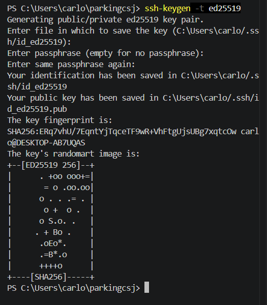
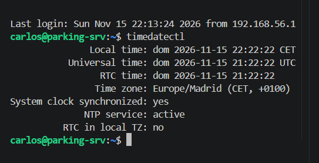
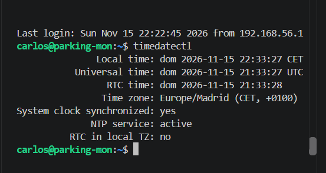
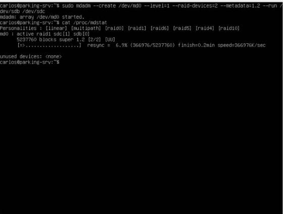
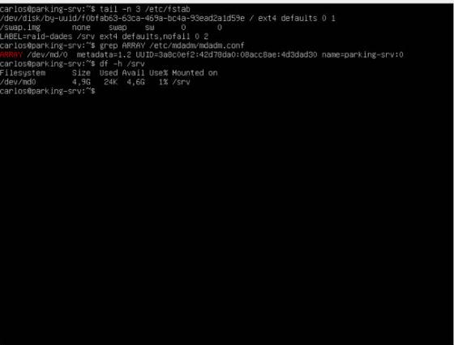
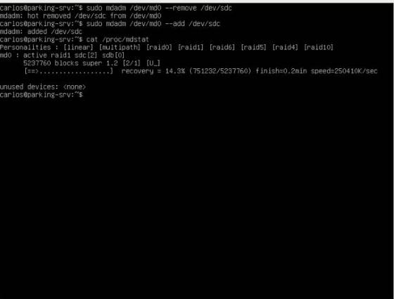
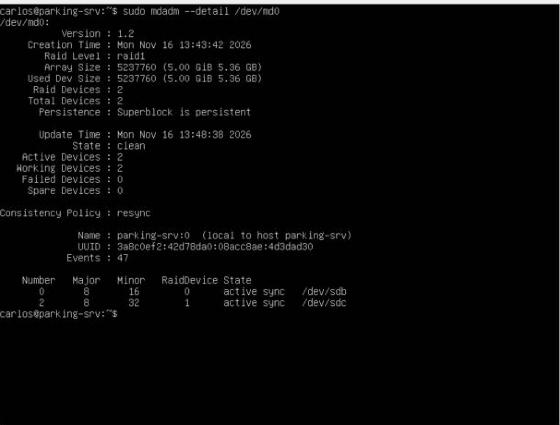
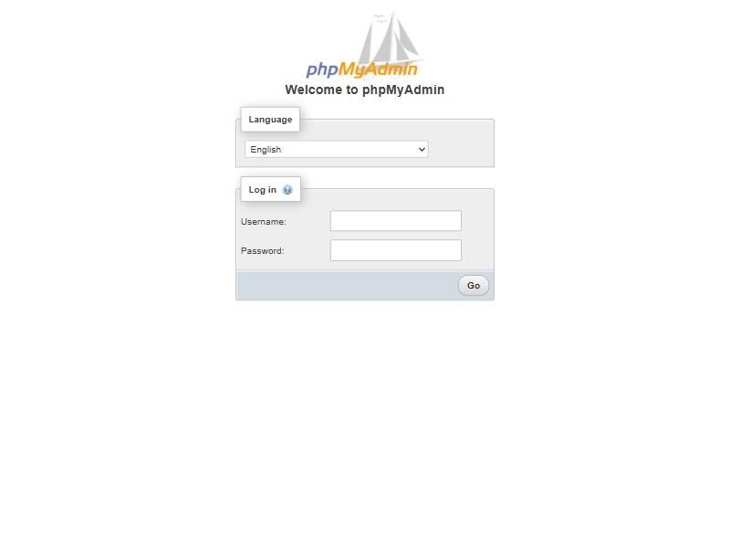
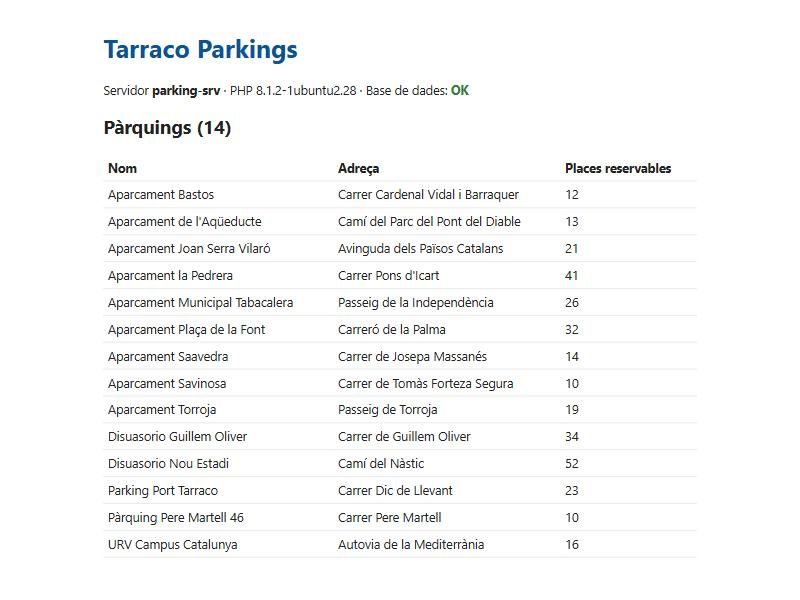
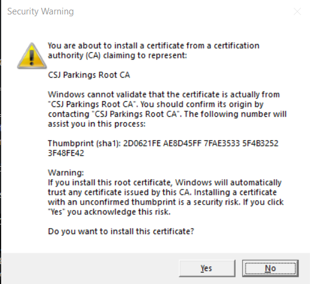

# Sprint 2 — Instal·lació i configuració dels servidors

## Sistema de Reserves de Places de Pàrquing · CSJ Parkings (Tarragona)

> Document viu: cada apartat es completa amb les ordres executades, la sortida rellevant i
> les captures **[CAPTURA]** a mesura que es fa la instal·lació.
> Prerequisit: màquines creades segons `01-arquitectura-i-maquines-virtuals.md`.

| # | Apartat | Servidor | Estat |
|---|---|---|---|
| 1 | Preparació del sistema i SSH | tots dos | ✅ |
| 2 | RAID 1 amb mdadm | parking-srv | ✅ |
| 3 | Apache2 + PHP | parking-srv | ✅ |
| 4 | MariaDB + phpMyAdmin | parking-srv | ✅ |
| 5 | Certificat SSL (HTTPS) | parking-srv | ✅ |
| 6 | Securització: tallafocs, fail2ban, SSH, Apache | parking-srv ✅ · parking-mon al pas 9 | 🔧 |
| 7 | Usuaris i permisos del sistema de fitxers | parking-srv | ✅ |
| 8 | Còpies de seguretat completes i incrementals | srv → mon | ⬜ |
| 9 | Monitoratge (Prometheus + Grafana) | parking-mon | ⬜ |
| 10 | Alta disponibilitat | tots dos | ⬜ |
| 11 | Proves finals de la infraestructura | tots dos | ⬜ |

---

## 1. Preparació del sistema i SSH

**Objectiu:** sistema actualitzat, zona horària correcta, resolució de noms entre servidors i accés SSH
amb clau (sense contrasenya) des de l'equip d'administració.

**A cada servidor:**

```bash
sudo apt update && sudo apt -y full-upgrade          # aplicar totes les actualitzacions
sudo timedatectl set-timezone Europe/Madrid          # hora local (logs, còpies, cron)
printf "192.168.56.30 parking-srv csjparkings.local\n192.168.56.31 parking-mon\n" | sudo tee -a /etc/hosts
sudo reboot
```

**A l'equip amfitrió (PowerShell):** es genera un parell de claus Ed25519 i es copia la clau pública
a cada servidor.

```powershell
ssh-keygen -t ed25519
type $env:USERPROFILE\.ssh\id_ed25519.pub | ssh carlos@192.168.56.30 "mkdir -p ~/.ssh && chmod 700 ~/.ssh && cat >> ~/.ssh/authorized_keys && chmod 600 ~/.ssh/authorized_keys"
type $env:USERPROFILE\.ssh\id_ed25519.pub | ssh carlos@192.168.56.31 "mkdir -p ~/.ssh && chmod 700 ~/.ssh && cat >> ~/.ssh/authorized_keys && chmod 600 ~/.ssh/authorized_keys"
```



Resultat: la connexió `ssh carlos@192.168.56.30` / `.31` ja no demana contrasenya i els dos servidors
tenen la zona horària `Europe/Madrid`.




> L'autenticació per contrasenya per SSH es desactivarà a l'apartat 6 (securització), un cop
> comprovat que l'accés amb clau funciona.

## 2. RAID 1 amb mdadm (parking-srv)

**Objectiu:** redundància de dades. Els dos discos de 5 GB (`sdb` i `sdc`) formen un RAID 1 (mirall):
tot el que s'escriu es guarda als dos discos, de manera que si un falla el servei continua.
Al RAID hi aniran el codi de la web (`/srv/www`) i les dades de MariaDB (`/srv/mysql`).

### 2.1 Creació del RAID

```bash
sudo apt install -y mdadm
sudo mdadm --create /dev/md0 --level=1 --raid-devices=2 --metadata=1.2 --run /dev/sdb /dev/sdc
cat /proc/mdstat
```



Quan acaba la sincronització inicial, l'estat és `[2/2] [UU]` (els dos discos actius):

![RAID sincronitzat: [UU] i md0 sobre sdb i sdc](img/raid-02-sincronitzat.jpg)

### 2.2 Sistema de fitxers, muntatge i configuració persistent

```bash
sudo mkfs.ext4 -F -L raid-dades /dev/md0
sudo mount /dev/md0 /srv
sudo sed -i "$ a LABEL=raid-dades /srv ext4 defaults,nofail 0 2" /etc/fstab
sudo /usr/share/mdadm/mkconf force-generate /etc/mdadm/mdadm.conf
sudo update-initramfs -u
```

- **Etiqueta `raid-dades`:** el muntatge a `/etc/fstab` es fa per etiqueta i no per nom de dispositiu.
- **`nofail`:** si el RAID tingués un problema, el servidor arrencaria igualment (no es queda bloquejat).
- **`mdadm.conf` + `update-initramfs`:** el RAID es munta sempre amb el nom `/dev/md0`
  (sense això, després de reiniciar podria aparèixer com a `/dev/md127`).



### 2.3 Prova de fallada d'un disc

Es crea un fitxer de prova i es marca el disc `sdc` com a fallit:

```bash
sudo cp /etc/hostname /srv/prova.txt
sudo mdadm /dev/md0 --fail /dev/sdc
cat /proc/mdstat
cat /srv/prova.txt
```

![Disc sdc fallit: estat [U_], però el fitxer es continua llegint](img/raid-04-fallada-disc.jpg)

Resultat: el RAID passa a `[2/1] [U_]` (*Operation continuing on 1 devices*) i les dades continuen
accessibles amb un sol disc.

### 2.4 Substitució del disc i reconstrucció

```bash
sudo mdadm /dev/md0 --remove /dev/sdc
sudo mdadm /dev/md0 --add /dev/sdc
cat /proc/mdstat
sudo mdadm --detail /dev/md0
```




Resultat: el disc es torna a sincronitzar automàticament (`recovery`) i el RAID queda en estat
`clean` amb `sdb` i `sdc` en `active sync`.

### 2.5 Comprovació després de reiniciar

Després de `sudo reboot`:

```bash
cat /proc/mdstat
df -h /srv
cat /srv/prova.txt
```

![Després de reiniciar: md0 [UU], /srv muntat automàticament i el fitxer de prova intacte](img/raid-07-despres-reinici.jpg)

Resultat: el RAID s'assembla sol com a `/dev/md0` amb els dos discos (`[2/2] [UU]`), `/srv` es munta
automàticament i les dades es conserven.

## 3. Apache2 + PHP i 4. MariaDB + phpMyAdmin (parking-srv)

La instal·lació i configuració d'aquests dos apartats es fa amb l'script
[`infra/03-lamp.sh`](../../infra/03-lamp.sh), que es copia al servidor i s'executa amb `sudo`.
Fer-ho amb un script permet repetir la instal·lació exactament igual (per exemple, a l'equip de
l'institut) i deixa un informe de tot el que s'ha fet: [`informe-03-lamp.txt`](informe-03-lamp.txt).

Des de l'equip amfitrió (PowerShell):

```powershell
scp -r proyecto_parking\infra proyecto_parking\database carlos@192.168.56.30:~
ssh -t carlos@192.168.56.30 "sudo bash ~/infra/03-lamp.sh"
scp carlos@192.168.56.30:~/informe-03-lamp.txt proyecto_parking\docs\sprint2\
```

### 3.1 Versions instal·lades

| Component | Versió |
|---|---|
| Apache | 2.4.52 (Ubuntu) |
| PHP | 8.1.2 (mòduls: mysql, mbstring, xml, intl, gd, curl, zip) |
| MariaDB | 10.6.23 |
| phpMyAdmin | 5.1.1 |

### 3.2 Apache: VirtualHost de l'aplicació

Fitxer `/etc/apache2/sites-available/csjparkings.conf`:

```apache
<VirtualHost *:80>
    ServerName  csjparkings.local
    ServerAlias www.csjparkings.local 192.168.56.30
    DocumentRoot /srv/www/csjparkings/public
    <Directory /srv/www/csjparkings/public>
        Options -Indexes +FollowSymLinks
        AllowOverride All
        Require all granted
    </Directory>
    ErrorLog  ${APACHE_LOG_DIR}/csjparkings-error.log
    CustomLog ${APACHE_LOG_DIR}/csjparkings-access.log combined
</VirtualHost>
```

- El codi de la web és **al RAID** (`/srv/www/csjparkings`).
- Només la carpeta `public/` és accessible des del navegador; la configuració amb les credencials
  (`config/config.php`) queda **fora** de la carpeta pública.
- `Options -Indexes`: no es mostra mai el llistat de fitxers d'una carpeta.
- Es desactiva el lloc per defecte (`000-default`) i s'activen els mòduls `rewrite` i `headers`.
- L'HTTPS s'afegeix a l'apartat 5.

Estructura i permisos de la web:

| Ruta | Propietari | Permisos |
|---|---|---|
| `/srv/www`, `/srv/www/csjparkings` | `root:www-data` | `750` |
| `public/`, `config/` | `root:www-data` | `750` (fitxers `640`): Apache llegeix però no pot modificar |
| `storage/` (PDF generats) | `www-data:www-data` | `750`: única carpeta on Apache pot escriure |

### 4.1 MariaDB

**Dades al RAID.** El directori de dades es copia a `/srv/mysql` (RAID) i es munta sobre
`/var/lib/mysql` amb un *bind mount* a `/etc/fstab`:

```
/srv/mysql /var/lib/mysql none bind,nofail,x-systemd.requires-mounts-for=/srv 0 0
```

Així MariaDB fa servir la ruta estàndard però les dades estan protegides pel RAID 1, sense haver de
modificar el `datadir` ni els perfils de seguretat del sistema.

**Configuració** (`/etc/mysql/mariadb.conf.d/60-csj.cnf`):

```ini
[mysqld]
bind-address          = 127.0.0.1      # només accessible des del mateix servidor
character-set-server  = utf8mb4
collation-server      = utf8mb4_unicode_ci
server_id             = 1
log_bin               = mysql-bin      # binary logs per a les còpies incrementals
binlog_format         = ROW
expire_logs_days      = 14
max_binlog_size       = 100M
```

**Securització:** s'eliminen els usuaris anònims i la base de dades `test`. L'usuari `root` de MariaDB
només pot entrar des del sistema amb `sudo` (autenticació `unix_socket`), mai amb contrasenya.

**Base de dades:** es crea amb els scripts del projecte (`database/schema.sql` i `database/seed.sql`):
14 pàrquings, 323 places, 9 tarifes, 3 usuaris de demostració i 1 reserva.

**Usuaris de la base de dades** (principi de privilegi mínim):

| Usuari | Ús | Privilegis |
|---|---|---|
| `csj_app` | Aplicació web (PHP) | `SELECT, INSERT, UPDATE` a `csj_parkings` (**sense `DELETE`**: les reserves no es poden esborrar) |
| `csj_backup` | Còpies de seguretat | Lectura de `csj_parkings` + `RELOAD, PROCESS, BINLOG MONITOR` |
| `csj_admin` | Administració amb phpMyAdmin | Tots els privilegis, **només** sobre `csj_parkings` |

Les contrasenyes es generen aleatòriament (20 caràcters) i es guarden a
`/root/csj-credencials.txt` (permisos `600`, només root). Per consultar la de phpMyAdmin:
`sudo grep CSJ_ADMIN /root/csj-credencials.txt`.

### 4.2 phpMyAdmin

S'instal·la el paquet `phpmyadmin` i es configura per a Apache. Accés: `http://192.168.56.30/phpmyadmin/`
amb l'usuari `csj_admin`. A l'apartat 5–6 es restringirà a HTTPS i a la xarxa interna.



### 4.3 Alta disponibilitat dels serveis

Apache i MariaDB tenen una configuració addicional de `systemd`
(`/etc/systemd/system/{apache2,mariadb}.service.d/10-csj.conf`):

- `Restart=on-failure`: si el servei cau, es reinicia sol al cap de 5 segons.
- `RequiresMountsFor=/srv`: no arrenquen si el RAID no està muntat (evita servir una web buida o
  crear una base de dades nova en un disc equivocat).

### 4.4 Comprovació

Pàgina provisional de l'aplicació: PHP es connecta a MariaDB amb l'usuari `csj_app` i llista els
pàrquings de la base de dades.



> **Incidència resolta:** a la primera execució la web retornava *403 Forbidden* perquè la carpeta
> `/srv/www` s'havia creat amb permisos només per a root (`700`) i Apache no la podia travessar.
> Solució: `chown root:www-data /srv/www` i `chmod 750 /srv/www` (corregit a l'script).

## 5. Certificat SSL (HTTPS) i 6–7. Securització, usuaris i permisos (parking-srv)

Es fa amb l'script [`infra/04-ssl-seguretat.sh`](../../infra/04-ssl-seguretat.sh). Informe complet de
l'execució: [`informe-04-ssl-seguretat.txt`](informe-04-ssl-seguretat.txt).

```powershell
scp -r proyecto_parking\infra carlos@192.168.56.30:~
ssh -t carlos@192.168.56.30 "sudo bash ~/infra/04-ssl-seguretat.sh"
scp carlos@192.168.56.30:~/informe-04-ssl-seguretat.txt proyecto_parking\docs\sprint2\
scp carlos@192.168.56.30:~/csj-parkings-ca.crt $env:USERPROFILE\
```

### 5.1 Autoritat de certificació pròpia

**Per què no Let's Encrypt?** Let's Encrypt només emet certificats per a dominis públics que pugui
verificar des d'Internet. El servidor és en una xarxa privada (`192.168.56.0/24`) amb un domini local
(`csjparkings.local`), per tant es crea una **CA pròpia** i el seu certificat arrel s'instal·la als
equips client. És el mateix que fan les empreses a les seves xarxes internes.

| Element | Valor |
|---|---|
| CA | *CSJ Parkings Root CA* · RSA 4096 · SHA-256 · vàlida 10 anys |
| Certificat del servidor | `CN=csjparkings.local` · RSA 2048 · vàlid 825 dies (fins al 18/02/2029) |
| Noms alternatius (SAN) | `csjparkings.local`, `www.csjparkings.local`, `192.168.56.30` |
| Ubicació | `/etc/ssl/csjparkings/` · claus privades amb permisos `600` (només root) |

```bash
# CA
openssl genrsa -out ca.key 4096
openssl req -x509 -new -key ca.key -sha256 -days 3650 -subj "/C=ES/O=CSJ Parkings/CN=CSJ Parkings Root CA" -out ca.crt
# Certificat del servidor signat per la CA (amb subjectAltName)
openssl genrsa -out csjparkings.local.key 2048
openssl req -new -key csjparkings.local.key -subj "/C=ES/O=CSJ Parkings/CN=csjparkings.local" -out csjparkings.local.csr
openssl x509 -req -in csjparkings.local.csr -CA ca.crt -CAkey ca.key -CAcreateserial -days 825 -sha256 \
    -extfile csjparkings.local.ext -out csjparkings.local.crt
```

**Instal·lació de la CA a l'equip client (Windows)**, sense permisos d'administrador:

```powershell
Import-Certificate -FilePath "$env:USERPROFILE\csj-parkings-ca.crt" -CertStoreLocation Cert:\CurrentUser\Root
```



### 5.2 Apache amb HTTPS

- **Port 80:** només redirigeix (301) a `https://`.
- **Port 443:** `SSLEngine on`, només **TLS 1.2 i TLS 1.3** (TLS 1.0/1.1 rebutjats).
- **Capçaleres de seguretat:** `Strict-Transport-Security` (HSTS), `X-Content-Type-Options: nosniff`,
  `X-Frame-Options: SAMEORIGIN` (*clickjacking*), `Referrer-Policy`, `Permissions-Policy`.
- **Sense informació del servidor:** `ServerTokens Prod`, `ServerSignature Off`, `TraceEnable Off`;
  PHP amb `expose_php = Off` (no s'envia `X-Powered-By`).

Comprovació (de l'informe):

```
HTTP -> 301 https://192.168.56.30/
HTTP/1.1 200 OK
Server: Apache
Strict-Transport-Security: max-age=31536000
X-Content-Type-Options: nosniff
X-Frame-Options: SAMEORIGIN
Referrer-Policy: strict-origin-when-cross-origin
tls1_1: rebutjat · tls1_2: acceptat · tls1_3: acceptat
```

### 6.1 phpMyAdmin restringit

`/etc/apache2/conf-available/phpmyadmin-restriccio.conf`:

```apache
<Location /phpmyadmin>
    Require ip 192.168.56.0/24 127.0.0.1 ::1
</Location>
```

Només s'hi pot accedir des de la xarxa interna i sempre per HTTPS (el port 80 redirigeix).

### 6.2 PHP en producció

`/etc/php/8.1/apache2/conf.d/99-csj.ini`: `display_errors = Off`, `log_errors = On`, `expose_php = Off`
i cookies de sessió `HttpOnly`, `Secure`, `SameSite=Strict` i `use_strict_mode` (protecció contra robatori
i fixació de sessió).

### 6.3 SSH

`/etc/ssh/sshd_config.d/10-csj.conf`:

| Directiva | Valor | Motiu |
|---|---|---|
| `PermitRootLogin` | `no` | No es pot entrar directament com a root |
| `PasswordAuthentication` | `no` | Només amb clau: impossible endevinar contrasenyes |
| `MaxAuthTries` | `3` | Pocs intents per connexió |
| `X11Forwarding` | `no` | No cal entorn gràfic |

L'script comprova abans que l'usuari té una clau a `authorized_keys`, per no quedar sense accés.
La consola de VirtualBox continua permetent entrar amb contrasenya en cas d'emergència.

### 6.4 Tallafocs UFW

Política per defecte: **denegar tot el trànsit entrant** i permetre el sortint.

| Port | Origen | Servei |
|---|---|---|
| 22/tcp | qualsevol | SSH |
| 80/tcp | qualsevol | HTTP (redirigeix a HTTPS) |
| 443/tcp | qualsevol | HTTPS |
| 9100/tcp | només 192.168.56.31 | node_exporter (monitoratge) |
| 9104/tcp | només 192.168.56.31 | mysqld_exporter (monitoratge) |

MariaDB (3306) **no** és accessible des de fora: escolta només a `127.0.0.1` i a més el tallafocs el bloqueja.

### 6.5 fail2ban

Presons actives: `sshd` i `apache-auth`. 5 intents fallits en 10 minuts → IP bloquejada 1 hora
(mitjançant UFW). Per desbloquejar una IP: `sudo fail2ban-client set sshd unbanip <IP>`.

### 6.6 Actualitzacions automàtiques

`unattended-upgrades` activat: cada dia s'actualitza la llista de paquets i s'instal·len les
actualitzacions de seguretat.

### 7. Usuaris i permisos del sistema de fitxers

| Ruta | Propietari:grup | Permisos | Motiu |
|---|---|---|---|
| `/srv/www`, `/srv/www/csjparkings` | `root:www-data` | `750` | Apache pot llegir, no modificar |
| `.../public`, `.../config` | `root:www-data` | dirs `750`, fitxers `640` | El codi i la configuració són de només lectura per a Apache |
| `.../config/config.php` | `root:www-data` | `640` | Conté la contrasenya de `csj_app`; fora de la carpeta pública |
| `.../storage` | `www-data:www-data` | `750` | Única carpeta on Apache pot escriure (PDF) |
| `/var/lib/mysql` (→ `/srv/mysql`) | `mysql:mysql` | `700` | Dades de la BD |
| `/etc/ssl/csjparkings/*.key` | `root:root` | `600` | Claus privades |
| `/root/csj-credencials.txt` | `root:root` | `600` | Contrasenyes de la BD |

### 7.1 Resum de les mesures de seguretat

| Amenaça | Mesura |
|---|---|
| Interceptació de dades (contrasenyes, dades personals) | HTTPS amb TLS 1.2/1.3 i HSTS |
| Atacs de força bruta | SSH només amb clau, fail2ban, bloqueig d'usuaris a l'aplicació |
| Accés a serveis interns | UFW (només 22/80/443), MariaDB només local, phpMyAdmin només xarxa interna |
| Robatori de sessió | Cookies `HttpOnly`, `Secure`, `SameSite=Strict` |
| Fuga d'informació del servidor | Sense versions d'Apache/PHP, sense errors visibles, sense llistat de directoris |
| Injecció SQL / XSS (aplicació) | Sentències preparades PDO i `htmlspecialchars()` |
| Esborrat de dades | Usuari de BD de l'aplicació sense `DELETE`, RAID 1, còpies de seguretat |
| Vulnerabilitats conegudes | Actualitzacions automàtiques de seguretat |

## 8. Còpies de seguretat

| Tipus | Què | Quan (`cron`) | Retenció |
|---|---|---|---|
| **Completa** | `mysqldump --single-transaction --routines --flush-logs` comprimit | Diumenge 02:00 | 4 setmanes |
| **Incremental** | *Binary logs* de MariaDB tancats des de l'última còpia | Cada dia 02:30 | Fins la següent completa + 1 setmana |
| Fitxers de la web i configuració | `tar` de `/srv/www` i `/etc/apache2`, `/etc/mysql` | Diumenge 03:00 | 4 setmanes |

- Les còpies es fan a `parking-srv` i s'envien a `parking-mon` amb `rsync` per SSH (clau dedicada).
- Registre de cada execució a `/var/log/tp-backup.log`.
- **Prova de restauració**: restaurar la completa + aplicar els *binlogs* (`mysqlbinlog | mariadb`)
  en una BD de prova i comparar.

**[CAPTURA]** `crontab -l`, fitxers a `parking-mon`, prova de restauració.

## 9. Monitoratge (parking-mon)

| Component | On | Què vigila |
|---|---|---|
| Prometheus | parking-mon | Recull i guarda les mètriques (retenció 15 dies) |
| Grafana | parking-mon | Taulers: estat del servidor, CPU, RAM, disc, RAID, MariaDB, web |
| node_exporter | tots dos | CPU, memòria, disc, xarxa, **estat del RAID** (`node_md_*`) |
| mysqld_exporter | parking-srv | MariaDB actiu, connexions, consultes |
| blackbox_exporter | parking-mon | La web respon per HTTPS i caducitat del certificat |

Alertes previstes: servidor caigut, web no respon, RAID degradat, disc > 85 %, MariaDB aturat.

**[CAPTURA]** taulers de Grafana i una alerta provocada (aturar Apache).

## 10. Alta disponibilitat

Amb els recursos disponibles l'alta disponibilitat es basa en:
- **RAID 1**: tolerància a la fallada d'un disc.
- **systemd**: `Restart=on-failure` per a Apache i MariaDB (es reinicien sols si cauen).
- **Monitoratge amb alertes**: detecció immediata de caigudes.
- **Còpies verificades** en un altre servidor: recuperació davant d'una pèrdua total.
- *(Opcional, equip de l'institut)* segon servidor web + **HAProxy** per al balanceig de càrrega.

## 11. Proves finals de la infraestructura

| Prova | Resultat esperat | OK |
|---|---|---|
| Accés a `https://csjparkings.local` | Pàgina amb certificat vàlid | ⬜ |
| Accés per `http://` | Redirigeix a `https://` | ⬜ |
| phpMyAdmin des de fora de la xarxa interna | Denegat | ⬜ |
| Fallada d'un disc del RAID | La web continua funcionant | ⬜ |
| Aturar Apache | Alerta a Grafana i reinici automàtic | ⬜ |
| 5 intents SSH fallits | IP bloquejada per fail2ban | ⬜ |
| Restaurar una còpia | Dades recuperades | ⬜ |
