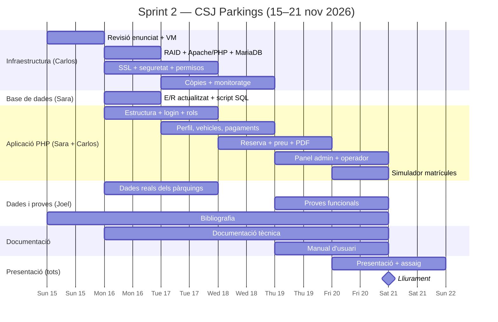

# Sprint 2 — Planificació actualitzada

## Sistema de Reserves de Places de Pàrquing · CSJ Parkings (Tarragona)

**Data d'actualització:** 15/11/2026
**Lliurament del Sprint 2:** dissabte 21/11/2026
**Equip:** 3 membres — Carlos, Sara i Joel.

---

## 1. Canvis respecte a la planificació del Sprint 1

| Sprint 1 (previst) | Realitat / canvi | Motiu |
|---|---|---|
| Equip de 4 membres | Equip de **3 membres** | Composició real del grup |
| 10 setmanes, S2–S9 seqüencials | El **Sprint 2 de l'enunciat** agrupa infraestructura, BD, backend, frontend i documentació en una sola setmana | Calendari de lliuraments del curs |
| Stack PHP + MariaDB | Es manté | Requisit de l'enunciat |
| Prototip React + Firebase (`app/`) | Es manté només com a referència de disseny i dades | No compleix l'stack demanat |
| `clients.es_admin` | Rols `client`, `operador`, `admin` | El Sprint 2 demana diversos rols |
| Pagament 1:1 | Mètodes de pagament de l'usuari i pagaments 1:N | Objectius 2.4 i cobrament d'excés |

Equivalència entre els sprints interns del Sprint 1 i el Sprint 2 de l'enunciat:

| Sprint intern | Contingut | Lliurament |
|---|---|---|
| S1 | Anàlisi i disseny | ✅ Sprint 1 |
| S2 + S3 | Infraestructura i base de dades | Sprint 2 |
| S4 + S5 + S7 | Backend, frontend i panel d'administració (rols) | Sprint 2 |
| S6 | Control d'accés per matrícula (simulador) | Sprint 2 si hi ha temps / Fase 2 |
| S8 | Seguretat i proves | Sprint 2 (bàsic) / Fase 2 (complet) |
| S9 | Documentació i exposició | Sprint 2 (parcial) / Final |

---

## 2. Repartiment de rols

| Membre | Rol principal | Responsabilitats |
|---|---|---|
| **Carlos** | Coordinació i infraestructura | Màquines virtuals, RAID, Apache + PHP, MariaDB, SSL, seguretat, còpies, monitoratge, integració i desplegament de l'aplicació, documentació tècnica de la instal·lació |
| **Sara** | Aplicació i base de dades | E/R actualitzat, script SQL, aplicació PHP (registre, perfil, vehicles, pagaments, reserves, PDF, panel admin), documentació tècnica del codi |
| **Joel** | Dades, proves i suport documental | Recollida de dades reals dels pàrquings de Tarragona, proves funcionals amb la llista de comprovació, captures i redacció de parts del manual d'usuari, bibliografia, disseny de les diapositives |
| **Tots** | — | Manual d'usuari, presentació i assaig, revisió final |

> Repartiment orientatiu: es pot ajustar a la reunió de seguiment.

---

## 3. Tasques del Sprint 2

| # | Tasca | Responsable | Dies | Depèn de | Prioritat |
|---|---|---|---|---|---|
| T1 | Revisió de l'enunciat i matriu de compliment | Carlos | dg 15 | — | Alta |
| T2 | Creació de les VM `parking-srv` i `parking-mon` | Carlos | dg 15 | — | Alta |
| T3 | RAID 1, Apache + PHP, MariaDB + phpMyAdmin | Carlos | dl 16 | T2 | Alta |
| T4 | SSL, tallafocs, fail2ban, permisos | Carlos | dl 16 – dt 17 | T3 | Alta |
| T5 | Còpies completes/incrementals i monitoratge | Carlos | dt 17 – dc 18 | T3 | Alta |
| T6 | Revisió de l'E/R actualitzat (rols, mètodes de pagament, pagaments 1:N) i prova de l'script SQL al servidor | Sara | dl 16 | T3 | Alta |
| T7 | Dades reals dels pàrquings (nom, adreça, places, coordenades) | Joel | dl 16 – dt 17 | — | Mitjana |
| T8 | App: estructura, connexió PDO, registre/login, rols | Sara + Carlos | dl 16 – dt 17 | T3, T6 | Alta |
| T9 | App: perfil, vehicles i mètodes de pagament | Sara | dt 17 – dc 18 | T8 | Alta |
| T10 | App: pàgina d'inici, formulari de reserva, càlcul del preu, condicions, número i PDF | Sara + Carlos | dc 18 – dj 19 | T8, T7 | Alta |
| T11 | App: panel admin (pàrquings, places, reserves, cerques) i rol operador | Sara + Carlos | dj 19 – dv 20 | T10 | Alta |
| T12 | Simulador del lector de matrícules | Carlos | dv 20 | T11 | Mitjana |
| T13 | Proves funcionals (llista de comprovació) i registre d'errors | Joel | dj 19 – dv 20 | T10 | Alta |
| T14 | Manual d'usuari amb captures | Joel + Sara | dj 19 – dv 20 | T10 | Alta |
| T15 | Documentació tècnica (instal·lació + codi) | Carlos + Sara | dl 16 – dv 20 | — | Alta |
| T16 | Bibliografia | Joel | durant la setmana | — | Mitjana |
| T17 | Presentació, document de presentació i assaig | Tots | dv 20 – ds 21 | T11 | Alta |
| T18 | Lliurament a Moodle | Carlos | ds 21 | Tot | Alta |

---

## 4. Diagrama de Gantt (Sprint 2)

---

## 5. Prioritats del Sprint 2 (MoSCoW)

| Prioritat | Contingut |
|---|---|
| **Must** | Servidor Apache + PHP + MariaDB + phpMyAdmin amb SSL · RAID · tallafocs · còpies programades · monitoratge en servidor a part · registre/login · rols (client, operador, admin) · perfil · vehicles · mètodes de pagament · reserva amb preu automàtic + 10 % · condicions · número de reserva + PDF · panel admin (pàrquings, places, reserves, cancel·lació, cerques) · manual · doc. tècnica · presentació |
| **Should** | Simulador del lector de matrícules · xifrat de dades sensibles · prova de fallada del RAID i de restauració · alertes de monitoratge |
| **Could** | Cobrament automàtic de l'excés de temps · gràfics d'ocupació · segon servidor web + HAProxy (equip de l'institut) |
| **Won't (Sprint 2)** | Passarel·la de pagament real · enviament real de correus |

---

## 6. Seguiment

| Data | Fet | Pendent / incidències |
|---|---|---|
| dg 15/11 | Revisió de l'enunciat, arquitectura, planificació actualitzada, E/R actualitzat i scripts SQL · VM `parking-srv` i `parking-mon` creades i accessibles per SSH | Incidència: l'instal·lador es bloqueja amb 1 GB de RAM (resolta amb 2 GB temporals) |
| dl 16/11 | Pas 1 (actualització, zona horària, claus SSH) i RAID 1 creat, provat (fallada + reconstrucció) i persistent després de reiniciar · Apache + PHP 8.1, MariaDB (dades al RAID, binlogs), BD creada amb els scripts, usuaris de BD i phpMyAdmin | Incidència 403 per permisos de /srv/www (resolta) |
| dt 17/11 | | |
| dc 18/11 | | |
| dj 19/11 | | |
| dv 20/11 | | |
| ds 21/11 | | |
