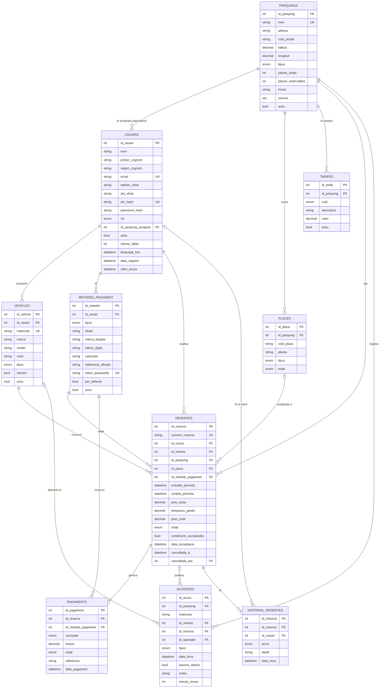

# Sprint 2 — Model E/R actualitzat

## Sistema de Reserves de Places de Pàrquing · CSJ Parkings (Tarragona)

**SGBD:** MariaDB 10.6 · **Joc de caràcters:** `utf8mb4_unicode_ci` · **Motor:** InnoDB (claus foranes i transaccions)
**Scripts:** `proyecto_parking/database/schema.sql` (estructura) i `proyecto_parking/database/seed.sql` (dades inicials)

---

## 1. Canvis respecte al model del Sprint 1

| # | Canvi | Motiu (requisit de l'enunciat) |
|---|---|---|
| 1 | `clients` passa a **`usuaris`** amb el camp **`rol`** (`client`, `operador`, `admin`) | El Sprint 2 demana *"gestió per part dels administradors i altres rols"*. L'operador gestiona el control d'accés d'un pàrquing (`id_parquing_assignat`). |
| 2 | Nova taula **`metodes_pagament`** | Objectiu 2.4: l'usuari ha de *tenir* mètodes de pagament. Es guarden només els 4 últims dígits i un *token* (mai el número complet ni el CVV). |
| 3 | `pagaments` passa de **1:1 a 1:N** amb la reserva i té **`concepte`** (`reserva`, `exces`, `reemborsament`) | L'excés de temps es cobra *"amb el mateix mitjà de pagament que ha fet la reserva"*: és un segon pagament de la mateixa reserva. |
| 4 | `reserves.id_metode_pagament` | Saber amb quin mètode es va pagar per cobrar-hi l'excés. |
| 5 | `data` + `hora_entrada` + `hora_sortida` (TIME) → **`entrada_prevista`** i **`sortida_prevista`** (DATETIME) | Amb TIME i `CHECK (sortida > entrada)` no es podia reservar de 22:30 a 00:30 (l'exemple de tarifa nocturna del Sprint 1) ni diversos dies. |
| 6 | Estats de reserva: `pendent`, `confirmada` (activa), **`en_curs`**, `completada`, **`cancellada`** | `en_curs` = el vehicle és dins (lector de matrícules). Valors sense accents ni `·` per evitar errors al codi. |
| 7 | Camps d'auditoria a `reserves` (`modificada_a`, `cancellada_a`, `cancellada_per`, `motiu_cancellacio`) + nova taula **`historial_reserves`** | Les reserves **no es poden eliminar**: cal saber qui ha fet cada canvi i quan (seguretat i accés a les dades). |
| 8 | **Xifrat** de `telefon` i `dni` (AES-256 des de PHP) + `dni_hash` | *"Anonimització/encriptació de dades sensibles"*. El hash permet evitar DNI duplicats sense desxifrar-los. |
| 9 | `intents_fallits` i `bloquejat_fins` a `usuaris` | Seguretat: bloqueig temporal després de diversos inicis de sessió fallits (força bruta). |
| 10 | `vehicles.actiu`, `metodes_pagament.actiu` | Un vehicle o targeta amb reserves no es pot esborrar (perdríem l'històric): es desactiva. |
| 11 | `parquings` amb adreça, codi postal, **coordenades**, tipus, horari i serveis | La rúbrica valora la integració *"amb diversos pàrquings de manera real"*; les coordenades permeten mostrar-los en un mapa. |
| 12 | `places.estat` = `disponible` / `fora_servei` | L'ocupació depèn de l'hora: es calcula amb les reserves, no es guarda fixa a la plaça. |
| 13 | `tarifes` amb `codi` fix i **`id_parquing` opcional** | El codi PHP pot llegir cada tarifa pel seu codi, i cada pàrquing pot tenir preus propis (si és NULL, s'aplica la general). |
| 14 | `numero_reserva` de 14 a **20** caràcters | El format `CSJ-AAAAMMDD-XXXXXX` té 19 caràcters. |
| 15 | `accessos` amb `id_vehicle`, `id_operador` i `minuts_exces` | Saber quin vehicle i qui ha fet el control, i calcular l'excés a la sortida. |
| 16 | Vistes `v_reserves_detall` i `v_ocupacio_actual` | Cerques avançades i visualització de l'ocupació al panel d'administració. |

---

## 2. Diagrama E/R



---

## 3. Relacions

| Relació | Cardinalitat | Comentari |
|---|---|---|
| usuari – vehicles | 1:N | Requisit mínim de l'enunciat |
| usuari – reserves | 1:N | Requisit mínim de l'enunciat |
| usuari – mètodes de pagament | 1:N | Un d'ells marcat com a predeterminat |
| reserva – pàrquing / vehicle | N:1 | *"Cada reserva està associada a un pàrquing i a un vehicle"* |
| reserva – mètode de pagament | N:1 | Mètode amb què es paga i es cobra l'excés |
| reserva – pagaments | 1:N | Pagament de la reserva + excés o reemborsament |
| pàrquing – places | 1:N | Places reservables |
| pàrquing – tarifes | 1:N (opcional) | Tarifes pròpies; si no n'hi ha, s'apliquen les generals |
| pàrquing – operadors | 1:N | Cada operador té un pàrquing assignat |
| reserva – accessos | 1:N (opcional) | Una entrada i una sortida; un accés denegat no té reserva |
| reserva – historial | 1:N | Auditoria de canvis |

---

## 4. Rols d'usuari i permisos

| Funcionalitat | Visitant | Client | Operador | Admin |
|---|:-:|:-:|:-:|:-:|
| Veure pàrquings i tarifes | ✅ | ✅ | ✅ | ✅ |
| Registrar-se / iniciar sessió | ✅ | — | — | — |
| Gestionar perfil, vehicles i mètodes de pagament | — | ✅ | — | — |
| Crear, consultar, modificar i cancel·lar les seves reserves + PDF | — | ✅ | — | — |
| Simular el lector de matrícules (entrada/sortida) del seu pàrquing | — | — | ✅ | ✅ |
| Veure l'ocupació i les reserves del dia del seu pàrquing | — | — | ✅ | ✅ |
| Gestionar pàrquings, places i tarifes | — | — | — | ✅ |
| Veure i modificar totes les reserves, canviar-ne l'estat i cancel·lar-les | — | — | — | ✅ |
| Cerques avançades i historial de canvis | — | — | — | ✅ |
| Gestionar usuaris (activar/desactivar, canviar rol) | — | — | — | ✅ |

A la base de dades, l'usuari de l'aplicació (`csj_app`) **no té permís `DELETE`**: encara que hi hagués un
error al codi, les reserves no es podrien esborrar.

---

## 5. Justificació del disseny

- **3a forma normal:** cap dada repetida (p. ex. el nom del pàrquing només és a `parquings`; les reserves
  hi fan referència per clau forana). Les úniques dades derivades guardades són els imports
  (`preu_base`, `despeses_gestio`, `preu_total`), perquè el preu pagat no ha de canviar si després
  es modifiquen les tarifes. Una restricció `CHECK` garanteix que `preu_total = preu_base + despeses_gestio`.
- **Integritat:** totes les relacions amb claus foranes `ON DELETE RESTRICT`, així no es pot esborrar
  un usuari, vehicle o pàrquing que tingui reserves.
- **Restriccions `CHECK`:** sortida posterior a l'entrada, condicions acceptades obligatòriament,
  imports no negatius i places reservables ≤ places totals.
- **Seguretat:** contrasenyes amb `password_hash()` (bcrypt), dades sensibles xifrades, sense dades de
  targeta completes, auditoria de canvis i bloqueig per intents fallits.
- **Rendiment:** índexs per a les consultes freqüents (disponibilitat d'un pàrquing en una franja,
  reserves d'un usuari, cerques per estat/data, accessos per matrícula).
- **Escalabilitat** (criteri de la rúbrica: *"pugui expandir-se en un futur sense limitacions"*):
  nous pàrquings, places, tarifes, rols, mètodes de pagament i conceptes de pagament s'afegeixen
  sense canviar l'estructura; claus `INT UNSIGNED`.

---

## 6. Disponibilitat d'un pàrquing (consulta clau)

Una reserva nova en una franja `[entrada, sortida)` és possible si el nombre de reserves actives que
s'hi solapen és menor que `places_reservables`:

```sql
SELECT p.places_reservables - COUNT(r.id_reserva) AS places_lliures
FROM parquings p
LEFT JOIN reserves r
       ON r.id_parquing = p.id_parquing
      AND r.estat IN ('pendent', 'confirmada', 'en_curs')
      AND r.entrada_prevista < :sortida
      AND r.sortida_prevista > :entrada
WHERE p.id_parquing = :id_parquing
GROUP BY p.id_parquing;
```

---

## 7. Dades inicials (`seed.sql`)

- Tarifes generals de l'enunciat i una tarifa pròpia d'exemple (disuasori Nou Estadi).
- **14 pàrquings reals de Tarragona** amb adreça i coordenades.
- Places reservables generades automàticament per a cada pàrquing.
- Tres usuaris de demostració, un per rol (`admin@`, `operador@`, `client@csjparkings.cat`),
  amb vehicles, una targeta simulada i una reserva confirmada per a demà.
