# Sprint 2 — Manual d'usuari

## Sistema de Reserves de Places de Pàrquing · CSJ Parkings (Tarragona)

**Adreça de l'aplicació:** `https://csjparkings.local/` (o `https://192.168.56.30/`)
**Navegadors provats:** Google Chrome i Microsoft Edge (ordinador i mòbil)

---

## Índex

1. [Què és CSJ Parkings](#1-què-és-csj-parkings)
2. [Pàgina d'inici](#2-pàgina-dinici)
3. [Crear un compte i iniciar sessió](#3-crear-un-compte-i-iniciar-sessió)
4. [El meu perfil](#4-el-meu-perfil)
5. [Fer una reserva](#5-fer-una-reserva)
6. [Les meves reserves, justificant PDF i cancel·lació](#6-les-meves-reserves-justificant-pdf-i-cancellació)
7. [Entrar i sortir del pàrquing](#7-entrar-i-sortir-del-pàrquing)
8. [Operador: panell del pàrquing i lector de matrícules](#8-operador-panell-del-pàrquing-i-lector-de-matrícules)
9. [Administrador](#9-administrador)
10. [Preguntes freqüents i missatges d'error](#10-preguntes-freqüents-i-missatges-derror)

---

## 1. Què és CSJ Parkings

CSJ Parkings és una aplicació web per **reservar plaça als 14 pàrquings municipals de Tarragona**. L'usuari tria
el pàrquing, el dia i les hores, paga en línia i rep un **número de reserva** i un **justificant en PDF**. En arribar,
el lector de matrícules reconeix el vehicle i obre la barrera.

Hi ha tres tipus d'usuari:

| Rol | Què pot fer |
|---|---|
| **Client** | Gestionar el seu perfil, vehicles i mètodes de pagament; reservar, descarregar el PDF i cancel·lar. |
| **Operador** | Treballador d'un pàrquing: veu l'ocupació i les reserves del dia del seu pàrquing i fa servir el lector de matrícules. |
| **Administrador** | Gestiona tots els pàrquings, places, tarifes, reserves i usuaris. |

**Usuaris de demostració** (contrasenya de tots: `Demo1234!`):

| Usuari | Rol |
|---|---|
| `client@csjparkings.cat` | Client (té els vehicles 1234ABC i 5678DEF i una targeta Visa) |
| `operador@csjparkings.cat` | Operador del pàrquing de la Plaça de la Font |
| `admin@csjparkings.cat` | Administrador |

---

## 2. Pàgina d'inici

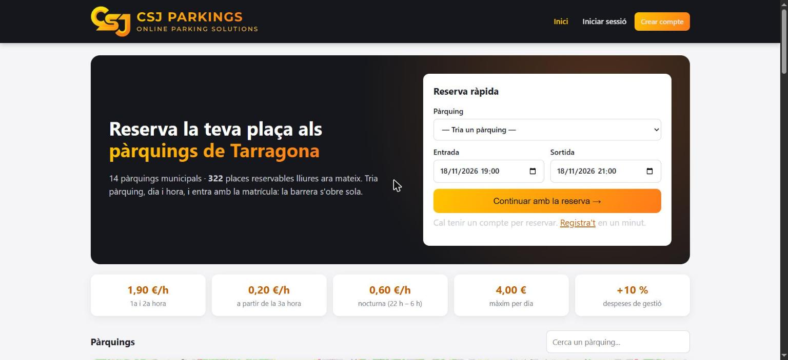
*Figura 1. Pàgina d'inici: reserva ràpida, tarifes, llista de pàrquings i mapa.*

La pàgina d'inici es pot consultar **sense compte**. Mostra:

1. **Reserva ràpida:** tria el pàrquing, l'entrada i la sortida i prem **Continuar amb la reserva →**.
   Si no has iniciat sessió, l'aplicació et demanarà que entris o et registris.
2. **Tarifes:** 1,90 €/h les 2 primeres hores, 0,20 €/h a partir de la 3a, 0,60 €/h de nit (22 h – 6 h),
   màxim 4,00 € per dia i **+10 % de despeses de gestió**.
3. **Pàrquings:** targeta de cada pàrquing amb foto, adreça, serveis (cobert, recàrrega elèctrica, PMR…) i
   **places lliures ara mateix**. Pots filtrar-los amb el cercador *Cerca un pàrquing...*. El botó
   **Reservar aquí** obre el formulari de reserva amb aquest pàrquing ja triat.
4. **Mapa** amb la situació de tots els pàrquings.

---

## 3. Crear un compte i iniciar sessió

### 3.1 Crear un compte

Per fer qualsevol reserva cal estar registrat. Prem **Crear compte** (a dalt a la dreta).

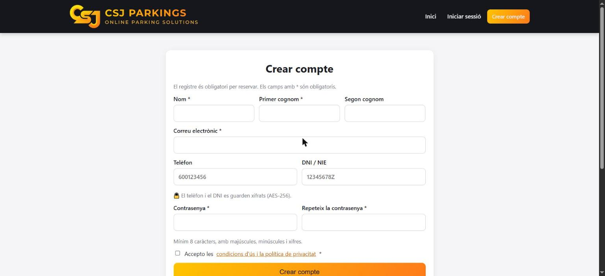
*Figura 2. Formulari de registre.*

| Camp | Obligatori | Observacions |
|---|---|---|
| Nom, primer cognom | Sí | Màxim 50 caràcters. |
| Segon cognom | No | |
| Correu electrònic | Sí | És el nom d'usuari per entrar. No pot estar ja registrat. |
| Telèfon | No | 9 xifres (pot començar per `+34`). Es guarda **xifrat**. |
| DNI / NIE | No | Es comprova la lletra. Es guarda **xifrat**. |
| Contrasenya | Sí | Mínim 8 caràcters, amb **majúscules, minúscules i xifres**. S'ha d'escriure dues vegades. |
| Acceptar condicions d'ús i privacitat | Sí | Es poden llegir a l'enllaç del mateix formulari. |

En prémer **Crear compte** s'inicia la sessió automàticament i l'aplicació et porta a afegir un vehicle.

### 3.2 Iniciar i tancar sessió

Prem **Iniciar sessió**, escriu el correu i la contrasenya. Segons el rol, entres a:
l'inici (client), el panell d'operador o el tauler d'administració.

> 🔒 **Seguretat:** després de **5 intents fallits** el compte queda bloquejat **15 minuts**. Si passes
> **30 minuts sense fer res**, la sessió es tanca sola.

Per sortir, obre el menú amb el teu nom (a dalt a la dreta) i prem **Tancar sessió**.

---

## 4. El meu perfil

Des del menú amb el teu nom s'accedeix a tres pestanyes: **Dades personals**, **Vehicles** i **Mètodes de pagament**.

### 4.1 Dades personals

Pots modificar el nom, els cognoms, el correu, el telèfon i el DNI i prémer **Desar canvis**.
A la part de sota pots **canviar la contrasenya** (cal escriure l'actual i la nova dues vegades).

### 4.2 Vehicles

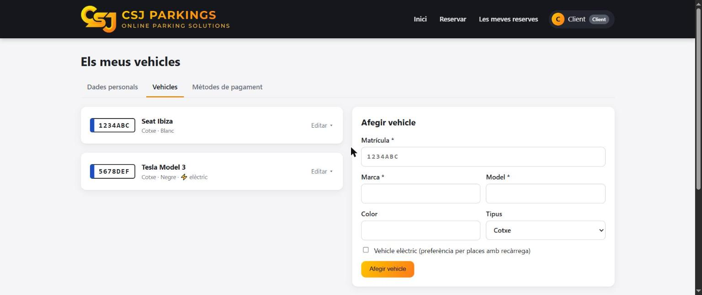
*Figura 3. Llista de vehicles i formulari per afegir-ne un.*

Per reservar cal tenir **almenys un vehicle**. Al formulari **Afegir vehicle** indica:

- **Matrícula** (obligatòria; p. ex. `1234ABC`, sense espais ni guions). No pot estar registrada per un altre usuari.
- **Marca** i **model** (obligatoris), color i tipus (**Cotxe**, **Moto** o **Furgoneta**).
- **Vehicle elèctric:** si el marques, l'aplicació et donarà preferència per places amb punt de recàrrega.

Per modificar un vehicle, fes clic sobre ell, canvia les dades i prem **Desar**. Si ja no el fas servir, prem
**Donar de baixa** (les reserves antigues amb aquest vehicle es conserven).

### 4.3 Mètodes de pagament

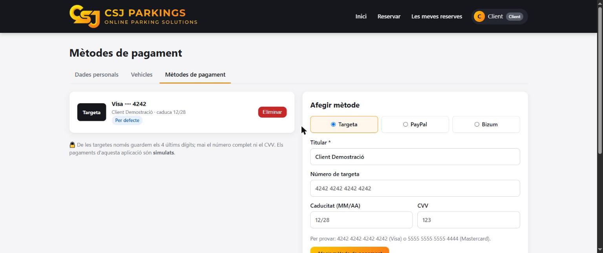
*Figura 4. Mètodes de pagament: targeta, PayPal o Bizum.*

Per reservar cal tenir **almenys un mètode de pagament**. Pots afegir:

- **Targeta:** titular, número, caducitat (MM/AA) i CVV. Es comprova que el número sigui vàlid.
  Per fer proves: `4242 4242 4242 4242` (Visa) o `5555 5555 5555 4444` (Mastercard), amb qualsevol data futura i CVV.
- **PayPal:** correu electrònic del compte.
- **Bizum:** telèfon mòbil.

> 🔒 De les targetes **només es guarden els 4 últims dígits**. El número complet i el CVV no es guarden mai.

Amb **Per defecte** tries el mètode que apareixerà seleccionat en reservar. **Eliminar** el treu de la llista.

> ℹ️ En aquesta versió el pagament és **simulat**: no es fa cap càrrec real.

---

## 5. Fer una reserva

Prem **Reservar** al menú (o **Reservar aquí** a la targeta d'un pàrquing).

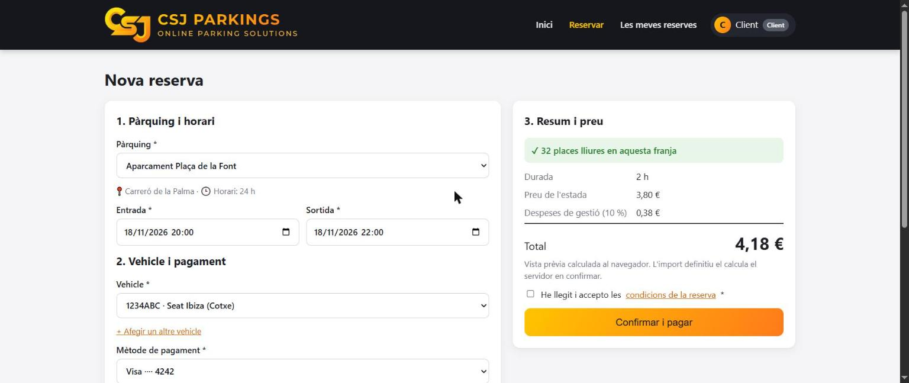
*Figura 5. Formulari de nova reserva amb el preu calculat.*

1. **Pàrquing i horari:** tria el pàrquing, la data i hora d'**entrada** i de **sortida**.
   - L'entrada no pot ser anterior a ara i la sortida ha de ser posterior a l'entrada.
   - La reserva ha de durar entre **30 minuts** i **30 dies**.
   - Mentre tries les hores, l'aplicació mostra quantes **places queden lliures en aquesta franja**.
2. **Vehicle i pagament:** tria el vehicle i el mètode de pagament. Si surts més tard de l'hora prevista,
   **l'excés es cobrarà amb aquest mateix mètode**.
3. **Resum i preu:** es mostra el preu de l'estada, les **despeses de gestió (10 %)** i el **total**.
   Llegeix les condicions i marca la casella **d'acceptació (obligatòria)**.
4. Prem **Confirmar i pagar**.

Exemple: de 10:00 a 13:00 → 1,90 € + 1,90 € + 0,20 € = 4,00 € + 0,40 € de gestió = **4,40 €**.

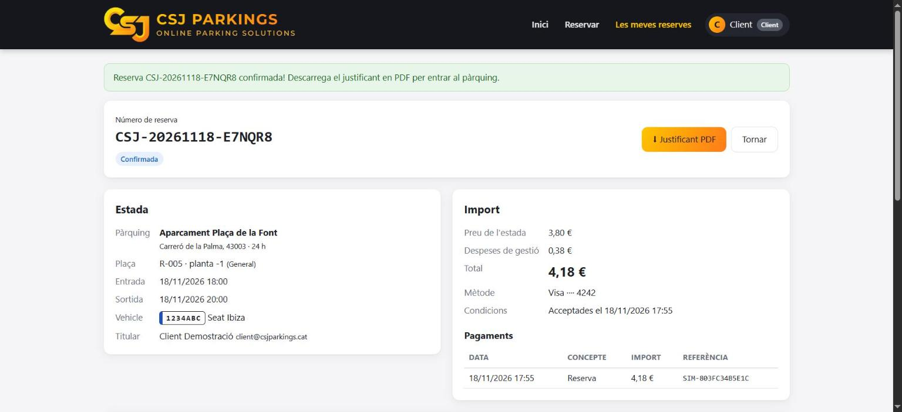
*Figura 6. Reserva confirmada amb el número de reserva.*

En confirmar es mostra la reserva amb el **número de reserva** (format `CSJ-AAAAMMDD-XXXXXX`), l'estat
**Confirmada**, la plaça assignada, el desglossament del preu i el pagament fet.

---

## 6. Les meves reserves, justificant PDF i cancel·lació

### 6.1 Llista de reserves

**Les meves reserves** mostra totes les teves reserves (de la més nova a la més antiga) amb el número,
pàrquing, entrada, sortida, vehicle, total i estat.

| Estat | Significat |
|---|---|
| **Confirmada** | Pagada i pendent d'utilitzar. |
| **En curs** | El vehicle és dins del pàrquing. |
| **Completada** | El vehicle ja ha sortit. |
| **Cancel·lada** | Anul·lada (es conserva a l'historial). |

### 6.2 Justificant en PDF

Prem **PDF** a la llista o **⬇ Justificant PDF** al detall de la reserva.

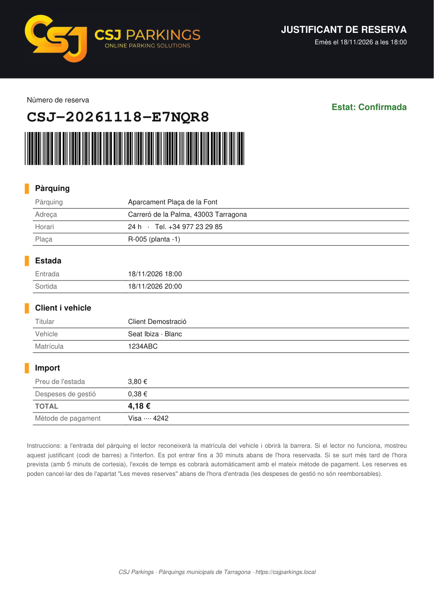
*Figura 7. Justificant de reserva en PDF amb el codi de barres.*

El justificant inclou el número de reserva amb **codi de barres**, les dades del client i del vehicle, el pàrquing,
la plaça, l'horari i el preu. Per entrar n'hi ha prou amb la matrícula; si el lector no funcionés, es pot mostrar el justificant (imprès o al mòbil)
a l'interfon de l'entrada.

### 6.3 Cancel·lar una reserva

Al detall d'una reserva **Confirmada** que encara no ha començat apareix el requadre **Cancel·lar la reserva**.
Pots escriure un motiu (opcional) i prémer **Cancel·lar reserva**.

- Es **reemborsa el preu de l'estada**. Les **despeses de gestió no són reemborsables**.
- La reserva no s'esborra: queda com a **Cancel·lada** amb la data i el motiu.
- Un cop ha passat l'hora d'entrada ja no es pot cancel·lar.

---

## 7. Entrar i sortir del pàrquing

1. **Entrada:** la càmera llegeix la matrícula. Si tens una reserva per a aquell pàrquing, la barrera s'obre.
   Pots arribar fins a **30 minuts abans** de l'hora reservada.
2. **Sortida:** la càmera torna a llegir la matrícula i s'obre la barrera.
3. **Excés de temps:** si surts més tard de l'hora de sortida (hi ha **5 minuts de cortesia**), l'excés es cobra
   automàticament **amb el mateix mètode de pagament de la reserva**, amb les mateixes tarifes. El pots veure a
   l'apartat *Pagaments* del detall de la reserva.

---

## 8. Operador: panell del pàrquing i lector de matrícules

En iniciar sessió com a operador s'obre el panell **Operador**, sempre del pàrquing que té assignat.

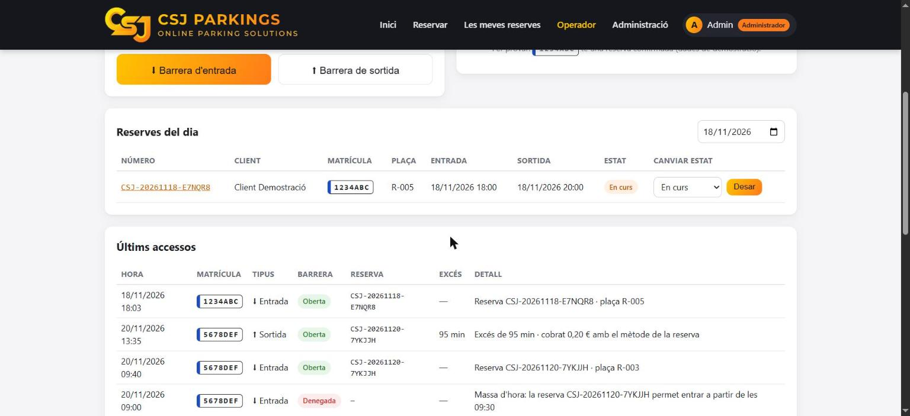
*Figura 8. Panell de l'operador: reserves del dia (amb canvi d'estat) i últims accessos registrats pel lector.*

### 8.1 Ocupació

A dalt es veuen quatre xifres: **places reservables lliures**, **reserves vigents ara**, **places de rotació
lliures** (per a vehicles sense reserva) i **places totals**.

### 8.2 Simulador del lector de matrícules

Simula la càmera de les barreres:

1. Escriu la **matrícula** (p. ex. `1234ABC`).
2. Opcionalment, obre **Simular una altra hora (per a proves)** i indica una data i hora (en blanc = hora actual).
3. Prem **⬇ Barrera d'entrada** o **⬆ Barrera de sortida**.

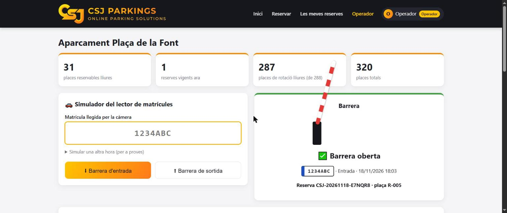
*Figura 9. Resultat d'una lectura: barrera oberta (verd) o accés denegat (vermell).*

| Situació | Resultat |
|---|---|
| Entrada amb reserva vigent (fins a 30 min abans) | **Barrera oberta**; la reserva passa a *En curs*. |
| Entrada massa d'hora | **Accés denegat**; indica a partir de quina hora pot entrar. |
| Entrada sense reserva i amb places de rotació | **Barrera oberta**; pagarà al caixer. |
| Entrada sense reserva i pàrquing complet | **Accés denegat**. |
| Sortida a temps | **Barrera oberta**; la reserva passa a *Completada*. |
| Sortida tard | **Barrera oberta**; es cobra l'excés i es mostra l'import. |

Totes les lectures queden a la taula **Últims accessos** (hora, matrícula, tipus, barrera, reserva, excés).

### 8.3 Reserves del dia

La taula **Reserves del dia** mostra les reserves que entren, surten o estan en curs avui. L'operador pot
**canviar l'estat** d'una reserva (per exemple, si un client entra manualment perquè la càmera no llegeix la
matrícula) i prémer **Desar**. Fent clic al número es veu el detall.

---

## 9. Administrador

En iniciar sessió com a administrador s'obre el **Tauler**. El menú d'administració té: **Tauler**, **Reserves**,
**Pàrquings i places**, **Tarifes**, **Usuaris i rols** i **Lector de matrícules**.

### 9.1 Tauler

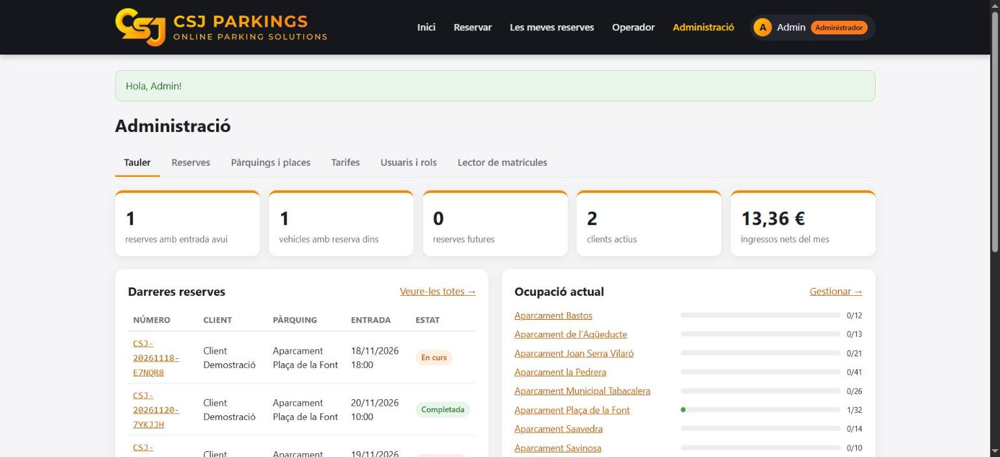
*Figura 10. Tauler d'administració amb xifres, darreres reserves i ocupació.*

Mostra les reserves d'avui, els vehicles dins, les reserves futures, els clients i els ingressos del mes, les
**darreres reserves** i l'**ocupació actual** de cada pàrquing.

### 9.2 Reserves: cerca avançada

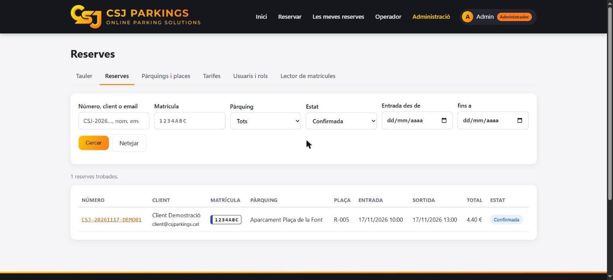
*Figura 11. Cerca avançada de reserves.*

Es poden combinar els filtres:

- **Número, client o email** (n'hi ha prou amb una part).
- **Matrícula**.
- **Pàrquing** i **estat**.
- **Entrada des de / fins a** (interval de dates).

Prem **Cercar**. **Netejar** treu tots els filtres. Els resultats es mostren de 25 en 25.

### 9.3 Gestionar una reserva

Fent clic al número d'una reserva s'obre la seva fitxa:

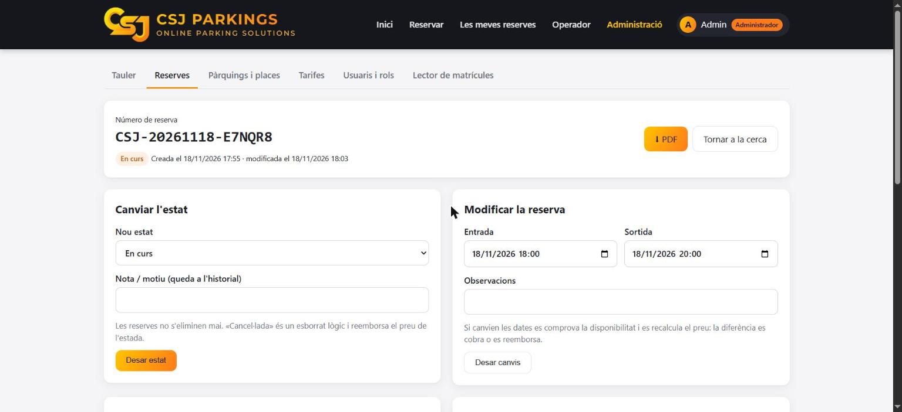
*Figura 12. Fitxa d'una reserva: canvi d'estat, modificació i historial.*

- **Canviar l'estat:** tria el nou estat, escriu una nota (queda a l'historial) i prem **Desar estat**.
  Triar *Cancel·lada* fa la cancel·lació amb reemborsament.
- **Modificar la reserva:** canvia l'entrada, la sortida o les observacions i prem **Desar canvis**.
  L'aplicació comprova si hi ha plaça i **recalcula el preu**: la diferència es cobra o es reemborsa.
- **Historial:** llista de tots els canvis, amb qui els ha fet i quan.

> ⚠️ Les reserves **no es poden eliminar mai**. Per anul·lar-ne una es cancel·la.

### 9.4 Pàrquings i places

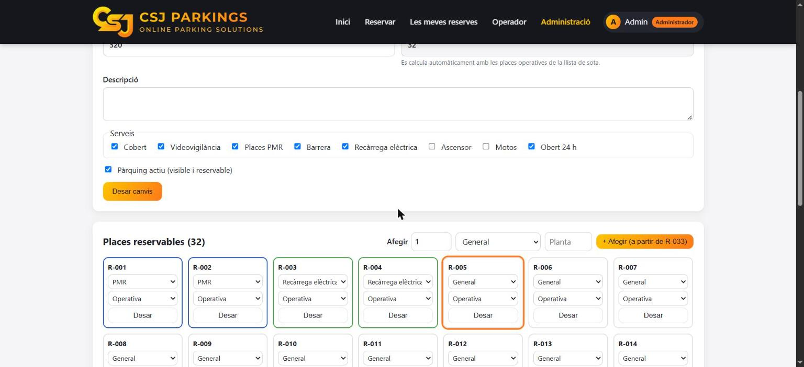
*Figura 13. Dades d'un pàrquing i mapa de places.*

- **Llista de pàrquings** amb el botó per crear-ne un de nou.
- **Dades del pàrquing:** nom, tipus (subterrani, superfície, en plantes), adreça, codi postal, telèfon,
  coordenades (latitud i longitud, per al mapa), horari, places totals i reservables, descripció i serveis.
- **Places:** es veuen totes les places. La vora taronja indica que està ocupada ara; ratllada, que està fora de servei.
  Es poden **afegir places** (quantitat, tipus i planta) i canviar el tipus o l'estat d'una plaça.
  Les places no s'eliminen: es posen **fora de servei**.

### 9.5 Tarifes

- Les **tarifes generals** s'apliquen a tots els pàrquings: es pot canviar el valor i activar-les o desactivar-les.
- **Tarifa pròpia d'un pàrquing:** tria el pàrquing, el concepte i el valor. Substitueix la general en aquell pàrquing.
- Els canvis només afecten les **reserves noves**: les ja fetes conserven el preu pagat.

### 9.6 Usuaris i rols

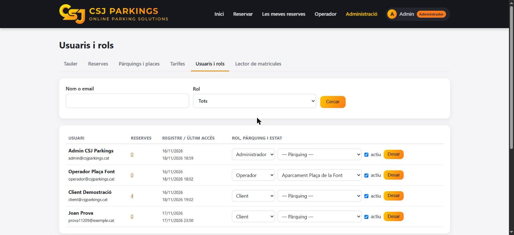
*Figura 14. Gestió d'usuaris i rols.*

- Cerca per **nom o email** i filtra per **rol**.
- Per a cada usuari es pot canviar el **rol** (client, operador, administrador), el **pàrquing assignat**
  (per als operadors) i si està **actiu**. Prem **Desar**.
- **Desbloquejar:** treu el bloqueig d'un compte després d'intents fallits.
- Els usuaris no s'eliminen: es **desactiven** (no poden entrar, però es conserven les seves reserves).

---

## 10. Preguntes freqüents i missatges d'error

| Missatge o problema | Què fer |
|---|---|
| *Has d'iniciar sessió per continuar.* | Inicia sessió o crea un compte. |
| *Correu electrònic o contrasenya incorrectes.* | Revisa les dades. Després de 5 intents el compte es bloqueja 15 minuts. |
| *Compte bloquejat temporalment...* | Espera els minuts indicats o demana a un administrador que el desbloquegi. |
| *Per reservar, primer afegeix un vehicle / un mètode de pagament.* | Afegeix-lo i l'aplicació et tornarà a la reserva. |
| *No queden places lliures en aquest pàrquing per a la franja escollida.* | Canvia d'hora o de pàrquing. |
| *El vehicle ... ja té la reserva ... en aquesta franja.* | Un mateix vehicle no pot tenir dues reserves a la mateixa hora. |
| *Aquesta reserva ja no es pot cancel·lar.* | Ja ha començat, està en curs o ja està cancel·lada. |
| *Sessió caducada* | La sessió s'ha tancat mentre tenies el formulari obert. Torna a carregar la pàgina i, si cal, inicia sessió. |
| *Accés denegat* | El teu compte no té permís per a aquesta secció (per exemple, un client que entra a Administració). |
| El navegador avisa que la connexió no és privada | Cal instal·lar el certificat de l'autoritat *CSJ Parkings Root CA* (vegeu `02-installacio-servidors.md`). |
