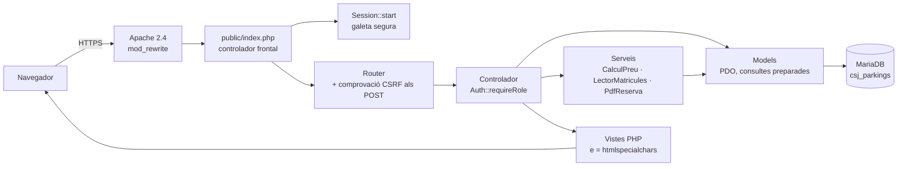
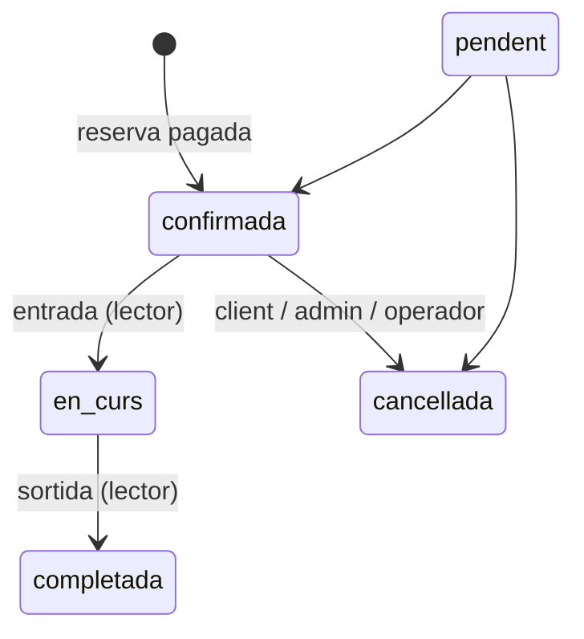
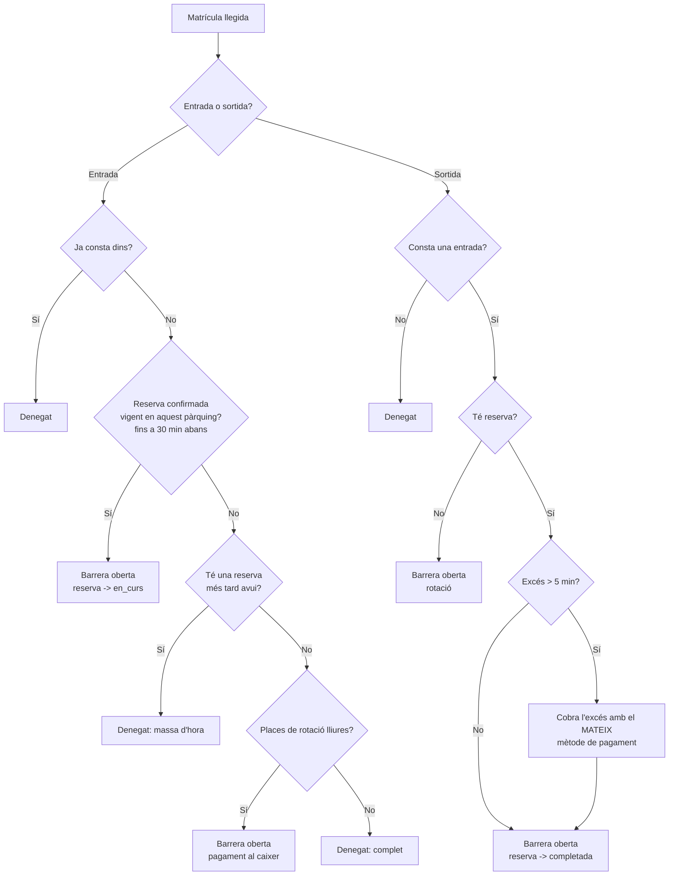

# Sprint 2 — Documentació tècnica del codi

## Sistema de Reserves de Places de Pàrquing · CSJ Parkings (Tarragona)

**Codi font:** `proyecto_parking/app_php/` · **Desplegament:** `proyecto_parking/infra/07-desplegar-app.sh`
**Aplicació en funcionament:** `https://csjparkings.local/` (servidor `parking-srv`, 192.168.56.30)

---

## Índex

1. [Tecnologies utilitzades](#1-tecnologies-utilitzades)
2. [Arquitectura de l'aplicació (MVC)](#2-arquitectura-de-laplicació-mvc)
3. [Estructura de fitxers](#3-estructura-de-fitxers)
4. [Rutes i rols](#4-rutes-i-rols)
5. [Seguretat de l'aplicació](#5-seguretat-de-laplicació)
6. [Lògica de negoci](#6-lògica-de-negoci)
7. [Interfície (HTML, CSS i JavaScript)](#7-interfície-html-css-i-javascript)
8. [Desplegament al servidor](#8-desplegament-al-servidor)
9. [Proves realitzades](#9-proves-realitzades)
10. [Limitacions i millores futures](#10-limitacions-i-millores-futures)
11. [Referències](#11-referències)

---

## 1. Tecnologies utilitzades

| Capa | Tecnologia | Per què l'hem triada |
|---|---|---|
| Sistema operatiu | Ubuntu Server 22.04 LTS | Obligatori GNU/Linux; versió LTS amb suport fins al 2027. |
| Servidor web | Apache 2.4 + `mod_rewrite` + `mod_ssl` | Obligatori a l'enunciat. `mod_rewrite` envia totes les URL al controlador frontal. |
| Llenguatge | **PHP 8.1** (sense framework) | Obligatori PHP. Sense framework per entendre i poder defensar tot el codi; fem servir tipus estrictes (`declare(strict_types=1)`), `match`, `never`, *enums* de text… |
| Base de dades | MariaDB 10.6 + **PDO** | Obligatori MariaDB. PDO permet sentències preparades reals i transaccions. |
| Administració BD | phpMyAdmin | Obligatori. Només accessible des de la xarxa interna 192.168.56.0/24. |
| PDF | **FPDF** (paquet Ubuntu `php-fpdf`) | Llibreria lleugera, sense dependències, instal·lable amb `apt`. |
| Mapa | **Leaflet 1.9.4** + **OpenStreetMap** | Mapa lliure i gratuït (sense clau d'API, a diferència de Google Maps). |
| Interfície | HTML5, CSS3 (*responsive*, sense frameworks) i JavaScript (ES2020, sense jQuery) | Pàgines lleugeres; el JS només millora la usabilitat (vista prèvia del preu, mapa), l'aplicació funciona sense. |
| Tipografia | Titillium Web (Google Fonts) | Lletra condensada i llegible per al tema visual "curses" de la web. |
| Control de versions | Git + GitHub (`carlosxavierx/parkingcsj`) | Treball en equip i historial de canvis. |

---

## 2. Arquitectura de l'aplicació (MVC)

L'aplicació segueix el patró **Model–Vista–Controlador** amb un **controlador frontal**: totes les peticions
entren per un sol fitxer (`public/index.php`), que decideix quin controlador executa.



| Capa | Carpeta | Responsabilitat |
|---|---|---|
| **Nucli** | `src/Core/` | Peces reutilitzables: `Router`, `Database` (PDO), `Auth`, `Session`, `Csrf`, `Crypto`, `View`, `Config`. |
| **Models** | `src/Models/` | Accés a dades: una classe per taula (`Reserva`, `Usuari`, `Vehicle`, `Parquing`…). Tot l'SQL és aquí. |
| **Serveis** | `src/Services/` | Lògica de negoci que no pertany a una sola taula: càlcul del preu, lector de matrícules, PDF. |
| **Controladors** | `src/Controllers/` | Reben la petició, comproven permisos, validen les dades, criden models/serveis i trien la vista. |
| **Vistes** | `src/Views/` | Plantilles PHP amb HTML. Una plantilla general (`layout.php`) i una carpeta per secció. |

**Per què així:** separar l'SQL (models), les regles (serveis) i l'HTML (vistes) fa que cada fitxer sigui petit
i fàcil de revisar. Per exemple, el càlcul del preu és en un sol lloc (`CalculPreu`) i el fan servir la reserva,
la modificació per l'administrador i el lector de matrícules.

### 2.1 Controlador frontal i arrencada

`public/.htaccess` envia a `index.php` tota petició que no sigui un fitxer real (CSS, JS, imatges):

```apache
RewriteEngine On
RewriteCond %{REQUEST_FILENAME} !-f
RewriteCond %{REQUEST_FILENAME} !-d
RewriteRule ^ index.php [QSA,L]

# No servir mai fitxers ocults ni de configuració
<FilesMatch "^\.|\.(ini|log|sql|md|sh)$">
    Require all denied
</FilesMatch>
```

`public/index.php` només té 4 línies útils:

```php
require dirname(__DIR__) . '/src/bootstrap.php';   // autoload, configuració, errors
Session::start();                                  // sessió segura
$router = new Router();
require APP_ROOT . '/src/routes.php';              // taula de rutes
$router->dispatch($_SERVER['REQUEST_METHOD'], $_SERVER['REQUEST_URI']);
```

`src/bootstrap.php` defineix la zona horària (`Europe/Madrid`), un **autoload PSR-4** senzill
(la classe `App\Core\Router` es carrega de `src/Core/Router.php`), llegeix `config/config.php` i instal·la un
gestor d'excepcions que **registra l'error al log d'Apache i mostra una pàgina genèrica** (mai detalls tècnics):

```php
set_exception_handler(static function (Throwable $e): void {
    error_log('[csjparkings] ' . get_class($e) . ': ' . $e->getMessage() . ' @ ' . $e->getFile() . ':' . $e->getLine());
    http_response_code(500);
    App\Core\View::render('errors/500', ['titol' => 'Error del servidor']);
});
```

### 2.2 Enrutador

`src/Core/Router.php` converteix cada patró de ruta en una expressió regular (`{id}` → `(\d+)`) i crida el mètode
del controlador amb els paràmetres. **Abans d'executar qualsevol ruta POST comprova el token CSRF**, de manera que
cap formulari se'n pot oblidar:

```php
foreach ($this->rutes[$metode] ?? [] as $regex => [$classe, $funcio]) {
    if (preg_match($regex, $path, $m)) {
        if ($metode === 'POST') {
            Csrf::verify();              // si el token no és correcte: 403 i s'atura
        }
        array_shift($m);
        $params = array_map(static fn($v) => ctype_digit($v) ? (int) $v : $v, $m);
        (new $classe())->$funcio(...$params);
        return;
    }
}
http_response_code(404);
```

### 2.3 Accés a la base de dades

`src/Core/Database.php` crea **una sola connexió PDO** per petició i ofereix funcions curtes (`one`, `all`,
`value`, `run`, `transaction`). Totes fan servir sentències preparades:

```php
self::$pdo = new PDO($dsn, $db['user'], $db['pass'], [
    PDO::ATTR_ERRMODE            => PDO::ERRMODE_EXCEPTION,  // errors com a excepcions
    PDO::ATTR_DEFAULT_FETCH_MODE => PDO::FETCH_ASSOC,
    PDO::ATTR_EMULATE_PREPARES   => false,                   // preparades REALS al servidor MariaDB
]);
```

```php
/** Executa $fn dins d'una transacció (commit o rollback automàtic). */
public static function transaction(callable $fn): mixed
{
    $pdo = self::pdo();
    $pdo->beginTransaction();
    try {
        $resultat = $fn($pdo);
        $pdo->commit();
        return $resultat;
    } catch (\Throwable $e) {
        $pdo->rollBack();
        throw $e;
    }
}
```

La connexió es fa amb l'usuari **`csj_app`**, que només té `SELECT, INSERT, UPDATE` (cap `DELETE`): encara que
hi hagués un error al codi, **la base de dades no permet esborrar res** (vegeu `04-model-er-actualitzat.md`).

---

## 3. Estructura de fitxers

```
app_php/
├── public/                     ← DocumentRoot d'Apache (l'única carpeta accessible des del web)
│   ├── index.php               ← controlador frontal
│   ├── .htaccess               ← reescriptura d'URL i bloqueig de fitxers sensibles
│   ├── css/app.css             ← estils (responsive)
│   ├── js/app.js               ← vista prèvia del preu, mapa, confirmacions
│   └── img/                    ← logotips i fotos dels pàrquings
├── src/
│   ├── bootstrap.php           ← arrencada: autoload, configuració, gestió d'errors
│   ├── helpers.php             ← funcions globals: e(), csrf_field(), flash(), euro()...
│   ├── routes.php              ← taula de rutes URL → controlador
│   ├── Core/                   ← Router, Database, Auth, Session, Csrf, Crypto, View, Config
│   ├── Models/                 ← Parquing, Tarifa, Usuari, Vehicle, MetodePagament,
│   │                             Reserva, Historial, Acces
│   ├── Services/               ← CalculPreu, LectorMatricules, PdfReserva
│   ├── Controllers/            ← Home, Auth, Perfil, Vehicle, Pagament, Reserva, Operador, Admin
│   └── Views/                  ← layout.php + auth/, perfil/, reserves/, operador/, admin/, errors/
└── config/
    └── config.example.php      ← exemple sense contrasenyes (el real només és al servidor)
```

| Fitxers | Línies aprox. |
|---|---|
| PHP (nucli, models, serveis, controladors) | ≈ 3.100 |
| Vistes PHP | ≈ 1.150 |
| CSS + JavaScript | ≈ 550 |

**Per què `public/` separada:** Apache només serveix el contingut de `public/`. El codi (`src/`) i la configuració
amb contrasenyes (`config/`) són **fora de l'arrel web**: encara que Apache fallés i no interpretés PHP, no es
podrien descarregar.

---

## 4. Rutes i rols

L'aplicació té **tres rols** (camp `usuaris.rol`). Cada rol hereta el que pot fer l'anterior.

| Rol | Pot fer |
|---|---|
| Visitant (sense sessió) | Veure pàrquings, places lliures, tarifes i mapa. Registrar-se i iniciar sessió. |
| **Client** | Perfil, vehicles, mètodes de pagament, reservar, PDF, les seves reserves i cancel·lar-les. |
| **Operador** | + Ocupació i reserves del dia **del seu pàrquing**, canvi d'estat i **simulador del lector de matrícules**. |
| **Administrador** | + Tots els pàrquings, places i tarifes; **totes les reserves** amb cerca avançada, modificació i canvi d'estat; usuaris i rols. |

Rutes principals (`src/routes.php`):

| Mètode i ruta | Controlador | Accés |
|---|---|---|
| `GET /` · `GET /condicions` · `GET /api/disponibilitat` | `HomeController` | Públic |
| `GET/POST /login` · `GET/POST /registre` · `POST /logout` | `AuthController` | Públic |
| `GET/POST /perfil` · `POST /perfil/contrasenya` | `PerfilController` | Sessió iniciada |
| `GET/POST /vehicles` · `POST /vehicles/{id}/baixa` | `VehicleController` | Sessió iniciada |
| `GET/POST /pagaments` · `POST /pagaments/{id}/defecte` | `PagamentController` | Sessió iniciada |
| `GET /reserves` · `GET /reserves/nova` · `POST /reserves` | `ReservaController` | Sessió iniciada |
| `GET /reserves/{id}` · `GET /reserves/{id}/pdf` · `POST /reserves/{id}/cancellar` | `ReservaController` | Titular, admin o operador del pàrquing |
| `GET /operador` · `POST /operador/lector` · `POST /operador/reserves/{id}/estat` | `OperadorController` | Operador, admin |
| `GET /admin/...` (reserves, parquings, tarifes, usuaris) | `AdminController` | Només admin |

El control d'accés es fa al principi de cada acció amb `Auth::requireLogin()` o `Auth::requireRole(...)`.
`AdminController` ho fa al constructor, així **cap mètode d'administració es pot executar sense ser admin**:

```php
public function __construct()
{
    Auth::requireRole('admin');
}
```

```php
/** Obliga a tenir un dels rols indicats. */
public static function requireRole(string ...$rols): array
{
    $u = self::requireLogin();                 // sense sessió -> pàgina d'inici de sessió
    if (!in_array($u['rol'], $rols, true)) {
        http_response_code(403);
        View::render('errors/403', ['titol' => 'Accés denegat']);
        exit;
    }
    return $u;
}
```

L'usuari **es torna a llegir de la base de dades a cada petició** (`Auth::user()`): si l'administrador desactiva
un compte o li canvia el rol, té efecte a l'instant, sense esperar que tanqui la sessió.

A més del rol, es comprova que **l'element pertanyi a l'usuari**. Un client que canviés el número de la URL
(`/reserves/7`) no veuria la reserva d'un altre; rep un 404 (no un 403, per no revelar que existeix):

```php
$permes = (int) $r['id_usuari'] === (int) $u['id_usuari']
    || $u['rol'] === 'admin'
    || ($u['rol'] === 'operador' && (int) $u['id_parquing_assignat'] === (int) $r['id_parquing']);
if (!$permes) {
    $this->noTrobat();   // 404 i no 403: no es revela que la reserva existeix
}
```

---

## 5. Seguretat de l'aplicació

Resum de les mesures, relacionades amb els riscos més habituals de l'**OWASP Top 10**:

| Risc | Mesura | On és |
|---|---|---|
| Injecció SQL | Sentències preparades reals (PDO, `EMULATE_PREPARES = false`) | `Core/Database.php`, tots els models |
| XSS (injecció de codi a la pàgina) | Tota la sortida passa per `e()` (`htmlspecialchars`) | `helpers.php`, totes les vistes |
| CSRF (falsificació de peticions) | Token aleatori per sessió en tots els formularis, comprovat pel Router | `Core/Csrf.php`, `Core/Router.php` |
| Contrasenyes | `password_hash()` (bcrypt) i `password_verify()`; política de complexitat | `Models/Usuari.php`, `AuthController` |
| Força bruta | Bloqueig de 15 minuts després de 5 intents; missatge d'error genèric | `AuthController::login`, `Usuari::intentFallit` |
| Robatori / fixació de sessió | Galeta `Secure`, `HttpOnly`, `SameSite=Strict`; `session_regenerate_id()`; caducitat 30 min | `Core/Session.php`, `Core/Auth.php` |
| Exposició de dades sensibles | Telèfon, DNI i referències de PayPal/Bizum xifrats amb **AES-256-GCM**; targetes: només 4 últims dígits | `Core/Crypto.php` |
| Control d'accés | Rol + propietat de cada element | `Core/Auth.php`, controladors |
| Errors amb informació tècnica | Pàgines d'error genèriques; detalls només al log | `bootstrap.php` |
| Configuració | `config.php` fora de `public/`, permisos 640, sense contrasenyes al repositori | `config/`, script 07 |
| Esborrat de dades | L'usuari de BD no té `DELETE`; esborrat lògic + historial | BD, `Models/Reserva.php` |

### 5.1 Protecció XSS

```php
/** Escapa qualsevol valor per mostrar-lo en HTML (protecció XSS). */
function e(mixed $valor): string
{
    return htmlspecialchars((string) ($valor ?? ''), ENT_QUOTES | ENT_SUBSTITUTE, 'UTF-8');
}
```

A les vistes, tota dada es mostra així: `<h1><?= e($r['numero_reserva']) ?></h1>`. Si un usuari escrivís
`<script>` al nom, es veuria com a text i no s'executaria.

### 5.2 Token CSRF

Cada sessió té un token de 64 caràcters hexadecimals generat amb `random_bytes`. Tots els formularis inclouen
`<?= csrf_field() ?>` (un camp ocult) i el Router el comprova amb `hash_equals` (comparació en temps constant):

```php
public static function verify(): void
{
    $enviat = $_POST['_csrf'] ?? ($_SERVER['HTTP_X_CSRF_TOKEN'] ?? '');
    if (!is_string($enviat) || empty($_SESSION['_csrf']) || !hash_equals($_SESSION['_csrf'], $enviat)) {
        http_response_code(403);   // (Apache no reconeix el codi 419 i el convertiria en 500)
        View::render('errors/419', ['titol' => 'Sessió caducada']);
        exit;
    }
}
```

Una web externa no pot conèixer aquest token, per tant no pot fer que el navegador de l'usuari enviï una
reserva o una cancel·lació sense que ell ho vulgui.

### 5.3 Inici de sessió i bloqueig per intents fallits

```php
if ($u && $u['bloquejat_fins'] && strtotime($u['bloquejat_fins']) > time()) {
    flash('error', "Compte bloquejat temporalment per massa intents fallits. ...");
    redirect('/login');
}
if (!$u || !$u['actiu'] || !password_verify($password, $u['password_hash'])) {
    if ($u && $u['actiu']) {
        Usuari::intentFallit($u, Auth::MAX_INTENTS, Auth::MINUTS_BLOQUEIG);  // 5 intents -> 15 min
    }
    flash('error', 'Correu electrònic o contrasenya incorrectes.');       // missatge genèric
    redirect('/login');
}
Auth::login($u);   // session_regenerate_id(true) + id_usuari a la sessió
```

- El missatge és el mateix si l'email no existeix o si la contrasenya és incorrecta: un atacant no pot saber
  quins correus estan registrats.
- `password_needs_rehash()` actualitza el hash si en el futur PHP canvia l'algorisme per defecte.
- Un administrador pot desbloquejar un compte des de *Administració → Usuaris*.

### 5.4 Sessió segura

```php
session_name('CSJSESSID');
session_set_cookie_params([
    'lifetime' => 0,          // la galeta s'esborra en tancar el navegador
    'path'     => '/',
    'secure'   => true,       // només per HTTPS
    'httponly' => true,       // JavaScript no la pot llegir (protecció davant XSS)
    'samesite' => 'Strict',   // no s'envia des d'altres webs (protecció CSRF addicional)
]);
ini_set('session.use_strict_mode', '1');   // no accepta identificadors inventats
```

Si passen **30 minuts sense activitat**, la sessió es buida i cal tornar a entrar.

### 5.5 Xifratge de dades sensibles (AES-256-GCM)

L'enunciat demana *anonimització o xifratge de les dades sensibles*. El telèfon, el DNI i la referència de
PayPal/Bizum es guarden xifrats amb `openssl_encrypt`. La clau (`app_key`, 32 bytes aleatoris) és a
`config.php`, **fora de la base de dades**: si algú obtingués una còpia de la BD, no podria llegir aquestes dades.

```php
private const CIPHER = 'aes-256-gcm';

public static function encrypt(?string $text): ?string
{
    if ($text === null || $text === '') {
        return null;
    }
    $iv = random_bytes(12);                       // vector d'inicialització diferent cada vegada
    $tag = '';
    $xifrat = openssl_encrypt($text, self::CIPHER, self::clau(), OPENSSL_RAW_DATA, $iv, $tag);
    return base64_encode($iv . $tag . $xifrat);   // es guarda IV | TAG | text xifrat
}
```

- **GCM** és un mode *autenticat*: si algú modifica el text xifrat a la BD, el desxifratge falla en lloc de
  retornar dades falses.
- Com que l'IV és aleatori, el mateix DNI xifrat dues vegades dona resultats diferents. Per poder detectar
  **DNI duplicats** sense desxifrar-los, es guarda també un **HMAC-SHA256** amb la mateixa clau (`dni_hash`):

```php
public static function hash(string $text): string
{
    return hash_hmac('sha256', $text, self::clau());
}
```

- A la pantalla, les dades es mostren **emmascarades** (`•••••678Z`) amb `Crypto::mask()`.

**Comprovació a la base de dades.** El client demo té el telèfon `600123456` i el DNI `87654321X` (dades fictícies).
A la web es veuen normals, però a la taula `usuaris` només hi ha el text xifrat i el hash:

```text
$ sudo mariadb csj_parkings -e 'SELECT email, telefon_xifrat, dni_xifrat, LEFT(dni_hash,16) AS dni_hash
                                FROM usuaris WHERE telefon_xifrat IS NOT NULL OR dni_xifrat IS NOT NULL'
+------------------------+------------------------------------------------------+------------------------------------------------------+------------------+
| email                  | telefon_xifrat                                       | dni_xifrat                                           | dni_hash         |
+------------------------+------------------------------------------------------+------------------------------------------------------+------------------+
| client@csjparkings.cat | RgCkOXZjCcZRSknpHh57tK/Ipn9Qui/X+IEj7saOJLvdzhALDA== | ktqCa1dJBlzG5JwX5GnSeQiAN+RsMdh0H5xmc6n7FQNQfEiLjA== | 8b491be9f356178d |
| prova11209@exemple.cat | crikkXipVE4vIBGhj2hDd7lBvfeAQhqGLsHad9RmToXdMtYboQ== | FN88d9B31rfmaBxEZXOm2Zyu31QNNWjSDIIKpI2BzRPmsLFHUg== | 323d3a68ee714654 |
+------------------------+------------------------------------------------------+------------------------------------------------------+------------------+
```

Quan es va intentar posar al client un DNI que ja tenia un altre usuari, l'aplicació el va rebutjar
(*"Aquest DNI/NIE ja està registrat en un altre compte"*): el duplicat es detecta comparant el `dni_hash`,
sense desxifrar cap DNI.

### 5.6 Mètodes de pagament

El pagament és **simulat** (no hi ha passarel·la real), però es fa com es faria en un sistema real:

- De les targetes només es guarden la marca, els **4 últims dígits**, la caducitat i un *token* aleatori que
  representaria el que retorna la passarel·la. **El número complet i el CVV no es guarden mai** (tampoc a la
  sessió: `guardar_old()` els elimina abans de recordar els valors d'un formulari amb errors).
- El número es valida amb l'**algorisme de Luhn**, el mateix que fan servir els bancs per detectar errors de tecleig:

```php
public static function luhn(string $numero): bool
{
    $suma = 0;
    $parell = false;
    for ($i = strlen($numero) - 1; $i >= 0; $i--) {
        $d = (int) $numero[$i];
        if ($parell && ($d *= 2) > 9) {
            $d -= 9;
        }
        $suma += $d;
        $parell = !$parell;
    }
    return $suma % 10 === 0;
}
```

### 5.7 Validació de dades

Totes les dades es validen **al servidor** (la validació HTML/JS és només per comoditat de l'usuari):

| Dada | Validació |
|---|---|
| Email | `filter_var(..., FILTER_VALIDATE_EMAIL)`, màxim 120 caràcters, no repetit |
| Contrasenya | Mínim 8 caràcters amb majúscula, minúscula i xifra; repetida correctament |
| DNI / NIE | Format i **lletra de control** (`'TRWAGMYFPDXBNJZSQVHLCKE'[número % 23]`) |
| Telèfon | 9–15 xifres, `+` opcional |
| Matrícula | Normalitzada (majúscules, sense espais ni guions) i 4–10 caràcters alfanumèrics |
| Dates de reserva | Entrada no anterior a ara, sortida posterior a l'entrada, mínim 30 min, màxim 30 dies |
| Identificadors (`id_vehicle`, `id_metode`…) | Es comprova que pertanyin a l'usuari (`Vehicle::delUsuari`) |

---

## 6. Lògica de negoci

### 6.1 Creació d'una reserva

`ReservaController::crear()` valida el formulari i crida `Reserva::crear()`, que ho fa tot **dins d'una
transacció**:

```php
return DB::transaction(static function () use ($usuari, $vehicle, $metode, $idParquing, $entrada, $sortida) {
    // 1. Bloqueja la fila del pàrquing: dues reserves simultànies no poden agafar la mateixa plaça
    DB::run('SELECT id_parquing FROM parquings WHERE id_parquing = ? AND actiu = 1 FOR UPDATE', [$idParquing]);

    // 2. Busca una plaça lliure en la franja
    $placa = self::placaLliure($idParquing, $entrada, $sortida, $vehicle);
    if (!$placa) {
        throw new \DomainException('No queden places lliures en aquest pàrquing per a la franja escollida.');
    }

    // 3. Preu definitiu calculat AL SERVIDOR amb les tarifes de la BD
    $preu = (new CalculPreu(Tarifa::perParquing($idParquing)))->calcular(new \DateTime($entrada), new \DateTime($sortida));
    $numero = self::nouNumero($entrada);

    // 4. Reserva, pagament (simulat) i historial
    DB::run("INSERT INTO reserves (...) VALUES (?,?,?,?,?,?,?,?,?,?,?,'confirmada',1,NOW())", [...]);
    self::pagament($id, (int) $metode['id_metode'], 'reserva', $preu['preu_total']);
    Historial::registrar($id, (int) $usuari['id_usuari'], 'creacio', 'Reserva creada i pagada ...');
});
```

**Per què una transacció i `FOR UPDATE`:** si dos clients reserven l'última plaça al mateix segon, el segon
espera que acabi el primer i després ja no la troba lliure. Si qualsevol pas falla, no queda cap reserva a mitges
(*rollback*).

**Plaça lliure:** una plaça està lliure si està operativa i **cap reserva activa s'hi solapa**. Dues franges
`[A, B)` i `[C, D)` se solapen si `A < D` i `B > C`:

```sql
SELECT pl.* FROM places pl
WHERE pl.id_parquing = ? AND pl.estat = 'disponible' AND pl.tipus <> 'moto'
  AND NOT EXISTS (SELECT 1 FROM reserves r WHERE r.id_placa = pl.id_placa
        AND r.estat IN ('pendent','confirmada','en_curs')
        AND r.entrada_prevista < :sortida AND r.sortida_prevista > :entrada)
ORDER BY FIELD(pl.tipus, 'general', 'electric', 'pmr'), pl.codi_placa
LIMIT 1
```

L'ordre fa que un cotxe normal ocupi primer places generals i deixi lliures les de recàrrega i PMR; un cotxe
elèctric prefereix les de recàrrega; les motos poden fer servir places de moto o generals.

També es comprova que **el mateix vehicle no tingui dues reserves solapades**.

### 6.2 Número de reserva

Format **`CSJ-AAAAMMDD-XXXXXX`**: data d'entrada + 6 caràcters aleatoris (`random_int`, criptogràficament segur).
S'evita `0/O` i `1/I` perquè no es confonguin en llegir-lo, i es repeteix si per casualitat ja existeix:

```php
$alfabet = 'ABCDEFGHJKLMNPQRSTUVWXYZ23456789';   // sense 0/O ni 1/I per evitar confusions
do {
    $codi = '';
    for ($i = 0; $i < 6; $i++) {
        $codi .= $alfabet[random_int(0, strlen($alfabet) - 1)];
    }
    $numero = 'CSJ-' . date('Ymd', strtotime($entrada)) . '-' . $codi;
} while (DB::value('SELECT COUNT(*) FROM reserves WHERE numero_reserva = ?', [$numero]));
```

Amb 32⁶ ≈ 1.000 milions de combinacions per dia, no es pot endevinar el número d'una altra reserva.

### 6.3 Càlcul del preu

`src/Services/CalculPreu.php` aplica les tarifes de la taula `tarifes` (si un pàrquing en té de pròpies,
substitueixen les generals). Es compta **minut a minut** des de l'entrada:

1. Minut entre les 22 h i les 6 h → **tarifa nocturna** (0,60 €/h).
2. Si no, durant les **2 primeres hores** de l'estada → 1,90 €/h; a partir de la 3a → 0,20 €/h.
3. Cada **dia natural** té un màxim de **4,00 €**.
4. Al total s'hi sumen les **despeses de gestió del 10 %**.

```php
for ($m = 0; $m < $minutsTotals; $m++) {
    $dia = $cursor->format('Y-m-d');
    $hora = (int) $cursor->format('G') + ((int) $cursor->format('i')) / 60;
    $nit = $iniciNit > $fiNit ? ($hora >= $iniciNit || $hora < $fiNit) : ($hora >= $iniciNit && $hora < $fiNit);
    $tipus = $nit ? 'nocturn' : ($m < $minutsInicials ? 'inicial' : 'extra');
    $dies[$dia][$tipus] = ($dies[$dia][$tipus] ?? 0) + 1;
    $cursor = $cursor->modify('+1 minute');
}
foreach ($dies as $dia => $minuts) {
    $import = (($minuts['inicial'] ?? 0) * $t['preu_hora_inicial']
             + ($minuts['extra'] ?? 0)   * $t['preu_hora_extra']
             + ($minuts['nocturn'] ?? 0) * $t['preu_nocturn']) / 60;
    $base += round(min($import, $t['maxim_diari']), 2);       // màxim diari
}
$gestio = round($base * $t['percentatge_gestio'] / 100, 2);  // +10 %
```

Exemples:

| Franja | Càlcul | Base | Gestió (10 %) | **Total** |
|---|---|---|---|---|
| 10:00 → 13:00 | 1,90 + 1,90 + 0,20 | 4,00 € | 0,40 € | **4,40 €** |
| 10:00 → 11:30 | 1,5 h × 1,90 | 2,85 € | 0,29 € | **3,14 €** |
| 22:30 → 00:30 | 2 h nocturnes × 0,60 (0,30 € + 0,90 €, dos dies) | 1,20 € | 0,12 € | **1,32 €** |
| 08:00 → 20:00 | 3,80 + 10 h × 0,20 = 5,80 → màxim diari | 4,00 € | 0,40 € | **4,40 €** |

**Per què es calcula dues vegades:** `public/js/app.js` té la funció `calcularPreu()` amb **exactament el mateix
algorisme**, per mostrar el preu a l'instant mentre l'usuari tria les hores. Però el valor que es guarda a la BD
és **sempre el del servidor**: el navegador el podria manipular qualsevol usuari. La taula `reserves` té a més un
`CHECK` que garanteix `preu_total = preu_base + despeses_gestio`.

### 6.4 Cancel·lació (esborrat lògic)

Les reserves **no s'eliminen mai**. Cancel·lar és canviar l'estat a `cancellada`, guardar qui, quan i per què,
crear el pagament de **reemborsament** i registrar-ho a l'historial, tot en una transacció:

```php
DB::run("UPDATE reserves SET estat = 'cancellada', cancellada_a = NOW(), cancellada_per = ?, motiu_cancellacio = ?
         WHERE id_reserva = ?", [$idUsuari, mb_substr($motiu, 0, 255), $r['id_reserva']]);
if ((float) $r['preu_base'] > 0) {
    self::pagament((int) $r['id_reserva'], (int) $r['id_metode_pagament'], 'reemborsament', (float) $r['preu_base']);
}
Historial::registrar((int) $r['id_reserva'], $idUsuari, 'cancellacio', "estat: {$r['estat']} -> cancellada. ...");
```

- El client només pot cancel·lar reserves `pendent` o `confirmada` **abans de l'hora d'entrada**.
- Es reemborsa el preu de l'estada; les despeses de gestió no (així consta a les condicions).
- L'administrador pot cancel·lar o canviar l'estat de qualsevol reserva; l'operador, les del seu pàrquing.

**Estats d'una reserva:**



### 6.5 Historial de canvis

Cada creació, modificació, canvi d'estat, cancel·lació o pas pel lector crea una fila a `historial_reserves`
amb l'usuari que l'ha fet, la data i una descripció (`estat: confirmada -> en_curs`). El detall de la reserva
mostra aquest historial, i així l'administrador pot saber qui ha fet cada canvi.

### 6.6 Modificació per l'administrador

`Reserva::modificar()` permet canviar les dates i les observacions. Torna a comprovar la disponibilitat
(manté la plaça si continua lliure, si no en busca una altra), **recalcula el preu** i genera un pagament
o un reemborsament per la diferència. Tot queda a l'historial (`franja: ... -> ...; preu: ... -> ...`).

### 6.7 Cerca avançada (administració)

`Reserva::cercar()` construeix la consulta **només amb els filtres omplerts**, sempre amb paràmetres
(mai concatenant el text de l'usuari a l'SQL), i pagina els resultats de 25 en 25:

```php
$where = ['1=1'];
$params = [];
if (($f['q'] ?? '') !== '') {                       // número, nom del client o email
    $where[] = '(numero_reserva LIKE ? OR client LIKE ? OR email LIKE ?)';
    array_push($params, "%{$f['q']}%", "%{$f['q']}%", "%{$f['q']}%");
}
if (($f['matricula'] ?? '') !== '') {
    $where[] = 'matricula LIKE ?';
    $params[] = '%' . normalitzar_matricula($f['matricula']) . '%';
}
if (in_array($f['estat'] ?? '', self::ESTATS, true)) {   // només valors permesos
    $where[] = 'estat = ?';
    $params[] = $f['estat'];
}
// ... pàrquing, des de, fins a
$files = DB::all("SELECT * FROM v_reserves_detall WHERE " . implode(' AND ', $where) . " ORDER BY entrada_prevista DESC LIMIT 25 OFFSET $offset", $params);
```

Es consulta la vista `v_reserves_detall`, que ja uneix reserva, client, vehicle, pàrquing i plaça.

### 6.8 Justificant en PDF

`src/Services/PdfReserva.php` genera el PDF amb **FPDF**: capçalera amb el logotip, número de reserva en gran,
**codi de barres Code 39** amb el número (el que llegiria l'escàner de l'entrada), dades del client, vehicle,
pàrquing, plaça, franja, desglossament del preu i condicions. FPDF fa servir la codificació Windows-1252, per
això els textos en català es converteixen abans (funció `t()`).

El PDF només el poden descarregar el titular, l'administrador i l'operador del pàrquing (mateixa comprovació que
per veure la reserva), i s'envia amb `Cache-Control: private, no-store` perquè no quedi guardat en memòries cau.

### 6.9 Simulador del lector de matrícules

Panell de l'operador (`/operador`). L'operador escriu la matrícula que "llegeix la càmera", tria entrada o
sortida i, opcionalment, una **hora simulada** per fer proves. `src/Services/LectorMatricules.php` decideix si
s'obre la barrera:



Càlcul de l'excés a la sortida (es fa servir el mateix `CalculPreu`, amb el màxim diari inclòs):

```php
$minutsExces = max(0, intdiv($ara->getTimestamp() - $sortidaPrevista->getTimestamp(), 60));
if ($minutsExces > self::MINUTS_CORTESIA) {                       // 5 minuts de cortesia
    $calcul = new CalculPreu(Tarifa::perParquing($this->idParquing));
    $total = $calcul->calcular(new \DateTimeImmutable($r['entrada_prevista']), $ara);
    $import = max(0.0, round($total['preu_base'] - (float) $r['preu_base'], 2));   // estada real - ja pagat
    if ($import > 0) {
        Reserva::pagament((int) $r['id_reserva'], (int) $r['id_metode_pagament'], 'exces', $import);
    }
}
```

**Per què "estada real menys el que ja s'ha pagat"** i no "minuts d'excés × preu": així es respecten les mateixes
regles de tarifa (hores inicials, nocturna, màxim diari) i el client mai paga més que si hagués reservat
directament tota l'estada.

Tot el procés és en una **transacció** i cada passada (oberta o denegada) es guarda a la taula `accessos` amb el
motiu, l'operador, la reserva i els minuts d'excés.

### 6.10 Ocupació en temps real

La pàgina d'inici i el formulari de reserva mostren les places lliures de cada pàrquing. El formulari consulta
`GET /api/disponibilitat` (respon en JSON) cada vegada que l'usuari canvia el pàrquing o les hores, i mostra
quantes places queden **en aquella franja**, no només ara.

---

## 7. Interfície (HTML, CSS i JavaScript)

- **Plantilla única** (`src/Views/layout.php`): capçalera amb logotip i menú segons el rol, missatges
  (*flash*) d'èxit/error, contingut i peu de pàgina. Totes les pàgines comparteixen el mateix aspecte.
- **CSS propi** (`public/css/app.css`): tema visual "curses" (negre carboni, vermell de competició i blanc, amb el
  groc i taronja del logotip) definit amb variables CSS; bandera a quadres i textures fetes només amb CSS; *grid* i *flexbox* amb *media queries*, de manera que es veu bé en mòbil.
- **JavaScript** (`public/js/app.js`), sense llibreries excepte Leaflet:
  - vista prèvia del preu (mateix algorisme que el servidor, apartat 6.3);
  - consulta de places lliures amb `fetch()`;
  - mapa dels 14 pàrquings amb Leaflet i OpenStreetMap;
  - límits als calendaris (l'entrada no pot ser en el passat, la sortida no pot ser anterior a l'entrada);
  - confirmació abans d'accions importants (cancel·lar una reserva).
- **Patró Post/Redirect/Get:** després de cada formulari el servidor respon amb una redirecció (`303 See Other`).
  Així, si l'usuari recarrega la pàgina, no es torna a enviar el formulari (no es duplica cap reserva).
- **Accessibilitat:** etiquetes `<label>` a tots els camps, contrast alt i text alternatiu a les imatges.

---

## 8. Desplegament al servidor

El codi es desenvolupa al repositori i es desplega a `parking-srv` amb l'script
`infra/07-desplegar-app.sh` (requereix `sudo`). Des de Windows:

```powershell
scp -r proyecto_parking\app_php proyecto_parking\infra carlos@192.168.56.30:~
ssh -t carlos@192.168.56.30 "sudo bash ~/infra/07-desplegar-app.sh"
```

Què fa l'script:

| Pas | Acció | Per què |
|---|---|---|
| 1 | Instal·la `php-fpdf` amb `apt` | Generar els PDF de les reserves. |
| 2 | Còpia de seguretat de la web actual a `/root/` | Poder tornar enrere si alguna cosa falla. |
| 3 | Copia `public/` i `src/` a `/srv/www/csjparkings/` **sense tocar `config/config.php` ni `storage/`** | Les contrasenyes reals només són al servidor i no es perden en actualitzar. |
| 4 | Genera `app_key` (`random_bytes(32)`) a `config.php` si no hi és | Clau del xifratge AES-256. **No es canvia mai** si ja existeix: les dades xifrades es tornarien il·legibles. |
| 5 | Permisos `root:www-data`, directoris 750 i fitxers 640; `storage/` escrivible per `www-data` | Apache **només pot llegir** el codi: si algú trobés una vulnerabilitat, no podria modificar-lo. |
| 6 | `php -l` a tots els fitxers PHP i petició HTTPS de prova | Detectar errors abans de donar el desplegament per bo. |

L'informe de l'execució és a `docs/sprint2/informe-07-app.txt`.

Configuració del servidor relacionada (feta al Sprint 2, vegeu `02-installacio-servidors.md`):
`display_errors = Off`, galetes de sessió segures a `php.ini`, HTTPS obligatori (HTTP redirigeix a HTTPS) amb el
certificat de la CA pròpia, i `DocumentRoot` apuntant a `/srv/www/csjparkings/public`.

---

## 9. Proves realitzades

Proves manuals fetes amb els usuaris de demostració (`admin@`, `operador@` i `client@csjparkings.cat`):

| # | Prova | Resultat esperat | Resultat |
|---|---|---|---|
| 1 | Registre amb DNI amb lletra incorrecta (`12345678A`) | Error "El DNI/NIE no és vàlid" | ✅ |
| 2 | Registre amb contrasenya `12345678` | Error de complexitat | ✅ |
| 3 | 5 intents d'inici de sessió fallits | Compte bloquejat 15 minuts | ✅ |
| 4 | Reserva sense acceptar les condicions | No es crea; missatge d'error | ✅ |
| 5 | Preu de 10:00 a 13:00 · 10:00 a 11:30 · 22:30 a 00:30 · 08:00 a 20:00 | 4,40 € · 3,14 € · 1,32 € · 4,40 € (taula de l'apartat 6.3) | ✅ |
| 6 | Entrada en el passat o sortida abans de l'entrada | Error de validació | ✅ |
| 7 | Mateix vehicle, dues reserves solapades | Error "ja té la reserva ..." | ✅ |
| 8 | Descarregar el PDF | PDF amb número i codi de barres | ✅ |
| 9 | Client accedeix a `/reserves/{id}` d'un altre usuari | 404 | ✅ |
| 10 | Client accedeix a `/admin` i a `/operador` | 403 Accés denegat | ✅ |
| 11 | Formulari enviat sense token CSRF | 403 Sessió caducada | ✅ |
| 12 | Nom amb `<script>alert(1)</script>` | Es mostra com a text | ✅ |
| 13 | Cancel·lar una reserva | Estat cancel·lada, reemborsament, historial; la fila continua a la BD | ✅ |
| 14 | Lector: entrada amb reserva vigent | Barrera oberta, reserva en curs | ✅ |
| 15 | Lector: entrada massa d'hora | Denegat amb l'hora a partir de la qual pot entrar | ✅ |
| 16 | Lector: sortida 1 h tard (hora simulada) | Es cobra l'excés amb el mateix mètode, reserva completada | ✅ |
| 17 | Admin: cerca per matrícula `1234ABC` i estat confirmada | Només les reserves que compleixen els filtres | ✅ |
| 18 | Telèfon i DNI consultats directament a la BD (`SELECT` amb el client `mariadb`) | Es veuen xifrats (base64), no en clar | ✅ |

---

## 10. Limitacions i millores futures

| Limitació actual | Millora possible |
|---|---|
| El pagament és **simulat** (sempre s'accepta). | Integrar una passarel·la real (Redsys, Stripe) en mode proves. |
| El lector de matrícules és un **simulador** on l'operador escriu la matrícula. | Càmera amb reconeixement automàtic (ALPR) que cridi una API de l'aplicació. |
| El mapa i la tipografia es carreguen d'internet (unpkg, Google Fonts). | Servir-los des del mateix servidor per funcionar sense connexió. |
| No s'envien correus (confirmació, recuperació de contrasenya). | Servidor SMTP i enviament del PDF per correu. |
| Proves manuals. | Proves automàtiques (PHPUnit) del càlcul del preu i del lector. |

---

## 11. Referències

- PHP Group. *Manual de PHP* (PDO, `password_hash`, `openssl_encrypt`, sessions). https://www.php.net/manual/es/
- MariaDB Foundation. *MariaDB Server Documentation* (transaccions, `SELECT ... FOR UPDATE`). https://mariadb.com/kb/en/
- Apache Software Foundation. *Apache HTTP Server 2.4 — mod_rewrite*. https://httpd.apache.org/docs/2.4/mod/mod_rewrite.html
- OWASP Foundation. *OWASP Top 10*. https://owasp.org/www-project-top-ten/
- OWASP Foundation. *Cross-Site Request Forgery Prevention Cheat Sheet*. https://cheatsheetseries.owasp.org/cheatsheets/Cross-Site_Request_Forgery_Prevention_Cheat_Sheet.html
- OWASP Foundation. *Password Storage Cheat Sheet*. https://cheatsheetseries.owasp.org/cheatsheets/Password_Storage_Cheat_Sheet.html
- Olivier Plathey. *FPDF — Manual*. http://www.fpdf.org/
- Leaflet. *Leaflet 1.9 Documentation*. https://leafletjs.com/reference.html
- OpenStreetMap Foundation. *Tile Usage Policy*. https://operations.osmfoundation.org/policies/tiles/
- Mozilla. *MDN Web Docs* (Fetch API, `input type="datetime-local"`, cookies `SameSite`). https://developer.mozilla.org/
- Ministerio del Interior. *Cálculo del dígito de control del NIF/NIE*. https://www.interior.gob.es/
