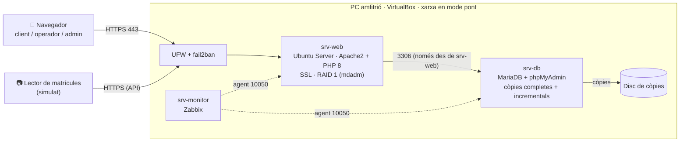
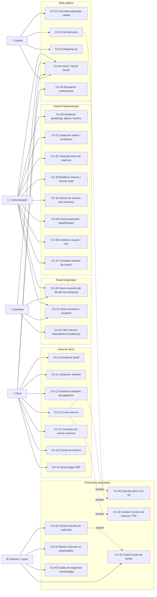
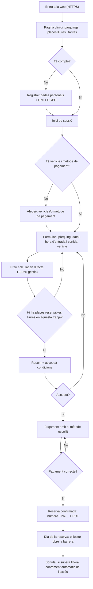
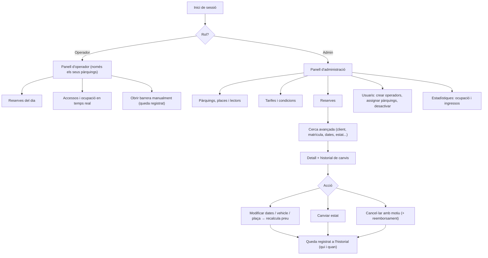
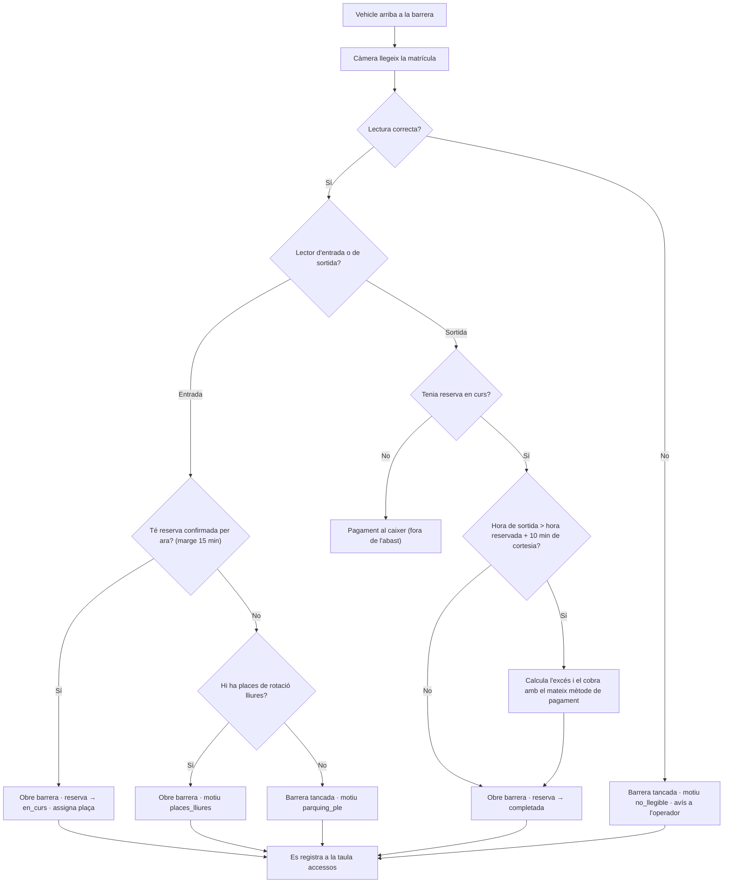
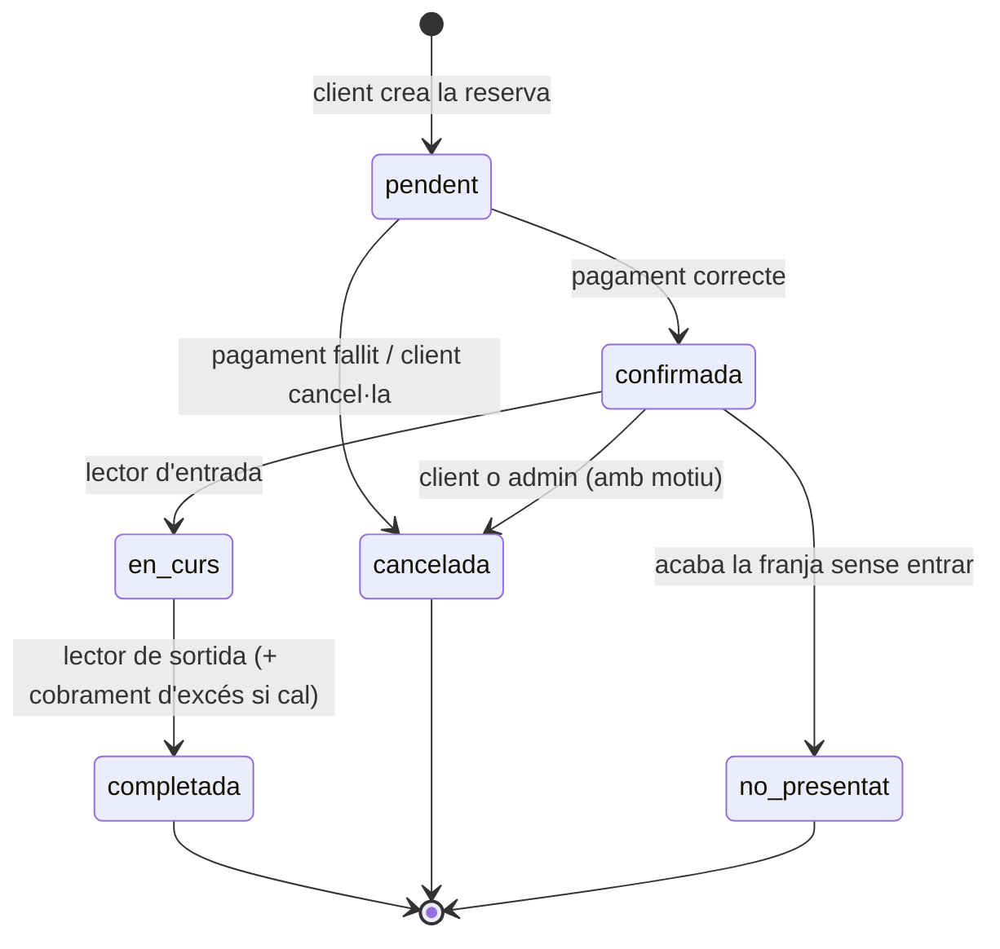
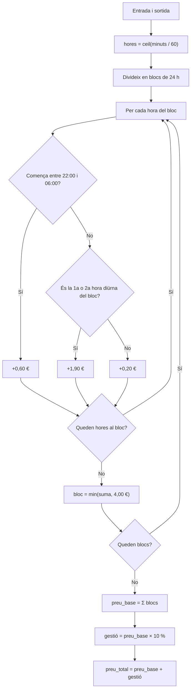

# Sprint 1 — Esquema funcional de l'aplicatiu (v2)

## Sistema de Reserves de Places de Pàrquing · Tarraco Parkings (Tarragona)

**Equip:** Carlos · Sara · Joel
**Stack:** GNU/Linux (Ubuntu Server) · Apache2 · PHP 8 · MariaDB · phpMyAdmin · Zabbix
**Fase:** Sprint 1 · Anàlisi i disseny (revisió v2)

---

## 1. Objectiu de l'aplicació

Tarraco Parkings gestiona els pàrquings municipals de Tarragona i vol un sistema en línia per:

1. Que els **clients** reservin una plaça (pàrquing, data, hora d'entrada i sortida) amb el **preu calculat automàticament** (+10 % de despeses de gestió), acceptant les condicions i pagant amb un mitjà desat al seu perfil.
2. Que el **lector de matrícules** obri la barrera automàticament si la matrícula té una reserva activa (o si hi ha places lliures) i **cobri l'excés de temps** amb el mateix mitjà de pagament.
3. Que els **administradors** donin d'alta pàrquings i places, i vegin, cerquin i modifiquin totes les reserves (**mai esborrar-les**, només cancel·lar-les).
4. Que les dades estiguin **protegides** (HTTPS, contrasenyes xifrades, dades sensibles xifrades, còpies de seguretat, monitoratge).

---

## 2. Parts de l'aplicació

| Part | Qui la fa servir | Què conté |
|---|---|---|
| **Web pública** | Visitant | Pàgina d'inici amb els pàrquings (mapa, adreça, places disponibles, tarifes), simulador de preu, registre i inici de sessió. |
| **Àrea de client** | Client | Perfil (dades personals), vehicles, mètodes de pagament, formulari de reserva, les meves reserves, cancel·lació i PDF. |
| **Panell d'operador** | Operador de pàrquing | Reserves del dia i accessos (entrades/sortides) **dels seus pàrquings**, ocupació en temps real. Només consulta i incidències. |
| **Panell d'administració** | Administrador | Pàrquings, places, lectors, tarifes, condicions, totes les reserves (modificar / canviar estat / cancel·lar), cerca avançada, historial de canvis, usuaris i rols. |
| **Servei del lector** | Sistema (lector de matrícules) | Endpoint PHP que rep la matrícula llegida per la càmera, decideix si s'obre la barrera i registra l'accés. Al projecte es simula amb una pantalla. |
| **Processos automàtics** | Sistema | Càlcul de preus, número de reserva, PDF, cobrament d'excés, marcar reserves *no presentat*, còpies de seguretat, monitoratge. |

---

## 3. Arquitectura del sistema



| VM | Serveis | RAM | Disc |
|---|---|---|---|
| `srv-web` | Apache2, PHP 8, certificat SSL, UFW, fail2ban | 2 GB | 2 × 20 GB en **RAID 1** |
| `srv-db` | MariaDB, phpMyAdmin (només accessible des de la xarxa interna), `mariabackup` + `cron` | 2 GB | 20 GB + 20 GB per a còpies |
| `srv-monitor` | Zabbix server + web (alertes si cau un servei o el disc s'omple) | 2 GB | 15 GB |
| `srv-web2` + HAProxy *(opcional)* | Redundància i balanceig de càrrega | 1–2 GB | 15 GB |

Les VM es fan amb **VirtualBox** a l'ordinador de l'equip (16 GB de RAM: 6–8 GB per a les VM). Es comparteixen entre els membres exportant-les en `.ova`, i el codi és al repositori de GitHub.

---

## 4. Actors

| Actor | Descripció |
|---|---|
| **Visitant** | No ha iniciat sessió. Pot consultar els pàrquings i les tarifes, simular un preu i registrar-se. |
| **Client** | Usuari registrat. Ha de registrar-se per poder reservar (requisit de l'enunciat). Gestiona perfil, vehicles, mètodes de pagament i reserves. |
| **Operador** | Treballador d'un pàrquing. Consulta reserves, accessos i ocupació dels pàrquings que té assignats. |
| **Administrador** | Gestió completa del sistema. Hereta tot el que pot fer l'operador, per a tots els pàrquings. |
| **Sistema** | Lector de matrícules, càlcul de preus, generació de documents, cobraments i tasques programades. |

---

## 5. Casos d'ús

### 5.1 Diagrama de casos d'ús



### 5.2 Web pública i client

| ID | Cas d'ús | Actor | Precondició | Flux principal | Resultat |
|---|---|---|---|---|---|
| CU-01 | Consultar pàrquings i tarifes | Visitant, Client | — | Llista / mapa amb adreça, horari, places reservables lliures i tarifes. | Informació mostrada |
| CU-02 | Simular preu | Visitant, Client | — | Tria pàrquing i franja → el sistema calcula el preu (CU-40). | Preu orientatiu |
| CU-03 | Registrar-se | Visitant | — | Nom, cognoms, DNI, telèfon, email, contrasenya (mín. 8 caràcters), accepta la política de privacitat (RGPD). | Compte de client creat (DNI xifrat, contrasenya amb bcrypt) |
| CU-04 | Iniciar / tancar sessió | Tots | Compte actiu | Email + contrasenya. Després de 5 intents fallits, bloqueig de 15 min. Redirecció segons el rol. | Sessió iniciada |
| CU-05 | Recuperar contrasenya | Client | Registrat | Envia un enllaç amb un *token* que caduca en 1 h. | Contrasenya nova |
| CU-10 | Gestionar perfil | Client | Sessió | Consultar i modificar les dades personals i la contrasenya. | Dades actualitzades |
| CU-11 | Gestionar vehicles | Client | Sessió | Alta (marca, model, matrícula, color, tipus, elèctric), edició i baixa lògica. | Vehicle desat |
| CU-12 | Gestionar mètodes de pagament | Client | Sessió | Afegir targeta / PayPal / Bizum (només es desa el *token* i els 4 últims dígits), marcar-ne un per defecte, donar-ne de baixa. | Mètode desat |
| CU-13 | Crear reserva | Client | Sessió + ≥1 vehicle + ≥1 mètode de pagament | Veure §6.1 | Reserva `confirmada` + número + PDF |
| CU-14 | Consultar les meves reserves | Client | Sessió | Llista amb filtre per estat; detall amb pagaments i accessos. | Historial |
| CU-15 | Cancel·lar reserva | Client | Reserva `pendent` / `confirmada` i abans de l'hora d'entrada | Indica el motiu → estat `cancelada`. | Reserva cancel·lada (no s'esborra) |
| CU-16 | Descarregar PDF | Client | Reserva confirmada | PDF amb número de reserva, pàrquing, dates, matrícula, preu i codi QR. | PDF descarregat |

### 5.3 Operador i administrador

| ID | Cas d'ús | Actor | Descripció |
|---|---|---|---|
| CU-20 | Reserves del dia | Operador, Admin | Llista de reserves d'avui dels pàrquings assignats (l'admin, de tots). |
| CU-21 | Accessos i ocupació | Operador, Admin | Entrades / sortides en temps real, places ocupades, accessos denegats. |
| CU-22 | Obrir barrera manualment | Operador | Si el lector no llegeix la matrícula: obre la barrera i queda registrat a `accessos`. |
| CU-30 | Pàrquings, places i lectors | Admin | Alta / edició / desactivació de pàrquings; alta de places (codi, planta, tipus, reservable, fora de servei); lectors d'entrada i sortida. |
| CU-31 | Tarifes i condicions | Admin | Canviar preus (es crea una tarifa nova amb data de vigència) i publicar una versió nova de les condicions. |
| CU-32 | Consultar reserves | Admin | Totes les reserves amb paginació. |
| CU-33 | Modificar reserva | Admin | Canviar dates, vehicle, plaça o estat. Es recalcula el preu i queda a l'historial (qui i quan). |
| CU-34 | Cancel·lar reserva | Admin | Estat `cancelada` + motiu obligatori + reemborsament opcional. **Les reserves no es poden eliminar** (ho impedeix també la BD). |
| CU-35 | Cerca avançada | Admin | Filtres combinats: número, client, email, matrícula, pàrquing, estat, interval de dates, import. Estadístiques (ocupació, ingressos per pàrquing). |
| CU-36 | Usuaris i rols | Admin | Crear operadors, assignar-los pàrquings, desactivar comptes. |
| CU-37 | Historial de canvis | Admin | Veure tots els canvis d'una reserva (taula `reserves_historial`). |

### 5.4 Processos automàtics

| ID | Procés | Descripció |
|---|---|---|
| CU-40 | Calcular preu | Algorisme de §7. El JavaScript el mostra en directe; **el PHP el torna a calcular** en desar (no ens fiem del navegador). |
| CU-41 | Número de reserva i PDF | Format `TPK-AAAAMMDD-NNNNNN`. PDF amb FPDF. |
| CU-42 | Control d'accés | Veure §6.3. |
| CU-43 | Cobrar excés | Veure §7.4. Es cobra amb el **mateix mètode de pagament** de la reserva. |
| CU-44 | No presentat | Tasca `cron`: les reserves `confirmada` sense entrada quan acaba la franja passen a `no_presentat`. |
| CU-45 | Còpies i monitoratge | Còpia completa setmanal + incremental diària; Zabbix avisa si cau Apache, MariaDB o el disc s'omple. |

---

## 6. Funcionament pas a pas

### 6.1 Flux del client (reserva)



**Passos que segueix l'usuari:**
1. Entra a la web i veu els pàrquings, les places disponibles i les tarifes (pot simular un preu sense compte).
2. Es **registra** amb les seves dades personals (és obligatori per reservar).
3. **Inicia sessió.**
4. Afegeix un **vehicle** (marca, model, matrícula…) i un **mètode de pagament**.
5. Omple el **formulari de reserva**: pàrquing, data, hora d'entrada i de sortida i vehicle.
6. Veu el **preu calculat automàticament** amb el 10 % de despeses de gestió.
7. **Accepta les condicions** i **paga**.
8. Rep el **número de reserva** i descarrega el **PDF**.
9. El dia de la reserva arriba al pàrquing: la càmera llegeix la matrícula i la **barrera s'obre sola**.
10. En sortir, si s'ha passat de l'hora, se li **cobra la diferència** amb el mateix mètode de pagament.
11. Pot consultar o **cancel·lar** les seves reserves des de *Les meves reserves*.

### 6.2 Flux de l'administrador i l'operador



### 6.3 Flux del lector de matrícules (control d'accés)



### 6.4 Estats d'una reserva



| Estat | Significat |
|---|---|
| `pendent` | Creada, falta el pagament. |
| `confirmada` | Pagada. És la que el lector accepta. |
| `en_curs` | El vehicle és dins del pàrquing. |
| `completada` | El vehicle ha sortit. |
| `cancelada` | Cancel·lada pel client o l'admin. **No s'elimina mai.** |
| `no_presentat` | No ha entrat dins la franja reservada. |

Els estats finals (`completada`, `cancelada`, `no_presentat`) no poden canviar: ho garanteix un *trigger* de la base de dades.

---

## 7. Càlcul del preu

### 7.1 Tarifes (enunciat)

| Concepte | Preu |
|---|---|
| 1a i 2a hora d'aparcament | 1,90 € / hora |
| 3a hora d'aparcament (i següents) | 0,20 € / hora |
| Preu màxim diari | 4,00 € |
| Tarifa nocturna (22:00 – 06:00) | 0,60 € / hora |
| **Despeses de gestió** | **+10 %** sobre el preu |

Els preus són a la taula `tarifes` i el 10 % a `configuracio`: l'administrador els pot canviar sense tocar el codi.

### 7.2 Algorisme

1. **Hores iniciades:** `hores = ceil(minuts_totals / 60)`. Cada hora començada es paga sencera.
2. L'estada es divideix en **blocs de 24 h** comptats des de l'hora d'entrada (així funcionen les reserves de diversos dies).
3. Dins de cada bloc, per a cada hora (segons l'hora en què **comença**):
   - Si comença entre les **22:00 i les 06:00** → **0,60 €** (nocturna).
   - Si no, és una hora diürna: la **1a i la 2a** hora diürna del bloc → **1,90 €**; de la **3a** en endavant → **0,20 €**.
4. El total de cada bloc té un **màxim de 4,00 €**.
5. `preu_base = suma dels blocs`
6. `despeses_gestio = arrodonir(preu_base × 10 %, 2 decimals)`
7. `preu_total = preu_base + despeses_gestio`



### 7.3 Exemples

| # | Franja | Càlcul | Base | +10 % | **Total** |
|---|---|---|---|---|---|
| 1 | 09:00 → 10:00 | 1,90 | 1,90 | 0,19 | **2,09 €** |
| 2 | 16:00 → 18:00 | 1,90 + 1,90 | 3,80 | 0,38 | **4,18 €** |
| 3 | 08:00 → 11:00 | 1,90 + 1,90 + 0,20 | 4,00 | 0,40 | **4,40 €** |
| 4 | 09:00 → 14:00 | 1,90 + 1,90 + 0,20 × 3 = 4,40 → màxim | 4,00 | 0,40 | **4,40 €** |
| 5 | 22:30 → 00:30 (passa de dia) | 0,60 + 0,60 | 1,20 | 0,12 | **1,32 €** |
| 6 | 20:00 → 23:30 | 1,90 + 1,90 + 0,60 + 0,60 = 5,00 → màxim | 4,00 | 0,40 | **4,40 €** |
| 7 | Dl 10:00 → Dc 10:00 (48 h) | 2 blocs × 4,00 | 8,00 | 0,80 | **8,80 €** |

### 7.4 Cobrament de l'excés de temps

Quan el vehicle surt **més de 10 minuts** (cortesia configurable) després de l'hora reservada:

```
excés_base  = preu(entrada_reservada → sortida_real) − preu_base_reservat
excés_total = excés_base + 10 %
```

**Exemple:** reserva 09:00 → 10:00 (2,09 €). Surt a les 11:20.
Preu 09:00 → 11:20 = 3 hores = 1,90 + 1,90 + 0,20 = 4,00 €.
Excés = 4,00 − 1,90 = 2,10 € + 0,21 € = **2,31 €**, cobrats amb la mateixa targeta (pagament de tipus `exces`).
Si el preu ja havia arribat al màxim diari, l'excés pot ser 0 €.

---

## 8. Regles de negoci

1. Cal estar **registrat i amb sessió iniciada** per reservar.
2. La reserva necessita un **vehicle** i un **mètode de pagament** del mateix client.
3. No es pot reservar **en el passat** ni amb sortida ≤ entrada.
4. No es poden superar les **places reservables** del pàrquing a la franja escollida.
5. Un vehicle no pot tenir **dues reserves solapades**.
6. Les reserves **mai s'eliminen**: només es cancel·len, amb motiu.
7. Tota modificació d'una reserva queda a l'**historial** (qui, quan, què).
8. El preu es calcula **al servidor** (PHP); el del navegador és només informatiu.
9. L'excés es cobra amb el **mateix mètode de pagament** de la reserva.
10. L'operador només veu els **pàrquings que té assignats**.

---

## 9. Seguretat (resum)

| Àmbit | Mesura |
|---|---|
| Comunicacions | HTTPS (certificat SSL) i redirecció de HTTP a HTTPS |
| Contrasenyes | `password_hash()` (bcrypt); bloqueig després de 5 intents |
| Dades sensibles | DNI xifrat (AES) + hash; targetes tokenitzades (només 4 dígits) |
| Aplicació | Sentències preparades PDO (SQL injection), `htmlspecialchars` (XSS), *token* CSRF als formularis, sessions amb `HttpOnly` i `Secure` |
| Permisos | Control d'accés per rol a cada pàgina; usuari MySQL de la web sense `DELETE` |
| Servidor | UFW (només 22, 80, 443), fail2ban, SSH amb claus, MariaDB només accessible des de `srv-web` |
| Disponibilitat | RAID 1, còpies completes i incrementals, monitoratge Zabbix, balanceig opcional |

---

## 10. Documents relacionats

- `02-modelo-er.md` — Model E/R v2.
- `03-modelo-er.sql` — Script de la base de dades.
- `04-planificacion.md` — Planificació, rols i Gantt.
- `05-presentacion.md` — Guió de la presentació.
- `06-diagramas.html` — Diagrames per a la presentació.
