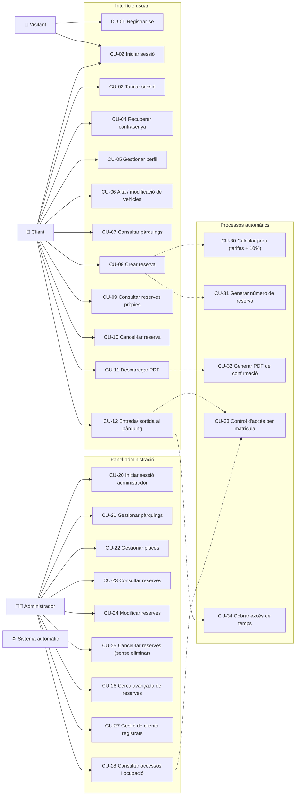
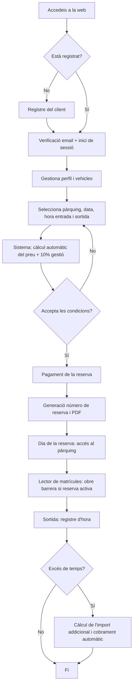
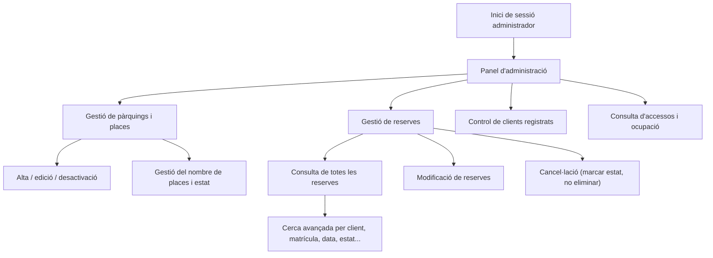
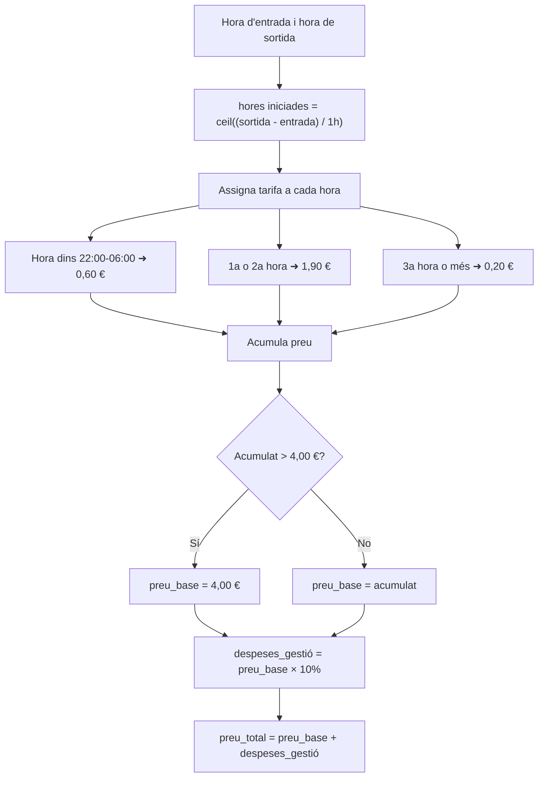

# Sprint 1 — Esquema funcional

## Sistema de Reserves de Places de Pàrquing · Tarraco Parkings (Tarragona)

**Projecte:** Sistema de Reserves de Places de Pàrquing per a la ciutat de Tarragona
**Empresa:** Tarraco Parkings
**Stack:** PHP + MariaDB/MySQL + Apache2 (servidor GNU/Linux)
**Fase:** Sprint 1 · Anàlisi i disseny

---

## 1. Objectiu de l'aplicació

Desenvolupar un sistema en línia que permeti als usuaris reservar una plaça de pàrquing
de qualsevol pàrquing municipal de Tarragona, gestionar el seu perfil i vehicles, pagar la
reserva, i desplaçar-se al pàrquing on el lector de matrícules controlarà l'entrada i la
sortida automàticament.

L'aplicació tindrà **dues interfícies**:

- **Front-web d'usuaris finals:** reserva, perfil, vehicles, consulta de reserves i PDF.
- **Panel d'administració:** gestió de pàrquings, places, reserves, clients i consultes avançades.

L'obertura de barreres es fa mitjançant un procés automàtic que detecta la **matrícula**
(no cal que l'usuari faci cap acció a l'app el dia de la reserva).

---

## 2. Actors del sistema

| Actor | Descripció |
|---|---|
| **Visitant** | Persona que accedeix a la web sense haver iniciat sessió. Pot veure informació dels pàrquings i registrar-se. |
| **Client** | Usuari registrat i autenticat. Pots fer reserves, gestionar el seu perfil i vehicles, consultar reserves i descarregar el PDF. |
| **Administrador** | Usuari amb rol d'administrador. Gestiona pàrquings, places, reserves, clients i consultes avançades. |
| **Sistema automàtic** | Processos automàtics: càlcul de preus, generació de número de reserva, generació del PDF, lector de matrícules (barreres), cobrament addicional per excés de temps i còpies de seguretat. |

---

## 3. Casos d'ús

### 3.1 Diagrama de casos d'ús

### 3.2 Descripció dels casos d'ús (part d'usuari)

| ID | Cas d'ús | Descripció | Requisit previ | Resultat |
|---|---|---|---|---|
| CU-01 | **Registrar-se** | El visitant crea un compte amb nom, cognoms, email, telèfon i contrasenya. | Cap | Compte creat i verificat per email. |
| CU-02 | **Iniciar sessió** | El client autentica amb email + contrasenya. | Estar registrat | Sessió iniciada. |
| CU-03 | **Tancar sessió** | El client finalitza la sessió. | Sessió iniciada | Sessió tancada. |
| CU-04 | **Recuperar contrasenya** | El client sol·licita restablir la contrasenya per email. | Estar registrat | Email de recuperació enviat. |
| CU-05 | **Gestionar perfil** | Consultar i modificar nom, cognoms, email i telèfon. | Sessió iniciada | Dades actualitzades. |
| CU-06 | **Alta / modificació de vehicles** | Afegir, editar o eliminar vehicles (marca, model, matrícula). | Sessió iniciada | Vehicle desat / actualitzat. |
| CU-07 | **Consultar pàrquings** | Veure llista de pàrquings, ubicació i places disponibles. | Cap (públic) | Llista de pàrquings. |
| CU-08 | **Crear reserva** | Seleccionar pàrquing, data, hora d'entrada i sortida, vehicle i acceptar condicions. El sistema calcula el preu automàticament. | Sessió iniciada + vehicle donat d'alta | Reserva creada, número de reserva generat i pagament processat. |
| CU-09 | **Consultar reserves pròpies** | Veure llista i detall de les seves reserves. | Sessió iniciada | Historial de reserves. |
| CU-10 | **Cancel·lar reserva** | Marcar una reserva com a cancel·lada (no s'elimina). | Sessió iniciada + reserva activa | Reserva amb estat «cancel·lada». |
| CU-11 | **Descarregar PDF** | Descarregar el PDF de confirmació d'una reserva. | Sessió iniciada + reserva confirmada | PDF generat. |
| CU-12 | **Entrada / sortida al pàrquing** | El client arriba amb el vehicle; el lector de matrícules detecta la placa, comprova la reserva i obre la barrera. | Reserva confirmada i dins del període | Barrera oberta i accés registrat. |

### 3.3 Descripció dels casos d'ús (part d'administració)

| ID | Cas d'ús | Descripció | Requisit previ | Resultat |
|---|---|---|---|---|
| CU-20 | **Iniciar sessió administrador** | Autenticació de l'administrador al panel. | Usuari amb rol admin | Sessió admin iniciada. |
| CU-21 | **Gestionar pàrquings** | Donar d'alta, editar o desactivar pàrquings (nom, ubicació, nombre de places). | Rol admin | Pàrquing creat / modificat. |
| CU-22 | **Gestionar places** | Crear i editar places reservables (codi, tipus, estat) i el nombre de places disponibles. | Rol admin | Places actualitzades. |
| CU-23 | **Consultar reserves** | Veure totes les reserves del sistema. | Rol admin | Llistat de reserves. |
| CU-24 | **Modificar reserves** | Canviar dades o estat de qualsevol reserva. | Rol admin | Reserva modificada. |
| CU-25 | **Cancel·lar reserves** | Marcar reserves com a cancel·lades. **No es poden eliminar.** | Rol admin | Reserva amb estat «cancel·lada». |
| CU-26 | **Cerca avançada de reserves** | Filtrar per client, matrícula, pàrquing, data, estat, etc. | Rol admin | Resultats filtrats. |
| CU-27 | **Gestió de clients** | Veure clients registrats, el seu estat i desactivar-los si cal. | Rol admin | Client gestionat. |
| CU-28 | **Consultar accessos i ocupació** | Veure entrades/sortides registrades i ocupació en temps real. | Rol admin | Informe d'accessos i ocupació. |

### 3.4 Processos automàtics (Sistema)

| ID | Procés | Descripció |
|---|---|---|
| CU-30 | **Calcular preu** | Aplica les tarifes (1ª-2ª hora 1,90 €; 3ª hora 0,20 €; màxim diari 4,00 €; nocturna 0,60 €) i suma un 10% de despeses de gestió. |
| CU-31 | **Generar número de reserva** | Crea un identificador únic (ex. `TPK-20261015-000123`). |
| CU-32 | **Generar PDF** | Genera el PDF de confirmació amb les dades de la reserva. |
| CU-33 | **Control d'accés** | El lector de matrícules detecta entrada/sortida, verifica les reserves actives i obre la barrera. |
| CU-34 | **Cobrar excés de temps** | Si el vehicle excedeix el temps reservat, calcula l'import addicional i cobra amb el mateix mètode de pagament. |

---

## 4. Funcionament de l'aplicació des del punt de vista de l'usuaris

El recorregut típic d'un client és:

1. L'usuari accedeix a la web i veu la **pàgina inicial** amb informació dels pàrquings de Tarragona i el formulari de reserva.
2. Si no té compte, es **registra** (nom, cognoms, email, telèfon, contrasenya). El sistema verifica l'email.
3. L'usuari **inicia sessió**.
4. Dona d'alta el seu **vehicle** (marca, model, matrícula).
5. Selecciona el **pàrquing**, la **data**, l'**hora d'entrada** i l'**hora de sortida**. El sistema **calcula el preu automàticament** aplicant les tarifes i el 10% de despeses de gestió.
6. L'usuari **accepta les condicions** i procedeix al **pagament**.
7. El sistema genera el **número de reserva** i el **PDF de confirmació** que l'usuari pot descarregar.
8. El dia de la reserva, el vehicle arriba al pàrquing. El **lector de matrícules** detecta la placa, comprova que té una **reserva activa** i obre la barrera automàticament.
9. A la sortida, el lector registra l'hora. Si el vehicle es queda **més temps** del reservat, es **calcula l'import addicional** i es **cobra automàticament** amb el mateix mètode de pagament.

Des del punt de vista de l'**administrador**:

1. L'administrador inicia sessió al panel.
2. Gestiona els **pàrquings** (alta, edició, places totals i places reservables) i les **places**.
3. Consulta, modifica o **cancel·la reserves** (mai les elimina).
4. Controla els **usuaris registrats**.
5. Fa **cerques avançades** de reserves i consulta els **accessos** registrats pel lector de matrícules.

---

## 5. Fluxe de la part d'usuari i de la part d'administració

### 5.1 Flux del procés de reserva (usuari)

### 5.2 Flux de la part d'administració

---

## 6. Procés complet de reserva i càlcul de tarifes

### 6.1 Tarifes (Taula de preus)

| Concepte | Preu (€) |
|---|---|
| 1a i 2a hora d'aparcament | 1,90 €/h |
| 3a hora d'aparcament | 0,20 €/h |
| Preu màxim diari | 4,00 € |
| Tarifa nocturna (22:00 – 06:00) | 0,60 €/h |

**Despeses de gestió:** 10% sobre el preu base (s'aplica sempre).

### 6.2 Algorisme de càlcul del preu

1. Es calculen les **hores iniciades**: `hores = ceil((hora_sortida - hora_entrada) / 1 hora)`.
2. Per a cada hora del període s'assigna una tarifa segons el rang horari:
   - Hora dins de **22:00 – 06:00** → **0,60 €** (nocturna).
   - **1a i 2a hora** → **1,90 €** cadascuna.
   - **A partir de la 3a hora** → **0,20 €** cadascuna.
3. S'acumula el preu i s'aplica el **màxim diari de 4,00 €** (el preu no pot superar els 4,00 € per dia).
4. `preu_base = min(acumulat, 4,00 €)`.
5. `despeses_gestió = preu_base × 10%`.
6. `preu_total = preu_base + despeses_gestió`.

### 6.3 Exemples de càlcul

**Exemple 1 — Reserva diürna de 3 hores:**
Entrada 08:00, sortida 11:00 → 3 hores iniciades.
1a hora = 1,90 · 2a hora = 1,90 · 3a hora = 0,20 → acumulat = **4,00 €**.
Màxim diari: 4,00 € (no s'hi aplica topall perquè ja ho és).
Despeses de gestió (10%) = 0,40 €.
**Total final = 4,40 €.**

**Exemple 2 — Reserva de 1 hora diürna:**
Entrada 09:00, sortida 10:00 → 1 hora = 1,90 €.
Gestió 10% = 0,19 €.
**Total final = 2,09 €.**

**Exemple 3 — Reserva nocturna de 2 hores:**
Entrada 22:30, sortida 00:30 → 2 hores nocturnes × 0,60 = 1,20 €.
Gestió 10% = 0,12 €.
**Total final = 1,32 €.**

**Exemple 4 — Excés de temps:**
El vehicle tenia reserva fins a les 11:00 i surt a les 11:45 (1 hora iniciada de més).
Hora addicional aplicable = 1,90 € (o nocturna si fos de nit).
S'afegeix al preu i es **cobra automàticament amb el mateix mètode de pagament**.

### 6.4 Estats d'una reserva

Una reserva passa pels següents estats:

| Estat | Significat |
|---|---|
| `pendent` | Creada, esperant el pagament. |
| `confirmada` | Pagada; reserva vàlida i amb barrera oberta per accés. |
| `cancel·lada` | Marcada com a cancel·lada. **La reserva mai s'elimina** (auditoria i històric). |
| `completada` | La reserva ha finalitzat (sortida registrada). |

**Regles de negoci:**
- Una matrícula necessita una **reserva activa** (`confirmada`) dins del període perquè la barrera s'obri.
- Les reserves no es poden eliminar: només canvien d'estat (`cancel·lada`).
- El càlcul de preu i el 10% de gestió són **automàtics**.

---

## 7. Documents relacionats

- `02-modelo-er.md` — Model Entitat-Relació de la base de dades.
- `03-modelo-er.sql` — Script DDL de creació de la base de dades (MySQL/MariaDB).
- `04-planificacion.md` — Planificació del projecte (tasques, rols, Gantt).
- `05-presentacion.md` — Document de presentació per a l'exposició oral.
- `06-diagramas.html` — Diagrames renderitzats (Mermaid) per exportar a imatge/PDF.