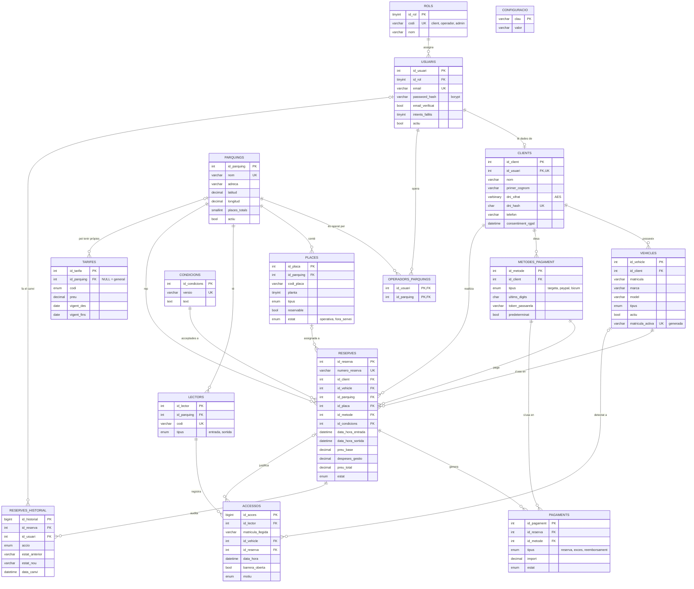

# Sprint 1 — Model Entitat-Relació (E/R) de la base de dades (v2)

## Sistema de Reserves de Places de Pàrquing · Tarraco Parkings (Tarragona)

**SGBD:** MariaDB ≥ 10.5 / MySQL ≥ 8.0.16 · **Motor:** InnoDB (transaccions i claus foranes) · **Joc de caràcters:** `utf8mb4`
**Script:** [`03-modelo-er.sql`](03-modelo-er.sql) (crea la BD, triggers, vistes i dades de demostració)

---

## 1. Visió general

La base de dades s'organitza en **4 blocs** i **16 taules**:

| Bloc | Taules | Per a què serveix |
|---|---|---|
| **1. Usuaris i clients** | `rols`, `usuaris`, `clients`, `vehicles`, `metodes_pagament` | Registre, inici de sessió, rols (client / operador / admin), dades personals protegides, vehicles i mitjans de pagament del client. |
| **2. Pàrquings** | `parquings`, `operadors_parquings`, `places`, `lectors`, `tarifes`, `configuracio`, `condicions` | Pàrquings amb les seves places reservables, lectors de matrícules, tarifes editables, paràmetres i condicions d'ús. |
| **3. Reserves i control** | `reserves`, `reserves_historial`, `pagaments`, `accessos` | Reserves (mai s'esborren), auditoria de canvis, pagaments (reserva + excés + reemborsament) i registre d'entrades/sortides. |
| **4. Lògica a la BD** | 7 triggers + 3 vistes | Regles de negoci que la BD garanteix encara que falli el codi PHP. |

---

## 2. Diagrama E/R

> Versió visual del diagrama (per a la presentació): [`06-diagramas.html`](06-diagramas.html).

---

## 3. Descripció de les taules

### Bloc 1 · Usuaris, rols i clients

#### `rols`
Catàleg de rols. És una taula (i no un ENUM) perquè en el futur es puguin afegir rols nous (p. ex. *comptable*) sense modificar l'estructura.

| Camp | Tipus | Restriccions | Descripció |
|---|---|---|---|
| `id_rol` | TINYINT UNSIGNED | **PK** | |
| `codi` | VARCHAR(20) | **UNIQUE** | `client`, `operador`, `admin` |
| `nom`, `descripcio` | VARCHAR | | Text per a la interfície |

#### `usuaris`
Credencials d'accés **comunes a tots els rols**. Separar-les de les dades personals permet que un administrador o operador no hagi de tenir DNI, vehicles, etc.

| Camp | Tipus | Restriccions | Descripció |
|---|---|---|---|
| `id_usuari` | INT UNSIGNED | **PK** | |
| `id_rol` | TINYINT | **FK → rols** | Rol de l'usuari |
| `email` | VARCHAR(120) | **UNIQUE**, CHECK format | Usuari d'accés |
| `password_hash` | VARCHAR(255) | NOT NULL | Hash **bcrypt** (`password_hash()` de PHP). Mai la contrasenya en clar |
| `email_verificat`, `token_verificacio`, `token_caducitat` | | | Verificació d'email i recuperació de contrasenya |
| `intents_fallits`, `bloquejat_fins` | | | Bloqueig temporal contra atacs de força bruta |
| `actiu` | BOOLEAN | DEFAULT 1 | Baixa lògica (els usuaris no s'esborren) |
| `ultim_acces`, `creat_a`, `actualitzat_a` | DATETIME | | Traçabilitat |

#### `clients`
Dades personals dels usuaris amb rol `client` (relació **1:1** amb `usuaris`).

| Camp | Tipus | Restriccions | Descripció |
|---|---|---|---|
| `id_client` | INT UNSIGNED | **PK** | |
| `id_usuari` | INT UNSIGNED | **FK → usuaris**, **UNIQUE** | Garanteix l'1:1 |
| `nom`, `primer_cognom`, `segon_cognom` | VARCHAR(50) | | |
| `dni_xifrat` | VARBINARY(255) | NOT NULL | **DNI xifrat amb AES**. La clau és al fitxer de configuració de la web, no a la BD |
| `dni_hash` | CHAR(64) | **UNIQUE** | SHA-256 (clau + DNI): permet saber si el DNI ja existeix sense desxifrar-lo |
| `telefon`, `data_naixement`, `adreca`, `codi_postal`, `poblacio` | | CHECK CP 5 dígits | Dades de contacte |
| `consentiment_rgpd` | DATETIME | NOT NULL | Quan va acceptar la política de privacitat (RGPD) |

#### `vehicles`
| Camp | Tipus | Restriccions | Descripció |
|---|---|---|---|
| `id_vehicle` | INT UNSIGNED | **PK** | |
| `id_client` | INT UNSIGNED | **FK → clients** | Propietari |
| `matricula` | VARCHAR(10) | CHECK `^[A-Z0-9]{4,10}$` | Normalitzada (sense espais ni guions) per al lector |
| `marca`, `model`, `color` | VARCHAR | | |
| `tipus` | ENUM | `turisme`, `moto`, `furgoneta` | |
| `es_electric` | BOOLEAN | | Per assignar places amb carregador |
| `actiu` | BOOLEAN | | Baixa lògica: el vehicle no s'esborra perquè té reserves antigues |
| `matricula_activa` | VARCHAR(10) | **UNIQUE**, columna generada | = `matricula` si està actiu, `NULL` si no. Així **només hi pot haver un vehicle actiu per matrícula**, però si es ven el cotxe, el nou propietari el pot registrar |

#### `metodes_pagament`
L'enunciat demana que l'usuari tingui **mètodes de pagament**. Per seguretat (normativa **PCI-DSS**) **mai es guarda el número complet de la targeta ni el CVV**: només el *token* que retorna la passarel·la de pagament i els 4 últims dígits per mostrar-los.

| Camp | Tipus | Restriccions | Descripció |
|---|---|---|---|
| `id_metode` | INT UNSIGNED | **PK** | |
| `id_client` | INT UNSIGNED | **FK → clients** | |
| `tipus` | ENUM | `targeta`, `paypal`, `bizum` | |
| `titular`, `marca_targeta`, `ultims_digits`, `caducitat_mes`, `caducitat_any` | | CHECKs | Dades visibles de la targeta |
| `email_compte` / `telefon_compte` | | | PayPal / Bizum |
| `token_passarela` | VARCHAR(255) | NOT NULL | Referència opaca per cobrar |
| `predeterminat`, `actiu` | BOOLEAN | | |

### Bloc 2 · Pàrquings

#### `parquings`
| Camp | Tipus | Restriccions | Descripció |
|---|---|---|---|
| `id_parquing` | INT UNSIGNED | **PK** | |
| `nom` | VARCHAR(80) | **UNIQUE** | |
| `adreca`, `codi_postal`, `poblacio` | | | |
| `latitud`, `longitud` | DECIMAL(9,6) | | Per mostrar-lo al mapa de la web |
| `obert_24h`, `hora_obertura`, `hora_tancament` | | CHECK coherència | Horari |
| `places_totals` | SMALLINT | CHECK > 0 | Places físiques totals (reservables + rotació) |
| `actiu` | BOOLEAN | | Desactivar sense esborrar |

> Les **places reservables** ja no es guarden com un número (a la v1 `places_reservables` podia no coincidir amb les places reals): es **calculen** comptant les files de `places` amb `reservable = 1` (vista `v_disponibilitat_parquings`).

#### `operadors_parquings` (relació N:M)
Un operador pot gestionar diversos pàrquings i un pàrquing pot tenir diversos operadors. PK composta `(id_usuari, id_parquing)`.

#### `places`
| Camp | Tipus | Restriccions | Descripció |
|---|---|---|---|
| `id_placa` | INT UNSIGNED | **PK** | |
| `id_parquing` | INT UNSIGNED | **FK → parquings** | |
| `codi_placa` | VARCHAR(20) | **UNIQUE (id_parquing, codi_placa)** | Ex. `P1-A01` |
| `planta` | TINYINT | | -1, -2… |
| `tipus` | ENUM | `general`, `mobilitat_reduida`, `electric`, `moto`, `familiar` | |
| `reservable` | BOOLEAN | | L'admin decideix quines places es poden reservar en línia |
| `estat` | ENUM | `operativa`, `fora_servei` | **Estat físic**. L'ocupació per franges horàries es calcula a partir de `reserves` (a la v1 un camp `lliure/reservada/ocupada` no podia representar reserves en hores diferents) |

#### `lectors`
Lectors de matrícules (càmera + barrera). Cada pàrquing té com a mínim un d'**entrada** i un de **sortida**. Guarda el `codi` i l'`adreca_ip` del dispositiu.

#### `tarifes`
| Camp | Tipus | Restriccions | Descripció |
|---|---|---|---|
| `id_tarifa` | INT UNSIGNED | **PK** | |
| `id_parquing` | INT UNSIGNED | **FK → parquings**, NULL | `NULL` = tarifa general. Permet en el futur tarifes pròpies d'un pàrquing |
| `codi` | ENUM | `hora_1_2`, `hora_3_endavant`, `maxim_diari`, `nocturna` | |
| `preu` | DECIMAL(6,2) | CHECK ≥ 0 | |
| `vigent_des`, `vigent_fins` | DATE | CHECK | **Històric de preus**: per canviar un preu es tanca la tarifa antiga i se'n crea una de nova |

#### `configuracio`
Parells clau/valor: `despeses_gestio_pct = 10`, `nit_inici = 22:00`, `nit_fi = 06:00`, marges de cortesia… Es poden canviar des del panell sense tocar codi.

#### `condicions`
Versions de les condicions d'ús. Cada reserva guarda **quina versió** va acceptar el client i **quan** (valor legal).

### Bloc 3 · Reserves, pagaments i accessos

#### `reserves`
| Camp | Tipus | Restriccions | Descripció |
|---|---|---|---|
| `id_reserva` | INT UNSIGNED | **PK** | |
| `numero_reserva` | VARCHAR(20) | **UNIQUE**, CHECK `TPK-AAAAMMDD-NNNNNN` | Número que surt al PDF |
| `id_client` | | **FK → clients** | |
| `id_vehicle` | | **FK composta (id_vehicle, id_client) → vehicles** | La BD garanteix que el vehicle **és del client** |
| `id_parquing` | | **FK → parquings** | |
| `id_placa` | | **FK composta (id_placa, id_parquing) → places**, NULL | La plaça ha de ser **del mateix pàrquing** |
| `id_metode` | | **FK composta (id_metode, id_client) → metodes_pagament** | El mitjà de pagament ha de ser **del client**; es fa servir també per cobrar l'excés |
| `id_condicions` | | **FK → condicions** | Versió acceptada |
| `data_hora_entrada`, `data_hora_sortida` | DATETIME | CHECK sortida > entrada | A la v1 eren `data` + `TIME`, i no es podien fer reserves nocturnes que passen de dia (22:30 → 00:30) |
| `preu_base`, `despeses_gestio`, `preu_total` | DECIMAL(8,2) | CHECK total = base + gestió | **Foto del preu** en el moment de reservar |
| `estat` | ENUM | `pendent`, `confirmada`, `en_curs`, `completada`, `cancelada`, `no_presentat` | Veure diagrama d'estats a l'esquema funcional |
| `condicions_acceptades_a` | DATETIME | NOT NULL | |
| `motiu_cancelacio` | VARCHAR(255) | CHECK obligatori si `cancelada` | |
| `pdf_path`, `creada_a`, `actualitzada_a` | | | |

#### `reserves_historial`
Auditoria **automàtica** (triggers): cada creació, canvi d'estat o modificació de dates/vehicle/plaça queda registrada amb **qui** ho ha fet i **quan**. Compleix el requisit "*accés segur a les dades de les reserves*" i permet saber quin administrador ha modificat una reserva.

#### `pagaments`
Relació **1:N** amb `reserves` (a la v1 era 1:1 i no es podia registrar el cobrament de l'excés de temps):

| `tipus` | Quan es crea |
|---|---|
| `reserva` | En confirmar la reserva |
| `exces` | A la sortida, si el vehicle ha superat l'hora reservada |
| `reemborsament` | Si l'administrador cancel·la i retorna l'import |

#### `accessos`
Cada lectura de matrícula d'un lector: matrícula llegida, vehicle i reserva (si n'hi ha), si s'ha obert la barrera i el **motiu** (`reserva_valida`, `places_lliures`, `sense_reserva`, `parquing_ple`, `fora_horari`, `no_llegible`, `sortida`, `sortida_amb_exces`) i els minuts d'excés.

---

## 4. Relacions i cardinalitats

| Relació | Cardinalitat | Explicació |
|---|---|---|
| `rols` – `usuaris` | 1 : N | Cada usuari té un rol |
| `usuaris` – `clients` | 1 : 0..1 | Només els usuaris amb rol client tenen fitxa de client |
| `usuaris` – `parquings` (via `operadors_parquings`) | **N : M** | Operadors assignats a pàrquings |
| `clients` – `vehicles` | 1 : N | **Un client pot tenir diversos vehicles** (requisit) |
| `clients` – `metodes_pagament` | 1 : N | Un client pot desar diversos mitjans de pagament |
| `clients` – `reserves` | 1 : N | **Un client pot tenir múltiples reserves** (requisit) |
| `vehicles` – `reserves` | 1 : N | **Cada reserva està associada a un vehicle** (requisit) |
| `parquings` – `reserves` | 1 : N | **Cada reserva està associada a un pàrquing** (requisit) |
| `parquings` – `places` | 1 : N | Un pàrquing té moltes places |
| `places` – `reserves` | 0..1 : N | Una reserva pot tenir plaça assignada; una plaça s'usa en moltes reserves (en hores diferents) |
| `parquings` – `lectors` | 1 : N | Lectors d'entrada i sortida |
| `parquings` – `tarifes` | 0..1 : N | Tarifes generals (NULL) o específiques |
| `condicions` – `reserves` | 1 : N | Versió acceptada |
| `reserves` – `pagaments` | 1 : N | Pagament inicial + excessos + reemborsaments |
| `metodes_pagament` – `pagaments` | 1 : N | |
| `reserves` – `reserves_historial` | 1 : N | Auditoria |
| `lectors` – `accessos` | 1 : N | |
| `reserves` / `vehicles` – `accessos` | 0..1 : N | Un accés pot no tenir reserva (vehicle de rotació) |

---

## 5. Claus primàries i foranes

| Taula | PK | FK → referència |
|---|---|---|
| `rols` | `id_rol` | — |
| `usuaris` | `id_usuari` | `id_rol` → `rols` |
| `clients` | `id_client` | `id_usuari` → `usuaris` (UNIQUE ⇒ 1:1) |
| `vehicles` | `id_vehicle` | `id_client` → `clients` |
| `metodes_pagament` | `id_metode` | `id_client` → `clients` |
| `parquings` | `id_parquing` | — |
| `operadors_parquings` | (`id_usuari`, `id_parquing`) | `id_usuari` → `usuaris`; `id_parquing` → `parquings` |
| `places` | `id_placa` | `id_parquing` → `parquings` |
| `lectors` | `id_lector` | `id_parquing` → `parquings` |
| `tarifes` | `id_tarifa` | `id_parquing` → `parquings` (NULL) |
| `configuracio` | `clau` | — |
| `condicions` | `id_condicions` | — |
| `reserves` | `id_reserva` | `id_client` → `clients`; (`id_vehicle`, `id_client`) → `vehicles`; `id_parquing` → `parquings`; (`id_placa`, `id_parquing`) → `places`; (`id_metode`, `id_client`) → `metodes_pagament`; `id_condicions` → `condicions` |
| `reserves_historial` | `id_historial` | `id_reserva` → `reserves`; `id_usuari` → `usuaris` |
| `pagaments` | `id_pagament` | `id_reserva` → `reserves`; `id_metode` → `metodes_pagament` |
| `accessos` | `id_acces` | `id_lector` → `lectors`; `id_vehicle` → `vehicles`; `id_reserva` → `reserves` |

**Política `ON DELETE`:** gairebé tot és `RESTRICT`. Com que les dades importants **no s'esborren mai** (baixa lògica amb `actiu` o estat `cancelada`), no es perd cap històric. Només `operadors_parquings` usa `CASCADE` (és una taula de relació).

---

## 6. Regles de negoci garantides per la base de dades

| Regla (enunciat) | Com la garanteix la BD |
|---|---|
| Les reserves **no es poden eliminar**, només cancel·lar | Trigger `trg_reserves_no_delete` (també a `pagaments`, `accessos` i `reserves_historial`) |
| Una reserva cancel·lada / completada no torna enrere | Trigger `trg_reserves_bu` |
| No sobrepassar les **places reservables** | Trigger `trg_reserves_bi` compta reserves solapades vs. places reservables operatives |
| Un vehicle no pot tenir dues reserves a la mateixa hora | Trigger `trg_reserves_bi` |
| Una plaça no es pot assignar dues vegades a la mateixa franja | Trigger `trg_reserves_bi` |
| El vehicle i el mitjà de pagament són del client | FK compostes |
| Total = base + 10 % | CHECK `chk_reserves_preus` (el càlcul el fa el PHP) |
| Registre de qui modifica una reserva | Triggers `trg_reserves_ai` / `trg_reserves_au` → `reserves_historial` |
| Dades sensibles protegides | DNI xifrat (AES) + hash; contrasenya bcrypt; targetes tokenitzades |

**Vistes:**
- `v_disponibilitat_parquings`: places reservables, reserves actives ara i vehicles dins, per pàrquing.
- `v_reserves_detall`: totes les dades d'una reserva en una fila (client, email, matrícula, pàrquing, plaça, excés cobrat). És la base de la **cerca avançada** de l'administrador.
- `v_reserves_vigents`: el que consulta el **lector de matrícules** per decidir si obre la barrera.

**Usuaris de la BD (mínim privilegi, Sprint 2):**

| Usuari MySQL | Permisos |
|---|---|
| `tp_web` | `SELECT, INSERT, UPDATE` a les taules, **sense `DELETE`** ni `DROP` |
| `tp_lector` | `SELECT` a `v_reserves_vigents`, `vehicles`, `lectors`; `INSERT` a `accessos`; `UPDATE` d'estat a `reserves` |
| `tp_backup` | `SELECT, LOCK TABLES, SHOW VIEW, TRIGGER, EVENT` (per a `mysqldump` / `mariabackup`) |
| `root` | Només en local, mai des de la web |

---

## 7. Canvis respecte la versió 1 (millores demanades pel professor)

| # | Problema de la v1 | Solució a la v2 |
|---|---|---|
| 1 | `numero_reserva VARCHAR(14)`, però el format `TPK-20261015-000123` té 19 caràcters → l'INSERT fallava | `VARCHAR(20)` + CHECK del format |
| 2 | `data` + `hora_entrada`/`hora_sortida` (TIME) amb `CHECK sortida > entrada` → **impossible** reservar de 22:30 a 00:30 o diversos dies | `data_hora_entrada` / `data_hora_sortida` DATETIME |
| 3 | No hi havia **mètodes de pagament** de l'usuari (els demana l'enunciat) | Taula `metodes_pagament` tokenitzada |
| 4 | `pagaments` 1:1 → no es podia cobrar l'**excés de temps** | `pagaments` 1:N amb `tipus` |
| 5 | Només `es_admin` → no hi cabien altres rols (Sprint 2 demana "*altres rols*") | Taula `rols` + `usuaris` / `clients` separats + operadors N:M |
| 6 | Dades sensibles en clar, sense DNI | DNI xifrat + hash, RGPD, bloqueig per intents |
| 7 | `places.estat` (`lliure/reservada/ocupada`) contradeia les reserves per franges | Estat físic + disponibilitat calculada (vista) |
| 8 | `places_reservables` com a número podia no coincidir amb les places reals | Es calcula a partir de `places.reservable` |
| 9 | Res impedia esborrar reserves ni solapar-les | Triggers |
| 10 | Un vehicle d'un altre client es podia posar a la reserva | FK compostes |
| 11 | No hi havia auditoria de canvis | `reserves_historial` |
| 12 | Tarifes sense històric ni per pàrquing; % de gestió al codi | `tarifes` amb vigència + `configuracio` |
| 13 | `accessos` sense dispositiu | Taula `lectors` |
| 14 | Hash de contrasenyes de prova falsos (`CANVIAR_A_UN_HASH_REAL`) | Hash bcrypt reals |
| 15 | Valor ENUM `cancel·lada` (caràcter `·` problemàtic) i índex duplicat a `matricula` | `cancelada`; índexs revisats |

---

## 8. Normalització (3FN)

- **1FN:** tots els camps són atòmics (nom i cognoms separats, adreça separada en adreça / CP / població).
- **2FN:** les taules amb PK composta (`operadors_parquings`) no tenen atributs que depenguin d'una part de la clau.
- **3FN:** no hi ha dependències transitives: el rol és a `rols`, el preu de cada concepte és a `tarifes`, el % de gestió a `configuracio`.
- **Desnormalització conscient:** `reserves.preu_*` guarda el preu cobrat (si demà canvia la tarifa, la reserva d'ahir ha de mantenir el seu preu). `accessos.matricula_llegida` guarda el que va llegir la càmera encara que el vehicle no estigui registrat.

---

## 9. Escalabilitat (preparada per créixer)

- Nous **rols** → una fila a `rols`.
- Nous **pàrquings, places, lectors** → només dades.
- **Tarifes diferents per pàrquing** o canvis de preu → `tarifes.id_parquing` + vigència.
- Nous **mètodes de pagament** → valor nou a l'ENUM / passarel·la.
- `BIGINT` a `accessos` i `reserves_historial`, que són les taules que creixeran més.
- Índexs a les consultes freqüents: matrícula + data (lector), estat + dates i pàrquing + dates (disponibilitat).

---

## 10. Documents relacionats

- `01-esquema-funcional.md` — Casos d'ús, fluxos i càlcul de tarifes.
- `03-modelo-er.sql` — Script de creació (taules, triggers, vistes, seed).
- `04-planificacion.md` — Planificació.
- `06-diagramas.html` — Diagrames per a la presentació.
