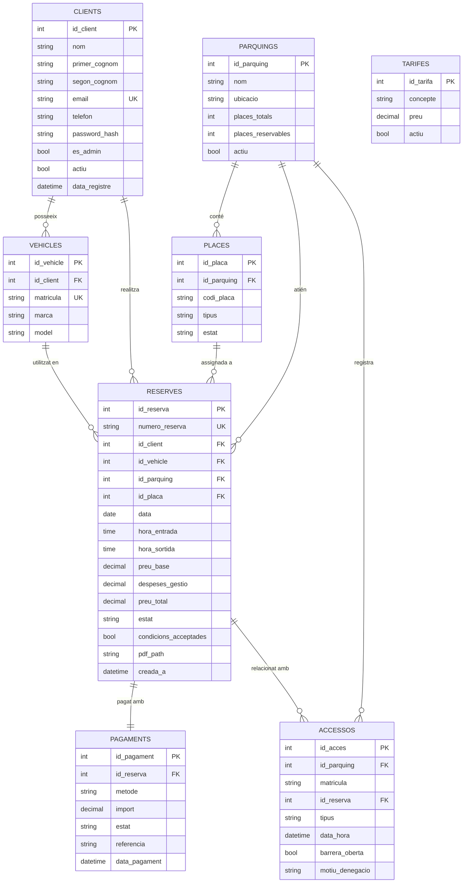

# Sprint 1 — Model Entitat-Relació (E/R) de la base de dades

## Sistema de Reserves de Places de Pàrquing · Tarraco Parkings (Tarragona)

**Stack:** MySQL / MariaDB · **Joc de caràcters:** `utf8mb4` (suporta accents i emojis)

---

## 1. Diagrama E/R

---

## 2. Entitats principals

### 2.1 `clients`

Almacena las dades dels usuaris registrats. El mateix taula serveix per a clients i administradors mitjançant el camp `es_admin`.

| Camp | Tipus | Claus / restriccions | Descripció |
|---|---|---|---|
| `id_client` | INT | **PK**, AUTO_INCREMENT | Identificador del client. |
| `nom` | VARCHAR(50) | NOT NULL | Nom. |
| `primer_cognom` | VARCHAR(50) | NOT NULL | Primer cognom. |
| `segon_cognom` | VARCHAR(50) | NULL | Segon cognom (opcional). |
| `email` | VARCHAR(120) | **UNIQUE**, NOT NULL | Correu d'accés. |
| `telefon` | VARCHAR(20) | NULL | Telèfon de contacte. |
| `password_hash` | VARCHAR(255) | NOT NULL | Hash de la contrasenya (bcrypt). |
| `es_admin` | BOOLEAN | DEFAULT 0 | Marca si l'usuari és administrador. |
| `actiu` | BOOLEAN | DEFAULT 1 | Permet desactivar comptes. |
| `data_registre` | DATETIME | NULL | Data de registre. |

### 2.2 `vehicles`

Emmagatzema les dades dels vehicles de cada client.

| Camp | Tipus | Claus / restriccions | Descripció |
|---|---|---|---|
| `id_vehicle` | INT | **PK**, AUTO_INCREMENT | Identificador del vehicle. |
| `id_client` | INT | **FK → clients.id_client** | Propietari del vehicle. |
| `matricula` | VARCHAR(10) | **UNIQUE**, NOT NULL | Matrícula normalitzada (ex. `1234ABC`). |
| `marca` | VARCHAR(50) | NOT NULL | Marca del vehicle. |
| `model` | VARCHAR(50) | NOT NULL | Model del vehicle. |

### 2.3 `parquings`

Informació dels pàrquings municipals.

| Camp | Tipus | Claus / restriccions | Descripció |
|---|---|---|---|
| `id_parquing` | INT | **PK**, AUTO_INCREMENT | Identificador del pàrquing. |
| `nom` | VARCHAR(80) | NOT NULL | Nom comercial. |
| `ubicacio` | VARCHAR(200) | NOT NULL | Adreça o ubicació. |
| `places_totals` | INT | NOT NULL | Nombre total de places físiques. |
| `places_reservables` | INT | NOT NULL | Nombre de places que es poden reservar en línia. |
| `actiu` | BOOLEAN | DEFAULT 1 | Si el pàrquing està operatiu. |

### 2.4 `places`

Les places reservables de cada pàrquing (gestió de places disponibles).

| Camp | Tipus | Claus / restriccions | Descripció |
|---|---|---|---|
| `id_placa` | INT | **PK**, AUTO_INCREMENT | Identificador de la plaça. |
| `id_parquing` | INT | **FK → parquings.id_parquing** | Pàrquing al qual pertany. |
| `codi_placa` | VARCHAR(20) | NOT NULL, UNIQUE(id_parquing) | Codi de la plaça (ex. `P1-A01`). |
| `tipus` | ENUM | `general`, `mobilitat_reduida`, `electric` | Tipus de plaça. |
| `estat` | ENUM | `lliure`, `reservada`, `ocupada` | Estat actual de la plaça. |

### 2.5 `reserves`

Informació completa de cada reserva.

| Camp | Tipus | Claus / restriccions | Descripció |
|---|---|---|---|
| `id_reserva` | INT | **PK**, AUTO_INCREMENT | Identificador de la reserva. |
| `numero_reserva` | VARCHAR(14) | **UNIQUE**, NOT NULL | Número de reserva auto-generat (ex. `TPK-20261015-000123`). |
| `id_client` | INT | **FK → clients.id_client** | Client que fa la reserva. |
| `id_vehicle` | INT | **FK → vehicles.id_vehicle** | Vehicle de la reserva. |
| `id_parquing` | INT | **FK → parquings.id_parquing** | Pàrquing reservat. |
| `id_placa` | INT | **FK → places.id_placa**, NULL | Plaça assignada (opcional a l'inici). |
| `data` | DATE | NOT NULL | Dia de la reserva. |
| `hora_entrada` | TIME | NOT NULL | Hora d'entrada. |
| `hora_sortida` | TIME | NOT NULL | Hora de sortida. |
| `preu_base` | DECIMAL(10,2) | NOT NULL | Import calculat amb les tarifes (màx. 4,00 €/dia). |
| `despeses_gestio` | DECIMAL(10,2) | NOT NULL | 10% del preu base. |
| `preu_total` | DECIMAL(10,2) | NOT NULL | `preu_base + despeses_gestio`. |
| `estat` | ENUM | `pendent`, `confirmada`, `cancel·lada`, `completada` | Estat de la reserva. |
| `condicions_acceptades` | BOOLEAN | DEFAULT 0 | L'usuari ha acceptat les condicions. |
| `pdf_path` | VARCHAR(255) | NULL | Ruta del PDF de confirmació generat. |
| `creada_a` | DATETIME | NULL | Data de creació de la reserva. |

### 2.6 `pagaments`

Registre dels pagaments de cada reserva.

| Camp | Tipus | Claus / restriccions | Descripció |
|---|---|---|---|
| `id_pagament` | INT | **PK**, AUTO_INCREMENT | Identificador del pagament. |
| `id_reserva` | INT | **FK → reserves.id_reserva**, UNIQUE | Reserva associada (1 reserva = 1 pagament). |
| `metode` | ENUM | `targeta`, `paypal`, `apple_pay` | Mètode de pagament. |
| `import` | DECIMAL(10,2) | NOT NULL | Import pagat. |
| `estat` | ENUM | `pendent`, `processat`, `reemborsat` | Estat del pagament. |
| `referencia` | VARCHAR(100) | NULL | Referència de la passarel·la de pagament. |
| `data_pagament` | DATETIME | NULL | Data del pagament. |

### 2.7 `accessos`

Registre d'entrades i sortides generat pel lector de matrícules (control d'accés).

| Camp | Tipus | Claus / restriccions | Descripció |
|---|---|---|---|
| `id_acces` | INT | **PK**, AUTO_INCREMENT | Identificador de l'accés. |
| `id_parquing` | INT | **FK → parquings.id_parquing** | Pàrquing on s'ha registrat. |
| `matricula` | VARCHAR(10) | NOT NULL | Matrícula detectada pel lector. |
| `id_reserva` | INT | **FK → reserves.id_reserva**, NULL | Reserva associada (si n'hi ha). |
| `tipus` | ENUM | `entrada`, `sortida` | Tipus de moviment. |
| `data_hora` | DATETIME | NOT NULL | Moment de la detecció. |
| `barrera_oberta` | BOOLEAN | NOT NULL | Si la barrera s'ha obert. |
| `motiu_denegacio` | VARCHAR(100) | NULL | Motiu si la barrera no s'ha obert (sense reserva, parc ple, etc.). |

### 2.8 `tarifes`

Configuració de les tarifes (editable per l'administrador sense tocar el codi).

| Camp | Tipus | Claus / restriccions | Descripció |
|---|---|---|---|
| `id_tarifa` | INT | **PK**, AUTO_INCREMENT | Identificador de la tarifa. |
| `concepte` | VARCHAR(60) | NOT NULL | Ex. `1a hora`, `2a hora`, `3a hora`, `màxim diari`, `nocturna`. |
| `preu` | DECIMAL(10,2) | NOT NULL | Preu en euros. |
| `actiu` | BOOLEAN | DEFAULT 1 | Si la tarifa està en vigor. |

---

## 3. Relacions entre entitats

| Relació | Cardinalitat | Explicació |
|---|---|---|
| `clients` – `vehicles` | 1 : N | Un client pot tenir **diversos vehicles**; un vehicle pertany a un únic client. |
| `clients` – `reserves` | 1 : N | Un client pot tenir **múltiples reserves**; una reserva pertany a un únic client. |
| `vehicles` – `reserves` | 1 : N | Un vehicle pot aparèixer en moltes reserves; **cada reserva està associada a un únic vehicle**. |
| `parquings` – `places` | 1 : N | Un pàrquing conté **moltes places**; cada plaça pertany a un únic pàrquing. |
| `parquings` – `reserves` | 1 : N | Un pàrquing atén **moltes reserves**; **cada reserva està associada a un únic pàrquing**. |
| `places` – `reserves` | 1 : N | Una plaça pot ser assignada a **una reserva activa** i, amb el temps, a **diverses reserves**; cada reserva té opcionalment **una única plaça**. |
| `reserves` – `pagaments` | 1 : 1 | **Cada reserva té un únic pagament** i cada pagament pertany a una única reserva. |
| `parquings` – `accessos` | 1 : N | Un pàrquing registra **molts accessos** (entrades/sortides). |
| `reserves` – `accessos` | 1 : N | Una reserva pot generar **diversos accessos** (entrada i sortida); un accés pot no tenir reserva (vehicle no registrat). |

---

## 4. Claus primàries i foranes (resum)

| Taula | Clau primària (PK) | Clau forana (FK) | Referència |
|---|---|---|---|
| `clients` | `id_client` | — | — |
| `vehicles` | `id_vehicle` | `id_client` | `clients.id_client` |
| `parquings` | `id_parquing` | — | — |
| `places` | `id_placa` | `id_parquing` | `parquings.id_parquing` |
| `reserves` | `id_reserva` | `id_client` | `clients.id_client` |
|  |  | `id_vehicle` | `vehicles.id_vehicle` |
|  |  | `id_parquing` | `parquings.id_parquing` |
|  |  | `id_placa` | `places.id_placa` |
| `pagaments` | `id_pagament` | `id_reserva` | `reserves.id_reserva` |
| `accessos` | `id_acces` | `id_parquing` | `parquings.id_parquing` |
|  |  | `id_reserva` | `reserves.id_reserva` |
| `tarifes` | `id_tarifa` | — | — |

---

## 5. Justificació del disseny

- **Normalització:** el model està en **3FN** (Tercera Forma Normal): no hi ha dependències transitives ni dades repetides.
- **Un client, molts vehicles, moltes reserves:** es compleix l'especificació de relacions mínimes del projecte (1 client → N vehicles, 1 client → N reserves, 1 reserva → 1 pàrquing i 1 reserva → 1 vehicle).
- **Matrícula única:** `vehicles.matricula` és UNIQUE, cosa que permet al **lector de matrícules** buscar ràpidament si aquella placa té una reserva activa.
- **Reserves que no s'eliminen:** el camp `estat` amb el valor `cancel·lada` permet conservar l'històric i complir el requisit de "les reserves no s'eliminaran".
- **Tarifes configurables:** la taula `tarifes` separada permet canviar els preus des de l'administració sense modificar el codi.
- **Auditoria d'accessos:** la taula `accessos` emmagatzema cada entrada/sortida, necessària per controlar l'ocupació, detectar excedents i calcular cobraments addicionals.
- **Pagament separat:** la taula `pagaments` permet portar el control econòmic independent de la reserva i fer reemborsaments.

---

## 6. Documents relacionats

- `01-esquema-funcional.md` — Casos d'ús i fluxos de l'aplicació.
- `03-modelo-er.sql` — Script DDL per crear la base de dades en MySQL/MariaDB.
- `04-planificacion.md` — Planificació del projecte.
- `06-diagramas.html` — Diagrames renderitzats.