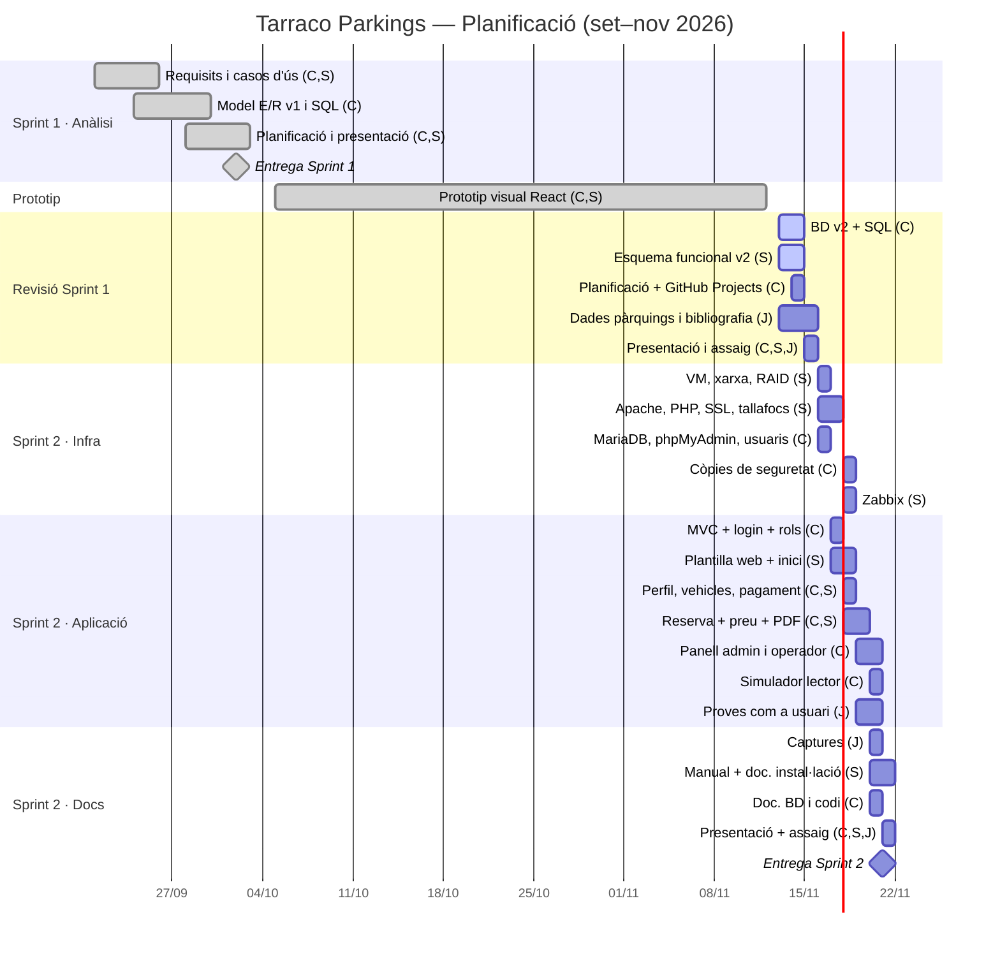

# Sprint 1 — Planificació del projecte (v2)

## Sistema de Reserves de Places de Pàrquing · Tarraco Parkings (Tarragona)

**Equip:** Carlos · Sara · Joel
**Metodologia:** Scrum lleuger per sprints + tauler Kanban.
**Eina de gestió de tasques:** **GitHub Projects** (tauler vinculat al repositori `parkingcsj`; cada tasca és una *issue* amb responsable, prioritat, estimació i dependències).
**Stack (segons l'enunciat):** GNU/Linux (Ubuntu Server) · Apache2 · PHP 8 · MariaDB · phpMyAdmin · Zabbix.

---

## 1. Fases del projecte

| Fase | Període | Objectiu | Estat |
|---|---|---|---|
| **Sprint 1 · Anàlisi i disseny** | 21/09 – 02/10/2026 | Esquema funcional, casos d'ús, model E/R, planificació, presentació | ✅ Entregat (73,2) |
| **Prototip visual** | 05/10 – 12/11/2026 | Prototip de la interfície (React + Firebase) per validar el disseny i el flux de reserva | ✅ Fet · **es descarta com a producte final** perquè l'enunciat exigeix Apache + PHP + MySQL. Se'n reaprofiten el disseny (CSS), les pantalles i l'algorisme de preus |
| **Sprint 1 · Revisió** | 13/11 – 15/11/2026 | Millorar la BD (v2), esquema funcional, planificació real i presentació segons el *feedback* del professor | 🔄 En curs |
| **Sprint 2 · Implementació** | 16/11 – 21/11/2026 | Infraestructura (VM, Apache, PHP, MariaDB, SSL, RAID, còpies, monitoratge) + aplicació PHP funcional amb rols + manual d'usuari + documentació tècnica | ⏳ Pendent |
| **Fase 2 del projecte** | des del 23/11/2026 | Funcionalitats que no entrin al Sprint 2 (veure MoSCoW), alta disponibilitat i millores | ⏳ Pendent |

---

## 2. Rols de l'equip

| Membre | Rol principal | Responsabilitats |
|---|---|---|
| **Carlos** | **Cap de projecte · Base de dades · Backend PHP** | Coordinació i seguiment del tauler, model E/R i script SQL, servidor de BD (MariaDB, phpMyAdmin, usuaris amb mínim privilegi, còpies de seguretat), lògica PHP (autenticació, reserves, càlcul de preus, pagaments, panell d'administració, simulador del lector de matrícules), documentació tècnica de la BD i del codi. |
| **Sara** | **Frontend / UX · Servidor web · Monitoratge** | Esquema funcional i diagrames, disseny de la web (HTML, CSS, JS), pantalles d'usuari i d'administració, PDF de la reserva, servidor web (Apache2 + PHP, SSL, tallafocs, RAID), monitoratge amb Zabbix, manual d'usuari i documentació d'instal·lació. |
| **Joel** | **Suport: proves, dades i recerca** | Tasques acotades i independents (no bloquegen la resta): recerca i dades reals dels pàrquings de Tarragona, bibliografia i registre d'ús d'IA, captures de pantalla per al manual, llista de proves i provar l'aplicació com a usuari, revisió ortogràfica, portada i introducció de la presentació. |

> **Revisió creuada:** cap tasca es dona per acabada fins que un altre membre l'ha revisada (columna *Revisió* del tauler). Carlos revisa el treball de Sara i a l'inrevés; Joel prova i dona *feedback* de les pantalles com a usuari.

---

## 3. Tauler de GitHub Projects

**Columnes:** `Backlog` → `Per fer` → `En curs` → `Revisió` → `Fet`
**Etiquetes:** `bd`, `backend`, `frontend`, `infra`, `docs`, `proves`, `presentacio` · Prioritat: `P1 alta`, `P2 mitjana`, `P3 baixa`
**Camps personalitzats:** Responsable, Sprint, Estimació (h), Data inici, Data fi (vista *Roadmap* = Gantt).

---

## 4. Tasques i subtasques

Llegenda: **C** = Carlos · **S** = Sara · **J** = Joel · Prioritat: P1 alta / P2 mitjana / P3 baixa.

### 4.1 Sprint 1 · Anàlisi i disseny (i revisió)

| ID | Tasca | Resp. | Prio. | Est. | Depèn de | Estat |
|---|---|---|---|---|---|---|
| S1-01 | Lectura i anàlisi de l'enunciat; llista de requisits | C, S | P1 | 2 h | — | ✅ |
| S1-02 | Actors i diagrama de casos d'ús (usuari, operador, admin, sistema) | S | P1 | 4 h | S1-01 | ✅ / 🔄 v2 |
| S1-03 | Diagrames de flux (reserva, admin, lector de matrícules) i diagrama d'estats | S | P1 | 4 h | S1-02 | 🔄 |
| S1-04 | Algorisme de càlcul del preu amb exemples | C | P1 | 2 h | S1-01 | 🔄 |
| S1-05 | Model E/R v2 (16 taules, FK, triggers, vistes) | C | P1 | 6 h | S1-02 | ✅ |
| S1-06 | Script SQL v2 + dades de prova i proves de les regles | C | P1 | 4 h | S1-05 | 🔄 |
| S1-07 | Recull de dades reals dels pàrquings (adreça, places, coordenades) | J | P3 | 2 h | — | 🔄 |
| S1-08 | Planificació, rols i tauler a GitHub Projects | C | P1 | 2 h | S1-01 | 🔄 |
| S1-09 | Disseny de l'arquitectura de servidors (VM, xarxa, serveis) | S | P2 | 2 h | S1-01 | 🔄 |
| S1-10 | Diapositives i guió de la presentació | S, C | P1 | 3 h | S1-03, S1-05, S1-08 | 🔄 |
| S1-11 | Portada, introducció de la presentació i bibliografia | J | P3 | 1,5 h | — | 🔄 |
| S1-12 | Assaig de la presentació (cronometrat, 5–10 min) | C, S, J | P1 | 1 h | S1-10 | ⏳ |

### 4.2 Sprint 2 · Infraestructura

| ID | Tasca | Resp. | Prio. | Est. | Depèn de |
|---|---|---|---|---|---|
| S2-01 | Crear les VM a VirtualBox (Ubuntu Server 24.04) i la xarxa (adaptador pont) | S | P1 | 2 h | S1-09 |
| S2-02 | RAID 1 per programari (`mdadm`) amb 2 discos virtuals a `srv-web` | S | P2 | 2 h | S2-01 |
| S2-03 | Apache2 + PHP 8 + mòduls (`pdo_mysql`, `mbstring`, `gd`) | S | P1 | 1,5 h | S2-01 |
| S2-04 | Certificat SSL (autosignat / CA pròpia) i redirecció HTTP → HTTPS | S | P1 | 1,5 h | S2-03 |
| S2-05 | Tallafocs (UFW), `fail2ban`, SSH amb claus, permisos de fitxers | S | P1 | 2 h | S2-01 |
| S2-06 | MariaDB + phpMyAdmin (protegit), execució de l'script, usuaris `tp_web` / `tp_backup` | C | P1 | 2 h | S2-01, S1-06 |
| S2-07 | Còpies de seguretat: completa setmanal + incremental diària (`mariabackup` + `cron`) i prova de restauració | C | P1 | 3 h | S2-06 |
| S2-08 | Monitoratge amb Zabbix (VM `srv-monitor`, agents a web i BD, alertes) | S | P2 | 3 h | S2-01 |
| S2-09 | Redundància i balanceig (2a VM web + HAProxy) | S | P3 | 3 h | S2-03 |

### 4.3 Sprint 2 · Aplicació PHP

| ID | Tasca | Resp. | Prio. | Est. | Depèn de |
|---|---|---|---|---|---|
| S2-10 | Estructura MVC PHP, connexió PDO, configuració fora del DocumentRoot | C | P1 | 2 h | S2-06 |
| S2-11 | Plantilla HTML/CSS (reaprofitant el disseny del prototip), capçalera, peu, menús per rol | S | P1 | 3 h | — |
| S2-12 | Registre, login/logout, sessions segures, rols, CSRF, bloqueig per intents | C | P1 | 4 h | S2-10 |
| S2-13 | Perfil del client, vehicles i mètodes de pagament (alta / edició / baixa) | C, S | P1 | 4 h | S2-12 |
| S2-14 | Pàgina d'inici amb els pàrquings (mapa i places disponibles) | S | P1 | 3 h | S2-11 |
| S2-15 | Formulari de reserva: càlcul automàtic del preu en directe (JS) i validació al servidor (PHP), condicions, pagament simulat | C, S | P1 | 6 h | S2-13 |
| S2-16 | Número de reserva i PDF descarregable (FPDF) | S | P2 | 2 h | S2-15 |
| S2-17 | Les meves reserves: consulta i cancel·lació | S | P1 | 2 h | S2-15 |
| S2-18 | Panell admin: pàrquings i places, totes les reserves, canvi d'estat, cerca avançada, historial | C | P1 | 6 h | S2-15 |
| S2-19 | Panell operador: reserves i accessos dels seus pàrquings | C | P2 | 2 h | S2-18 |
| S2-20 | Simulador del lector de matrícules (entrada / sortida, barrera, cobrament de l'excés) | C | P2 | 3 h | S2-15 |
| S2-21 | Llista de proves (checklist) i proves com a usuari de tots els formularis | J | P2 | 3 h | S2-15 |

### 4.4 Sprint 2 · Documentació i presentació

| ID | Tasca | Resp. | Prio. | Est. | Depèn de |
|---|---|---|---|---|---|
| S2-22 | Documentació tècnica: instal·lació i configuració dels servidors | S | P1 | 3 h | S2-01…S2-08 |
| S2-23 | Documentació tècnica: BD (model relacional) i codi comentat | C | P1 | 2 h | S2-18 |
| S2-24 | Captures de pantalla de cada pantalla, per rol | J | P2 | 1,5 h | S2-18 |
| S2-25 | Manual d'usuari (client, operador, admin) | S | P1 | 3 h | S2-24 |
| S2-26 | Bibliografia i registre d'IA (eines, parts i *prompts* utilitzats) | J | P2 | 1,5 h | — |
| S2-27 | Planificació actualitzada (Gantt real) | C | P2 | 1 h | — |
| S2-28 | Presentació + assaig amb demo per rols | C, S, J | P1 | 3 h | tot |

**Càrrega aproximada:** Carlos ≈ 48 h · Sara ≈ 50 h · Joel ≈ 12 h (les tasques compartides es reparteixen a parts iguals).

---

## 5. Seqüenciació (camí crític)

```
S1 Anàlisi ─► BD v2 (S1-05/06) ─► VM + MariaDB (S2-01/06) ─► PHP MVC + login (S2-10/12)
          ─► Reserva + preu (S2-15) ─► Admin (S2-18) ─► Docs + manual ─► Presentació
                       │
Plantilla web (S2-11) ─┘          Infra en paral·lel: Apache/SSL/tallafocs ─► Còpies ─► Zabbix
```

- El **camí crític** és BD → PHP → reserva → admin: el porta Carlos amb el suport de Sara.
- **Infraestructura** (Sara) i **plantilla web** (Sara) avancen en paral·lel al backend.
- Les tasques de **Joel** no estan al camí crític: es poden fer en qualsevol moment i no bloquegen ningú.

---

## 6. Diagrama de Gantt



---

## 7. Prioritats (MoSCoW) per al Sprint 2

| Prioritat | Funcionalitats |
|---|---|
| **Must** | Servidor Apache + PHP + MariaDB + SSL, registre/login amb rols, perfil i vehicles, formulari de reserva amb preu automàtic (+10 %), condicions, número de reserva, les meves reserves i cancel·lació, admin: pàrquings/places i reserves (modificar / cancel·lar, mai esborrar), còpies de seguretat, tallafocs. |
| **Should** | PDF de la reserva, mètodes de pagament, cerca avançada, rol operador, Zabbix, RAID 1, simulador del lector amb cobrament de l'excés. |
| **Could** | Mapa a la pàgina d'inici, 2a VM web + HAProxy, verificació d'email real. |
| **Won't (ara)** | Passarel·la de pagament real, lector de matrícules físic (OCR), app mòbil. |

---

## 8. Seguiment

- **Reunió curta** (15 min) a l'inici de cada sessió de classe: què s'ha fet, què es farà, bloquejos.
- Tot el treball passa pel tauler de GitHub Projects; els *commits* referencien la issue (`#12`).
- Carlos revisa l'estat del tauler cada dia i reassigna si una tasca P1 es retarda.

---

## 9. Documents relacionats

- `01-esquema-funcional.md` · `02-modelo-er.md` · `03-modelo-er.sql` · `05-presentacion.md` · `06-diagramas.html`
