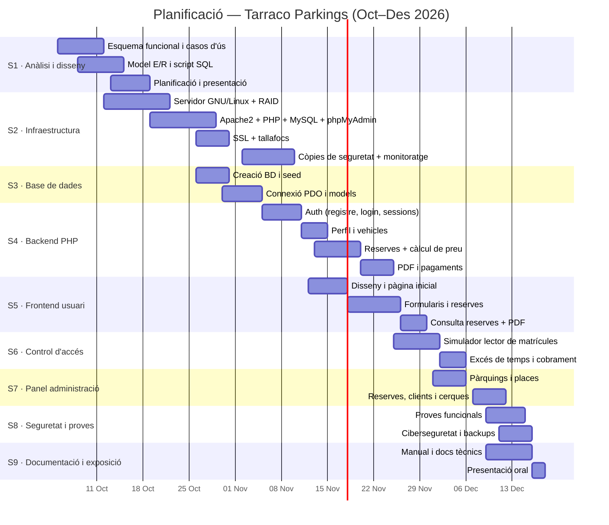

# Sprint 1 — Planificació del projecte

## Sistema de Reserves de Places de Pàrquing · Tarraco Parkings (Tarragona)

**Metodologia:** desenvolupament per sprints (Scrum lleuger) amb eines de Kanban.
**Eines de planificació proposades:** Trello o GitHub Projects (tauler Kanban), i documentació en aquest repositori (fases, Gantt i tasques).
**Durada estimada total:** 10 setmanes (amb reunió de seguiment setmanal).

---

## 1. Fases del projecte (sprints)

| Sprint | Nom | Objectiu principal | Prioritat |
|---|---|---|---|
| **S1** | Anàlisi i disseny | Esquema funcional, casos d'ús, model E/R i planificació. ✅ *Aquest document.* | Alta |
| **S2** | Infraestructura | Servidor GNU/Linux, Apache2 + PHP, MySQL/MariaDB, phpMyAdmin, SSL, firewall, RAID, còpies de seguretat i monitoratge. | Alta |
| **S3** | Base de dades | Creació de la BD (script SQL), connexió PDO i capes de dades. | Alta |
| **S4** | Backend PHP | Registre/login, gestió de perfil i vehicles, reserves, càlcul de tarifes, PDF, pagaments i accessos per matrícula. | Alta |
| **S5** | Frontend usuari | Disseny nou (HTML/CSS/JS), pàgina inicial, formularis de reserva, perfil, vehicles, consulta de reserves i PDF. | Alta |
| **S6** | Control d'accés | Simulació del lector de matrícules, detecció d'excés de temps i cobrament addicional. | Mitjana |
| **S7** | Panel d'administració | Gestió de pàrquings, places, reserves, clients i cerques avançades. | Mitjana |
| **S8** | Seguretat, proves i desplegament | Ciberseguretat, proves funcionals, backups automàtics, alta disponibilitat. | Alta |
| **S9** | Documentació i exposició | Manual d'usuari, documentació tècnica i presentació oral. | Mitjana |

---

## 2. Tasques detallades

### S1 · Anàlisi i disseny *(complet)*
- [x] Esquema funcional i casos d'ús (`01-esquema-funcional.md`).
- [x] Model E/R (`02-modelo-er.md`) i script SQL (`03-modelo-er.sql`).
- [x] Planificació, rols i calendari (`04-planificacion.md`).
- [x] Document de presentació (`05-presentacion.md`).

### S2 · Infraestructura (servidor GNU/Linux)
| Tasca | Prioritat | Dependència |
|---|---|---|
| Instal·lació i hardenització del servidor GNU/Linux (Debian/Ubuntu Server) | Alta | — |
| Configuració de **RAID** (RAID 1 per redundància de discos) | Alta | — |
| Instal·lació d'**Apache2 + PHP** (8.x) i mòduls | Alta | — |
| Instal·lació de **MariaDB** i **phpMyAdmin** | Alta | — |
| Configuració del **certificat SSL** (Let's Encrypt / certbot) | Alta | S2 Infraestructura |
| **Tallafocs** i polítiques de seguretat del sistema i de fitxers | Alta | — |
| **Monitoratge** (Zabbix / Prometheus + Node Exporter / Nagios) | Mitjana | — |
| **Còpies de seguretat** programades (incrementals i completes) | Alta | BD creada |
| Redundància del servidor i balanceig de càrrega (opcional) | Baixa | — |

### S3 · Base de dades
| Tasca | Prioritat | Dependència |
|---|---|---|
| Execució de l'script SQL de creació (`03-modelo-er.sql`) | Alta | S2 (MySQL) |
| Connexió PHP amb PDO (classe `db.php` segura) | Alta | S3 BD creada |
| Capes de models (Clients, Vehicles, Parquings, Reserves, Pagaments, Accessos, Tarifes) | Alta | — |

### S4 · Backend PHP
| Tasca | Prioritat | Dependència |
|---|---|---|
| Registre d'usuaris + confirmació de email | Alta | S3 |
| Login/logout amb sessions segures + `password_hash`/`verify` | Alta | S3 |
| Recuperació de contrasenya | Mitjana | — |
| CRUD de perfil i vehicles | Alta | — |
| Creació de reserva amb càlcul automàtic del preu (tarifes + 10%) | Alta | S3 |
| Generació del **número de reserva** automàtic | Alta | — |
| Generació del **PDF** de confirmació (FPDF/TCPDF) | Mitjana | — |
| Pagaments (passarel·la o simulació) + cobrament addicional per excés | Mitjana | — |
| Endpoint del lector de matrícules (entrada/sortida, obertura de barrera) | Mitjana | — |

### S5 · Frontend usuari (disseny nou)
| Tasca | Prioritat | Dependència |
|---|---|---|
| Disseny web responsiu (CSS nou, identitat Tarraco Parkings) | Alta | — |
| Pàgina inicial amb informació dels pàrquings | Alta | S4 (dades) |
| Formularis: registre, login, perfil, vehicle | Alta | S4 |
| Formulari de reserva (pàrquing, data, hora entrada/sortida, preu automàtic) | Alta | S4 |
| Consulta de reserves pròpies + descàrrega del PDF | Mitjana | S4 |

### S6 · Control d'accés
| Tasca | Prioritat | Dependència |
|---|---|---|
| Pantalla/simulador del lector de matrícules (barrera) | Mitjana | S4 |
| Verificació de reserva activa i places disponibles | Alta | S3 |
| Registre d'accessos i control de temps | Alta | S3 |
| Càlcul i cobrament de l'import addicional | Mitjana | S4 pagaments |

### S7 · Panel d'administració
| Tasca | Prioritat | Dependència |
|---|---|---|
| Login d'administrador i protecció del panel | Alta | S4 |
| Gestió de pàrquings i places (alta/edició/estat) | Alta | S4 |
| Consulta i modificació de reserves (estat inclòs) | Alta | S4 |
| Cancel·lació de reserves (mai eliminar) | Alta | S4 |
| Control de clients registrats | Mitjana | S4 |
| Consultes avançades (filtres per client, matrícula, data, estat, pàrquing) | Mitjana | S4 |
| Informe d'accessos i ocupació | Baixa | S6 |

### S8 · Seguretat, proves i desplegament
| Tasca | Prioritat | Dependència |
|---|---|---|
| Proves funcionals de tot el sistema (usuaris, reserves, admin) | Alta | S5–S7 |
| Revisió de ciberseguretat (SQL injection, XSS, CSRF, contrasenyes) | Alta | S4–S7 |
| Encriptació/anonimització de dades sensibles | Alta | — |
| Verificació de còpies de seguretat i restauració | Alta | S2 |
| Alta disponibilitat i monitoratge operatiu | Mitjana | S2 |

### S9 · Documentació i exposició
| Tasca | Prioritat | Dependència |
|---|---|---|
| Manual d'usuari | Mitjana | S5–S7 |
| Documentació tècnica d'instal·lació i configuració | Alta | S2–S8 |
| Presentació oral i assaig | Mitjana | S9 docs |

---

## 3. Assignació de rols (equip de 4 membres)

> Plantilla orientativa. Adapta els noms i la distribució al teu equip real.

| Membre | Rol principal | Tasques principals |
|---|---|---|
| **Membre A** | Cap de projecte / coordinador | Planificació, seguiment, integració final, presentació. |
| **Membre B** | Backend i base de dades | Model E/R, SQL, lògica de reserves, càlcul de tarifes, PDF, pagaments. |
| **Membre C** | Frontend / UX | Disseny nou, HTML/CSS/JS, formularis, consulta de reserves. |
| **Membre D** | Infraestructura / seguretat | Servidor, Apache2, MySQL, SSL, RAID, backups, monitoratge, ciberseguretat. |

**Distribució de tasques per rol (resum):**

| Àrea | S1 | S2 | S3 | S4 | S5 | S6 | S7 | S8 | S9 |
|---|---|---|---|---|---|---|---|---|---|
| Coordinació (A) | Si | — | — | — | — | — | — | Integració | Presentació |
| Backend/BD (B) | E/R | — | BD+connexió | Lògica | — | Cobraments | — | Proves | Docs tècnics |
| Frontend (C) | Fluxos | — | — | Consum dades | Tot | Simulador barrera | — | Proves UX | Manual |
| Infraestructura (D) | — | Tot | — | Desplegament | — | — | — | Seguretat/backups | Docs instal·lació |

---

## 4. Ordenació (seqüenciació) i dependències

```
S1 (anàlisi) ──> S2 (infraestructura) ──> S3 (BD) ──> S4 (backend) ──> S5 (frontend)
                                                              └─────> S6 (control d'accés) ──> S7 (admin)
Totes ─────────────────────────────────────────────────────────────────────> S8 (seguretat/proves) ──> S9 (exposició)
```

- **S1 i S2** poden començar en paral·lel: l'anàlisi la fa tot l'equip, i la infraestructura pot iniciar el membre D.
- **S3 depèn de S2** (necessita MySQL instal·lat).
- **S4 depèn de S3.**
- **S5, S6 i S7 depenen de S4** (necessiten les dades i lògica del backend).
- **S8 ho tanca tot** i **S9** és la documentació final.

---

## 5. Calendari / Diagrama de Gantt

> Dates orientatives: inici **5 d'octubre de 2026** (10 setmanes fins a mitjans de desembre).



---

## 6. Prioritització de tasques (MoSCoW)

| Prioritat | Tasques |
|---|---|
| **Must (obligatori)** | Registre/login, gestió de vehículos i perfil, formulari de reserva amb càlcul automàtic del preu (+10% gestió), acceptació de condicions, número de reserva, consulta de reserves, gestió de pàrquings i places (admin), consulta i modificació de reserves (admin), cancel·lació sense eliminar, control de matrícules amb barrera. |
| **Should (important)** | PDF de confirmació, cobrament automàtic de l'excés de temps, cerques avançades, control de clients (admin), còpies de seguretat programades, monitoratge. |
| **Could (opcional)** | Redundància de servidor i balanceig de càrrega, informes d'ocupació avançats, app mòbil. |
| **Won't (ara no)** | Sistema de multes sancionador, integració amb operadors de pagament reals, multi-idioma avançat. |

---

## 7. Documents relacionats

- `01-esquema-funcional.md` — Casos d'ús i fluxos.
- `02-modelo-er.md` — Model E/R.
- `03-modelo-er.sql` — Script SQL.
- `05-presentacion.md` — Document de presentació per a l'exposició oral.
- `06-diagramas.html` — Diagrames (inclou el Gantt) renderitzats.